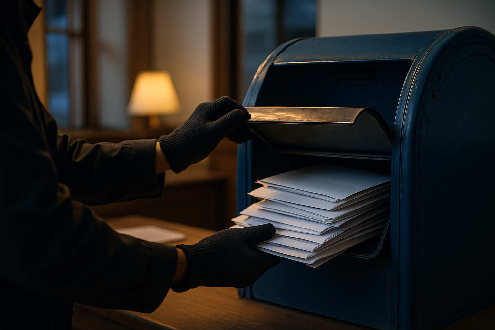

# [행정 규제] 미국 SEC의 크립토 공모 면제 이야기 (feat. 세이프하버) A/S

> 📜 **Regulation Crypto Assets**
> 원안 전문: https://www.federalregister.gov/d/2026-17183
> 🔙 이전 글: [미국 SEC의 크립토 공모 면제 이야기 (feat. 세이프하버)](2026-08-21_FR_2026-17183_blog.md)
> 🗳 의견수렴 2026-10-20 마감 · 접수 의견 248건 (마감 시점 집계)

✅ 제안 → ✅ 의견수렴 → 🔵 **심사 중** → ⬜ 확정 공포 → ⬜ 시행

| 단계 | 상태 | 날짜·비고 |
|---|---|---|
| ① 제안 공포 | ✅ 완료 | 2026-08-21 |
| ② 의견수렴 | ✅ 완료 | ~2026-10-20 마감 |
| ③ 확정안 심사·작성 | 🔵 **지금 여기** |  |
| ④ 확정(Final Rule) 공포 | ⬜ 아직 |  |
| ⑤ 시행 | ⬜ 아직 |  |

---

1. 1. 지난 글에서 미국 SEC(증권거래위원회, 미국의 증권 감독기관)가 2026-08-21에 공포한 'Regulation Crypto Assets' 제안을 다뤘음. 등록(투자자에게 증권을 팔기 전에 SEC에 회사 정보를 내고 심사받는 절차) 없이 4년간 최대 500만 달러, 12개월마다 최대 7,500만 달러까지 토큰을 팔 수 있는 길을 열고, 조건을 지키면 증권법상 투자계약으로 보지 않는 세이프하버(미리 그어 둔 안전선)를 두는 내용임.

2. 2. 이 제안의 의견수렴(규정을 확정하기 전에 누구나 찬성·반대 의견을 제출할 수 있는 기간)이 2026-10-20에 마감됐음. 이제 SEC가 접수된 의견을 반영해 확정안을 심사하고 작성하는 단계로 넘어갔고, 언제 어떤 내용으로 확정될지는 아직 정해진 것이 없음.

3. 3. 접수된 의견 가운데 명시적인 반대는 AFREF·Better Markets 같은 투자자보호 진영 소수에 그쳤고, 상장사(NDAQ·COIN)와 업계 협회 다수, 소매 투자자까지 골격을 지지했음.

4. 4. 공격은 규정 자체를 막자는 쪽이 아니라 세부에 집중됐음 — 세이프하버 자격을 발행사가 스스로 인증하는 방식(Rule 400 자기인증)과 모금 한도를 계산하는 방식(Rule 200 캡 산정)이 주된 표적이었음. 찬성 진영에서도 자기인증만으로는 안 되고 객관적 증거와 추가 공시가 필요하다는 요구가 나와, 세이프하버 조건이 최종안에서 강화될 가능성이 커졌음.

5. 5. 업계 쪽에서는 현행 한도(500만·7,500만 달러)가 준수 의향이 있는 개발자를 역외로 내모는 수준이라며 상향을 요구했음. 비증권 크립토 자산의 송금·결제를 다루는 결제 중개자는 규칙이 다루지 않고 있다며, 그 법적 지위를 명문화해 달라는 의견도 나왔음.

6. 6. 지속적인 개발과 유지보수가 필수인 프로젝트는 세이프하버가 '관리 노력(managerial efforts)의 종료'를 요구하는 구조상 실효성이 낮을 수 있다는 지적도 있었음. 증권법 교수들의 연명 제출도 있었는데, 이는 채택 자체를 막는 반대가 아니라 규칙이 채택된 뒤의 소송 리스크가 구체화될 수 있는 전조로 꼽혔음.

7. 7. 역외(해외) 가상자산 발행·거래 플랫폼 진영에서는 MiCA Crypto Alliance가 공식 의견을 접수했고, EU 쪽이 정합·상호인정 협상으로 움직일 가능성이 지적됐음. 연방 규정에 밀리는 쪽으로 지목됐던 주(州) 단위 증권 등록·심사 관련 서비스 진영도 주 변호사회 등을 통해 의견서를 내며 대응 중인 것이 확인됐음.

8. 8. 참고로 같은 기관의 과거 초안 중 78%가 확정됐고, 확정까지는 중앙값으로 391일이 걸렸음(표본 59쌍). 이것은 과거 통계일 뿐 이 법안의 예측이 아님.

9. 9. 지켜볼 날짜 첫째는 2027-05-16임 — 최종 규칙 공포가 가능해지는 시작점으로, 이 전에 재제안 신호가 나오면 '완화 확정' 쪽으로, 의제에서 사라지면 '좌초' 쪽으로 해석함. 둘째는 2027-09-16으로, 이때까지 최종 규칙이 안 나오면 지연 자체가 좌초 확률을 올리는 신호임.

10. 10. 확정 전에 SEC 위원 교체 같은 위원회 구성 변동이 일어나면 좌초 확률이 크게 올라감. 최종 규칙이 공포되면 그 뒤 60일 안에 소송이 제기되는지도 봐야 하는데, 제기되면 효력정지·무효화 경로를 다시 따져야 함.

**한 줄 코멘트**: 싸움의 무게가 '규정을 만들 것이냐'에서 '세이프하버를 어떻게 다듬느냐'로 옮겨 간 모습임. 확정안이 나오면 A/S 후속편으로 다시 정리하겠음.

---

**용어**
- **세이프하버(safe harbor)**: 쉽게 말해 '이 조건만 지키면 규제하지 않겠다'고 미리 그어 둔 안전선. 조건 안에만 있으면 법 적용 여부를 두고 다툴 필요가 없어집니다.
- **의견수렴(comment period)**: 규정을 확정하기 전에 누구나 찬성·반대 의견을 제출할 수 있는 기간. 이 의견을 반영해 규정이 수정되거나 그대로 확정됩니다.

---

### ⚠️ 이 글은 투자 권유 목적이 아니며, 투자에 대한 책임은 본인에게 있습니다.

_이 글은 AI의 도움을 받아 작성한 글이며, 대표 이미지는 AI가 생성한 이미지입니다._
