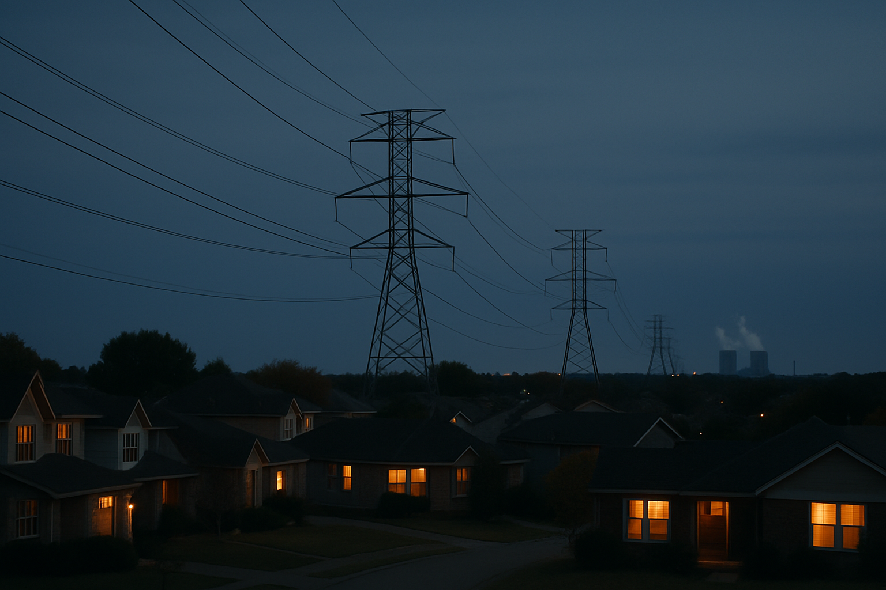

# [법안 산책] 미국 발전소 탄소규제 폐지 이야기 (feat. EPA, CCS, 웨스트버지니아 판결)

> 📜 **Partial Repeal of the Carbon Pollution Standards for Fossil Fuel-Fired Electric Generating Units**
> 원안 전문: https://www.federalregister.gov/d/2026-19071

✅ 제안 → ✅ 의견수렴 → ✅ 심사·작성 → ✅ 확정 공포 → 🔵 **시행 대기**

| 단계 | 상태 | 날짜·비고 |
|---|---|---|
| ① 제안 공포 | ✅ 완료 | 2025-06-17 |
| ② 의견수렴 | ✅ 완료 | — |
| ③ 확정안 심사·작성 | ✅ 완료 |  |
| ④ 확정(Final Rule) 공포 | ✅ 완료 | 2026-09-17 (제안 후 457일) |
| ⑤ 시행 | 🔵 **지금 여기** | 2026-11-16 예정 (D-30) |

---

1. 미국에는 환경보호청(EPA)이라는 정부 기관이 있어서, 공장과 발전소가 내뿜는 오염물질을 단속함. 발전소가 석탄이나 가스를 태우면 이산화탄소가 나오는데, 이것이 지구 온난화의 주범으로 꼽힘.

2. 그래서 EPA는 2024년에 "석탄발전소는 2032년까지 탄소를 거의 다 붙잡아 땅에 묻든지, 아니면 문을 닫으라"는 강한 규제를 만들었음.

3. 탄소를 붙잡아 땅속에 묻는 기술을 CCS(탄소 포집·저장)라고 하는데, 아직 비싸고 대규모로 검증된 사례가 적음.

4. 미국은 정권이 바뀌면 이런 규제가 통째로 뒤집히는 일이 잦고, 2022년에는 대법원이 "EPA가 발전소에 석탄 대신 다른 연료를 쓰라고 강제할 권한은 없다"고 선을 그었음(웨스트버지니아 판결).

5. 2025년 들어선 트럼프 행정부가 '청정 석탄산업 재활성화'를 내건 대통령 명령 등을 잇따라 내렸고 → EPA가 기존 규제를 다시 들여다보게 됐음.

6. 그 결과물이 2026년 9월 17일 공포된 이번 규칙으로, 새 규제를 만드는 것이 아니라 2024년 발전소 탄소 규제를 대부분 되돌리는 폐지 조치임.

7. 없어지는 것은 기존 화석연료 증기발전소에 적용되던 배출지침, 대규모 개조를 하는 석탄발전소의 CCS 기준, 새로 짓는 대형 가스터빈의 CCS 기준임. 각 주정부가 지침에 맞춰 이행계획을 내야 했던 의무도 함께 사라짐.

8. EPA가 내세운 이유는, 탄소를 90% 붙잡으라는 요구가 기술이 충분히 실증되지 않았고 비용이 합리적이지 않으며 달성할 수 없다는 것임.

9. 석탄에 천연가스를 40% 섞어 태우라던 의무(혼소, 한 보일러에서 두 연료를 섞어 태우는 것)도 폐지됐는데, 웨스트버지니아 판결이 금지한 '연료 갈아타기 강제'에 해당한다고 봤음.

10. 새로 짓는 가스발전소의 CCS 의무는, 필요한 파이프라인·저장 인프라를 2032년 1월 1일 준수시한까지 구축할 가능성이 낮다고 판단해 폐지됐음.

11. 다만 새 가스터빈에 적용되는 효율 기준(1단계)은 이번에는 남겨 뒀음.

12. EPA는 같은 날 발전소 온실가스 규제 전부를 없앨지 묻는 추가 제안도 따로 내놓아 의견을 받고 있는데, 이것이 확정되면 이번에 살아남은 효율 기준까지 사라질 수 있음.

13. 이번 규칙은 2026년 11월 16일부터 효력이 생김.

14. 돈의 흐름을 보면, 석탄 화력발전은 2032년까지 CCS를 달거나 문을 닫으라던 의무가 사라져 → 거액의 설비 투자 부담과 조기 폐쇄 압력이 한꺼번에 풀리는 가장 직접적인 수혜 업종임.

15. 석탄발전소가 계속 돌아가면 발전용 석탄 수요도 유지되기 때문에 석탄 채굴도 수혜 업종임. 이 규칙의 근거가 된 대통령 명령 자체가 석탄 생산 지원을 국가 우선순위로 명시하고 있음.

16. 천연가스 발전 (신설 가스터빈)은 CCS 비용 부담이 사라져 AI 데이터센터발 전력 수요에 맞춘 신규 건설이 쉬워짐. 단, 1단계 효율 기준은 여전히 남아 있음.

17. 발전부문 준수비용 절감은 2026~2047년 현재가치(2024달러 기준)로 950억~1,600억 달러($95B~$160B, 1B=10억 달러)인데, 할인율(미래의 돈을 지금 가치로 환산할 때 깎는 비율)을 7%로 잡으면 950억 달러, 3%로 잡으면 1,600억 달러가 됨.

18. 준수비용 절감과 석탄설비 존치로 전력 공급 여력이 유지되면서 전기요금 상승 압력이 완화되는데, 전기를 많이 쓰는 데이터센터·제조업 (전력 다소비 산업)이 이 비용 절감의 실질적인 수혜자임.

19. 반대로 탄소포집(CCS) 설비·엔지니어링은 규제가 강제로 만들어 주던 설비 수요가 통째로 사라지는 데다, EPA가 공식 문서로 '이 기술은 충분히 실증되지 않았다'고 판정한 것 자체가 민간 발주 심리에도 부담이 되는 가장 타격이 큰 업종임.

20. 천연가스 파이프라인 건설도, 석탄발전소가 가스를 40% 섞어 태우려면 필요했던 증설 수요가 의무 폐지로 사라짐.

21. 재생에너지 발전은 석탄 이탈을 강제해 전환을 간접적으로 밀어주던 장치가 사라져 증설 유인이 약해지는데, 다만 간접 경로라서 영향 강도는 약한 편으로 평가됨.

22. 지켜볼 것 하나, 2026년 11월 16일 발효 전후로 환경단체·주정부가 소송을 거는지, 그리고 D.C. 연방항소법원이 가처분(재판 결과가 나오기 전에 시행을 멈추라는 임시 명령)을 내리는지임. 세 폐지는 서로 분리 가능한 구조라 법원에서 하나가 뒤집혀도 나머지는 유지됨.

23. 지켜볼 것 둘, '발전소 온실가스 규제 전면 폐지' 추가 제안의 확정 여부와, 전력회사들이 석탄발전소 폐쇄 일정을 철회하거나 수명연장을 발표하는지임.

24. 지켜볼 것 셋, CCS·CO2 파이프라인 업체들이 2027년 1분기 실적 시즌에 발전부문 프로젝트 취소나 수주잔고 조정을 공시하는지임.

**한 줄 코멘트**: 규제가 만들어 준 수요는 규제가 사라지면 같이 사라짐. CCS처럼 규제에 기대어 온 업종일수록 2026년 11월 16일 발효 이후의 소송전까지 지켜보고 판단해도 늦지 않겠음.

---

**영향 산업 한눈에**

| 산업 | 방향 |
|---|---|
| 석탄 화력발전 | 🟢 수혜 |
| 석탄 채굴 | 🟢 수혜 |
| 천연가스 발전 (신설 가스터빈) | 🟢 수혜 |
| 데이터센터·제조업 (전력 다소비 산업) | 🟢 수혜 |
| 탄소포집(CCS) 설비·엔지니어링 | 🔴 부담 |
| 천연가스 파이프라인 건설 | 🔴 부담 |
| 재생에너지 발전 | 🔴 부담 |

---

**용어**
- **CCS (탄소 포집·저장)**: 발전소 굴뚝에서 나오는 이산화탄소를 공기 중으로 날려 보내지 않고 붙잡아서, 파이프로 옮겨 땅속 깊이 묻는 기술입니다. 아직 비싸고 대규모로 검증된 사례가 적습니다.
- **웨스트버지니아 판결**: 2022년 미국 대법원 판결로, 'EPA가 발전소에 연료 자체를 바꾸라고 강제할 권한은 없다'고 선을 그었습니다. 이번 폐지의 핵심 법적 근거입니다.
- **가처분 (stay)**: 재판 결과가 나오기 전에 법원이 '일단 시행을 멈추라'고 내리는 임시 명령입니다. 이게 나오면 규칙이 발효돼도 효력이 잠시 정지됩니다.

---

### ⚠️ 이 글은 투자 권유 목적이 아니며, 투자에 대한 책임은 본인에게 있습니다.

_이 글은 AI의 도움을 받아 작성한 글이며, 대표 이미지는 AI가 생성한 이미지입니다._
