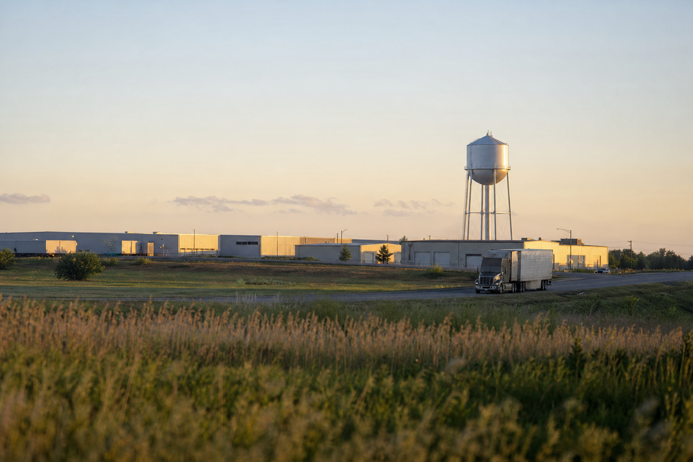

# [법안 산책] 미국 핵심 인프라 국산화 연구법 이야기 (feat. 리쇼어링 설계도)

> 📜 **Critical Infrastructure Manufacturing Feasibility Act**
> 원안 전문: https://www.congress.gov/bill/119th-congress/house-bill/1721

✅ 발의 → ✅ 하원 → ✅ 상원 → ✅ 법률

| 단계 | 상태 | 날짜·비고 |
|---|---|---|
| ① 발의 | ✅ 완료 | 2025-02-27 |
| ② 하원 통과 | ✅ 완료 | 2025-04-28 |
| ③ 상원 통과 | ✅ 완료 | 2026-09-23 |
| ④ 대통령 서명 → 법률 | ✅ 완료 | 2026-10-20 서명 · Public Law 119-127 |

---

1. 미국은 2013년 대통령 정책지침 21호(PPD-21)로 전기, 수도, 통신, 의료처럼 멈추면 나라 전체가 흔들리는 분야 16개를 '핵심 인프라 부문'(나라의 기초 설비와 서비스)으로 지정해 관리해 왔음.

2. 이 16개 부문에서 쓰이는 제품 가운데는 수요가 많은데도 미국 안의 제조·소재·공급망(원재료부터 완제품까지 이어지는 연결 고리) 제약 때문에 수입에 의존하는 것들이 있음.

3. 이런 제품을 미국에서 만드는 것이 가능한지 연구하라고 상무부 장관에게 지시하는 법안이 H.R. 1721로 발의돼(2025년 2월 27일) 하원(2025년 4월 28일)과 상원(2026년 9월 23일)을 통과했음.

4. 2026년 10월 20일 대통령 서명까지 끝나 Public Law(공법 — 상·하원 통과와 대통령 서명을 마쳐 정식 효력이 생긴 법률) 119-127이 됐고, 법의 공식 공포·발효일은 2026년 9월 23일로 기록돼 있음.

5. 법이 하는 일은 한마디로 상무부에 연구 숙제를 내주는 것이고, 당장 돈을 쓰거나 민간을 규제하는 법이 아님.

6. 1단계로, 16개 핵심 인프라 부문마다 수요는 많은데 미국 내 제조·소재·공급망 문제로 수입에 의존하는 제품을 찾아냄.

7. 2단계로, 그 제품을 미국에서 만들 경우의 비용과 이득을 일자리·고용률·노동 여건, 제품 가격에 미치는 영향까지 포함해 분석함.

8. 3단계로, 분석한 제품 중 미국 내 제조가 실제로 가능한 제품을 가려내고, 그 제품에 한해 농촌 지역이나 산업단지, 농촌에 있는 산업단지에서 만드는 것이 현실적인지와 걸림돌을 따짐.

9. 연구는 공포·발효일(2026년 9월 23일) 기준 1년 안인 2027년 9월 23일까지 해야 함.

10. 공포 후 18개월 안인 2028년 3월 23일까지는 연구 결과와 '이런 제품은 미국에서 만들자'는 권고안을 담은 보고서를 의회에 제출하고, 상무부 웹사이트에도 공개해야 함.

11. 단, 상무부가 기업 등에게 자료 제출을 강제할 권한은 이 법이 주지 않음 → 기업에 새로 생기는 의무는 없고, 의무를 지는 쪽은 상무부임.

12. 상무부 보고서가 '이 품목은 미국에서 만들 수 있다'는 공식 목록과 권고안을 내놓으면, 보조금·조달 우대(정부가 물건을 살 때 조건을 갖춘 제품을 우선 사 주는 것) 같은 지원 정책의 근거 자료가 됨.

13. 미국 내 제조업 (핵심 인프라 관련 장비·소재)에는 국산화 수요를 예고하는 신호인 셈이지만, 이 법 자체는 연구 지시일 뿐이라 지금 당장 생기는 직접 수혜는 없고 효과는 약한 단계임.

14. 법이 농촌 지역과 산업단지를 제조 입지 후보로 콕 집어 분석을 지시했기 때문에, 보고서가 농촌 산업단지 입지를 권고하면 산업단지 개발·운영업 (특히 미국 농촌 지역)에는 산업용 부동산·단지 개발 수요의 선행 신호가 됨.

15. 다만 이것도 보고서 결과에 달린 조건부 수혜임.

16. 반대로 연구의 목적 자체가 수입 품목을 국산으로 바꿀 수 있는지 가려내는 것이라, 권고가 실제 입법이나 조달 정책으로 이어지면 수입 유통·해외 조달 중개업 (핵심 인프라 품목)은 수입 물량이 국산으로 대체될 위험이 있음.

17. 역시 현 단계는 연구일 뿐이라 영향은 약함.

18. 이 보고서의 국산화 후보 품목 목록은 다음 리쇼어링(해외로 나갔던 공장과 생산을 자기 나라로 다시 불러들이는 것) 지원 정책의 설계도가 될 수 있음.

19. 지켜볼 것은 먼저 상무부가 연구를 실제로 착수·완료하는지로, 기한은 2027년 9월 23일임.

20. 다음은 2028년 3월 23일이 기한인 의회 제출 보고서와 상무부 웹사이트 공개본에 담길 국산화 후보 품목 목록과 권고안의 실제 내용임.

21. 마지막으로 보고서 공개 후 2028년 하반기에 권고를 반영한 후속 법안(보조금·조달 우대 등)이 발의되는지를 지켜볼 필요가 있음.

**한 줄 코멘트**: 당장 돈이 움직이는 법은 아니지만, 상무부가 내놓을 국산화 후보 품목 목록은 다음 리쇼어링 지원 정책의 설계도가 될 수 있다. 미국 안에서 만드는 쪽에는 미리 깔리는 호재의 씨앗, 수입에 기대는 쪽에는 중장기 경고등인 셈이다.

---

**영향 산업 한눈에**

| 산업 | 방향 |
|---|---|
| 미국 내 제조업 (핵심 인프라 관련 장비·소재) | 🟢 수혜 |
| 산업단지 개발·운영업 (특히 미국 농촌 지역) | 🟢 수혜 |
| 수입 유통·해외 조달 중개업 (핵심 인프라 품목) | 🔴 부담 |

---

**용어**
- **핵심 인프라 (Critical Infrastructure)**: 전기, 수도, 통신, 병원처럼 멈추면 나라 전체가 흔들리는 기초 설비와 서비스를 말합니다. 미국은 2013년 PPD-21이라는 대통령 지침으로 이런 분야 16개를 지정해 관리합니다.
- **리쇼어링 (Reshoring)**: 해외로 나갔던 공장과 생산을 자기 나라로 다시 불러들이는 것입니다. 수입이 끊겨도 버틸 수 있게 하려는 전략입니다.
- **Public Law (공법)**: 미국 상원과 하원을 모두 통과하고 대통령 서명까지 끝나 정식으로 효력이 생긴 법률을 말합니다. 아직 논의 중인 '법안'과 달리 이미 확정된 상태입니다.

---

### ⚠️ 이 글은 투자 권유 목적이 아니며, 투자에 대한 책임은 본인에게 있습니다.

_이 글은 AI의 도움을 받아 작성한 글이며, 대표 이미지는 AI가 생성한 이미지입니다._
