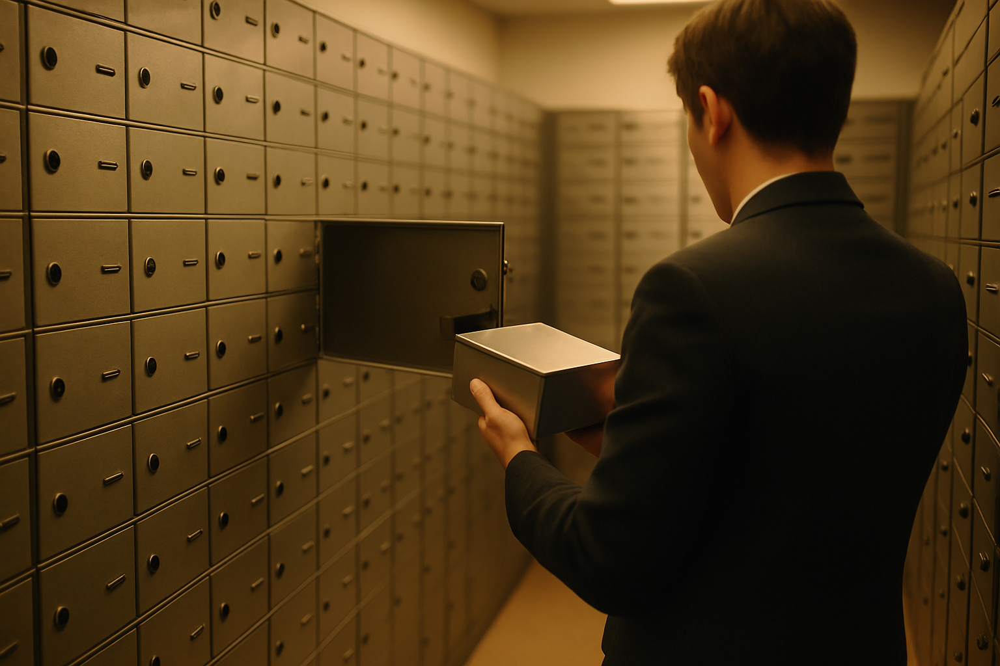

# [법안 산책] SEC 암호화폐 보관 규칙 이야기 (feat. 주신탁회사)

> 📜 **Adviser and Regulated Fund Custody Rules; Crypto Custody Rules**
> 원안 전문: https://www.federalregister.gov/d/2026-20466

✅ 제안 → 🔵 **의견수렴** → ⬜ 심사·작성 → ⬜ 확정 공포 → ⬜ 시행

| 단계 | 상태 | 날짜·비고 |
|---|---|---|
| ① 제안 공포 | ✅ 완료 | 2026-10-06 |
| ② 의견수렴 | 🔵 **지금 여기** | ~2026-12-07 마감 (D-51) · 의견 15건 |
| ③ 확정안 심사·작성 | ⬜ 아직 |  |
| ④ 확정(Final Rule) 공포 | ⬜ 아직 |  |
| ⑤ 시행 | ⬜ 아직 |  |

**지금까지 들어온 굵직한 의견** _(의견 15건 접수 중 · 입장 요약은 검증 통과한 제출 의견만)_

- 👉 제출된 의견 전부 읽어보기: https://www.sec.gov/rules-regulations/public-comments/s7-2026-35

---

1. 미국에서는 펀드나 투자자문사가 고객 돈으로 산 자산을 자기 주머니에 직접 들고 있으면 안 되고, 은행이나 증권사 같은 정해진 보관 기관에 맡기도록 법으로 정해져 있음.

2. 이렇게 고객 자산을 대신 맡아 보관하는 일을 수탁(커스터디, 귀중품을 은행 금고에 맡기는 것과 비슷함)이라고 부름. 고객 돈을 빼돌리는 사고를 막기 위한 장치임.

3. 그런데 이 규칙은 주식·채권 같은 전통 자산을 전제로 만들어져서, 비트코인 같은 암호화폐에는 잘 맞지 않았음.

4. 은행들도 규제 부담 때문에 암호화폐 보관 서비스를 거의 내놓지 않았음 → 맡길 곳이 없어서 펀드가 암호화폐에 투자하기 어려운 상황이 이어졌음.

5. 2025년 출범한 미국 행정부는 암호화폐 산업에 우호적인 정책을 펴 왔고, 이번 초안도 그 흐름 위에 있음.

6. 2026년 10월 6일, 미국 증권거래위원회(SEC)가 펀드와 투자자문사가 암호화폐를 보관할 수 있는 길을 새로 열어주는 규칙 초안을 내놓았음.

7. 아직 확정이 아니라 초안이고, 2026년 12월 7일까지 누구나 의견을 낼 수 있음.

8. 핵심은 두 가지임. 하나는 일정한 안전장치를 갖추면 투자자문사와 공모펀드(일반인 누구나 돈을 넣을 수 있는 펀드)가 암호화폐를 남에게 맡기지 않고 직접 보관(자체수탁)할 수 있게 되는 것임.

9. 다른 하나는 주(州) 정부 인가를 받은 신탁회사(주신탁회사)를 암호화폐 보관 기관으로 정식 인정하는 것임. 지금까지는 이런 회사가 법에서 말하는 '은행'에 해당하는지 애매해서 다들 쓰기를 꺼렸음.

10. 직접 보관에는 안전장치가 조건으로 붙음. 접근 제한, 여러 명이 함께 승인해야 거래가 되는 장치, 거래 기록 유지, 독립 회계사가 자산이 실제로 있는지 검증하는 절차임.

11. 공시 서식인 Form ADV와 Form N-CEN(투자자문사와 펀드가 SEC에 정기적으로 내는 서류)에는 토큰화(펀드 지분 같은 자산의 소유권을 블록체인 위의 디지털 토큰으로 기록하는 것)된 펀드 지분에 관한 질문이 새로 생김.

12. 암호화폐와 무관한 기존 보관 규칙도 현재 업계 관행에 맞게 전반적으로 현대화함.

13. 돈의 흐름을 보면, 가장 확실한 수혜처는 암호화폐 수탁 서비스업(주신탁회사·전문 커스터디)임. 법적 지위가 불확실해 기피되던 주신탁회사가 정식 보관 기관으로 인정받으면, 펀드·운용사의 기관 보관 수요가 이들에게 직접 흘러드는 구조임.

14. 자산운용업(투자자문사·공모펀드·BDC, BDC는 중소기업에 투자하는 상장형 투자회사)도 수혜를 봄. 맡길 곳이 없어 막혀 있던 암호화폐 투자와 상품화(토큰화 펀드 포함)가 가능해지고, 직접 보관까지 허용되면서 운용할 수 있는 자산의 폭이 넓어짐.

15. 회계·감사업도 수혜 쪽임. 직접 보관에 독립 회계사의 자산 검증과 내부통제보고서가 조건으로 붙어 있어서, 보관이 늘어날수록 검증 용역 수요도 함께 늘어나는 구조임.

16. 다만 비용을 내는 쪽도 운용사 자신임. 새 길을 쓰려면 기록보관·공시·사이버보안·연례 점검 같은 추가 의무를 져야 하는데, 의무 자체가 선택지를 쓸 때 붙는 조건이라 자산운용업(준수비용 측면)의 부담 강도는 약한 편임.

17. 지켜볼 것 하나, 2026년 12월 7일 의견수렴 마감까지 은행권(SIFMA)과 암호화폐 업계가 낸 의견이 얼마나 부딪히는지임.

18. 둘, SEC가 최종규칙을 채택하는지와 직접 보관·주신탁회사 조항이 원안대로 살아남는지임.

19. 채택 시점과 시장에 첫 영향이 나타나는 시점은 아직 추정치임. 지금 잡혀 있는 시간표는 각각 2027년 중, 2027년 4분기임.

20. 셋, 최종규칙이 공포되면 준수 개시일(compliance date, 규칙을 실제로 지키기 시작해야 하는 날)과 Form ADV·N-CEN 개정 시행 일정이 정해짐.

21. 넷, 최종규칙 공포 후 2~3분기 사이에 대형 운용사(ETF·공모펀드)가 암호화폐 보관 기관을 선정하거나 직접 보관으로 전환한다고 발표하는지임.

**한 줄 코멘트**: 맡길 곳이 생기면 막혀 있던 돈이 움직이기 시작함. 확정 가능성이 높은 만큼, 암호화폐 수탁 서비스업(주신탁회사·전문 커스터디)과 자산운용업(투자자문사·공모펀드·BDC)의 수혜 여부를 지켜볼 생각임.

---

**영향 산업 한눈에**

| 산업 | 방향 |
|---|---|
| 암호화폐 수탁 서비스업(주신탁회사·전문 커스터디) | 🟢 수혜 |
| 자산운용업(투자자문사·공모펀드·BDC) | 🟢 수혜 |
| 회계·감사업 | 🟢 수혜 |
| 자산운용업(준수비용 측면) | 🔴 부담 |

---

**용어**
- **수탁(커스터디)**: 고객 자산을 대신 맡아 안전하게 보관하는 일. 귀중품을 은행 금고에 맡기는 것과 비슷하다.
- **자체수탁**: 펀드나 자문사가 자산을 외부 기관에 맡기지 않고 스스로 보관하는 것. 이번 초안은 안전장치를 갖추는 조건으로 이를 허용한다.
- **주신탁회사**: 미국의 주(州) 정부에서 인가를 받아 자산 보관 같은 신탁 업무를 하는 회사. 연방 인가 은행이 아니라서 지금까지는 법적 지위가 애매했다.

---

### ⚠️ 이 글은 투자 권유 목적이 아니며, 투자에 대한 책임은 본인에게 있습니다.

_이 글은 AI의 도움을 받아 작성한 글이며, 대표 이미지는 AI가 생성한 이미지입니다._
