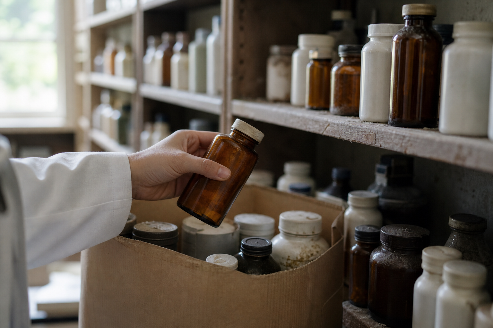

# [행정 규제] DEA 면제 명단 청소 이야기 (feat. 부탈비탈 진통제 160개) A/S

> 📜 **Schedules of Controlled Substances; Removal of Exemption Status for Inactive Butalbital Products**
> 원안 전문: https://www.federalregister.gov/d/2026-20757
> 🔙 이전 글: [DEA 면제 명단 청소 이야기 (feat. 부탈비탈 진통제 160개)](2026-10-09_FR_2026-20757_blog.md)

✅ 제안 → ✅ 의견수렴 → ✅ 심사·작성 → ✅ 확정 공포 → ✅ 시행

| 단계 | 상태 | 날짜·비고 |
|---|---|---|
| ① 제안 공포 | ✅ 완료 | 2026-05-26 |
| ② 의견수렴 | ✅ 완료 | — |
| ③ 확정안 심사·작성 | ✅ 완료 |  |
| ④ 확정(Final Rule) 공포 | ✅ 완료 | 2026-10-09 (제안 후 136일) |
| ⑤ 시행 | ✅ 완료 | 2026-11-09 시행 |

---

1. 미국 DEA(마약단속국)는 중독 위험이 있는 약이라도 남용을 막는 성분을 충분히 섞은 제품이면 규제 일부를 덜어 주는 '면제 처방 제품 목록'을 운영하고 있음.

2. 그런데 이 목록에는 이미 단종되어 시장에서 사라진 부탈비탈(신경을 가라앉히는 바르비투르산 계열 성분) 복합 진통제 160개가 그대로 남아 있었고, 이번 규칙은 그 죽은 이름들을 지우는 장부 청소임.

3. 2026-05-26에 사전 예고됐고, 내용 변경 없이 2026-10-09 확정 규칙(Final Rule)으로 공포됐음.

4. 이 규칙이 2026-11-09 부로 시행에 들어갔음.

5. 2026-11-09부터 달라지는 것은 하나로, DEA의 면제 처방 제품 목록에서 부탈비탈 제품 160개가 제거된 상태가 적용됨.

6. DEA는 NDC(의약품 고유 번호)가 살아 있는 면제 처방 제품에는 이 조치가 영향을 미치지 않는다고 밝혔음.

7. 지워진 제품들은 이미 시판되지 않는 상태라, 이 조치가 이들 제품에 미치는 효과는 없다고 DEA가 설명했음.

8. 지워진 제품도 영영 못 파는 것은 아니고, 회사와 제품이 모든 DEA 규정과 CSA(규제약물법)를 지키면 여전히 제조·판매할 수 있음.

9. 다만 다시 팔려면 면제 혜택 없이 Schedule III(3등급 규제 약물)에 붙는 등록·기록·보안 요건을 전부 지켜야 하므로, 이론상 재진입 비용이 생김.

10. 그래서 산업 영향은 제네릭 의약품 제조업(부탈비탈 복합 진통제)에 부담 쪽이지만, 대상 제품이 전부 이미 판매 중단 상태라 현실에서 느껴질 영향은 사실상 0에 가깝다는 조건이 붙음.

11. DEA도 면제 목록에서 제거되는 제품들이 더 이상 시판되지 않으므로 경제적 영향은 없을 것이라고 공식 인증했음.

12. 지켜볼 것은 2026-11-09 전후로 DEA 단속부서(Diversion Control Division)의 면제 처방 제품 목록이 실제로 갱신됐는지 확인하는 것임.

13. 또 하나는 2026년 4분기 중 지워진 160개 가운데 '사실은 아직 팔리고 있는 제품'이 섞였다는 이의 제기가 업계·위탁생산사 쪽에서 나오는지 확인하는 것임.

**한 줄 코멘트**: 이미 시장에서 사라진 이름 160개를 장부에서 지우는 청소라, 시행이 시작돼도 지금 팔리는 약과 기업 실적에 미칠 영향은 사실상 없는 규칙임.

---

**용어**
- **DEA(마약단속국)**: 미국 법무부 소속으로, 중독 위험이 있는 약과 마약을 관리·단속하는 기관입니다. 어떤 약을 얼마나 엄격하게 관리할지 정합니다.
- **NDC(의약품 고유 번호)**: 미국에서 팔리는 모든 약에 붙는 주민등록번호 같은 고유 번호입니다. 이 번호가 '비활성'이면 그 약은 더 이상 시장에서 팔리지 않는다는 뜻입니다.

---

### ⚠️ 이 글은 투자 권유 목적이 아니며, 투자에 대한 책임은 본인에게 있습니다.

_이 글은 AI의 도움을 받아 작성한 글이며, 대표 이미지는 AI가 생성한 이미지입니다._
