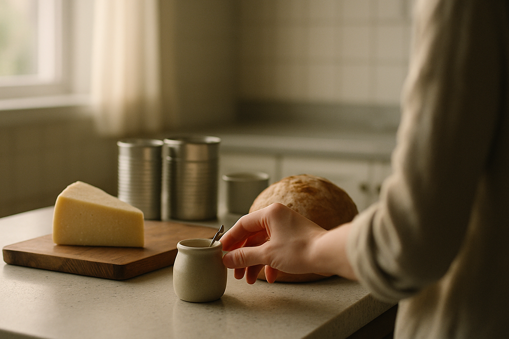

# [법안 산책] 미국 표준식품의 소금 대체재 허용 이야기 (feat. 염화칼륨)

> 📜 **Use of Salt Substitutes To Reduce the Sodium Content in Standardized Foods**
> 원안 전문: https://www.federalregister.gov/d/2026-20848

✅ 제안 → ✅ 의견수렴 → ✅ 심사·작성 → ✅ 확정 공포 → 🔵 **시행 대기**

| 단계 | 상태 | 날짜·비고 |
|---|---|---|
| ① 제안 공포 | ✅ 완료 | 2023-04-10 |
| ② 의견수렴 | ✅ 완료 | — |
| ③ 확정안 심사·작성 | ✅ 완료 |  |
| ④ 확정(Final Rule) 공포 | ✅ 완료 | 2026-10-13 (제안 후 1282일) |
| ⑤ 시행 | 🔵 **지금 여기** | 2026-12-14 예정 (D-59) |

---

1. 미국에는 표준식품(SOI, 치즈·빵·통조림처럼 그 이름을 쓰려면 법으로 정해진 레시피대로 만들어야 하는 식품)이라는 제도가 있음.

2. 정해진 레시피와 다르게 만든 제품은 '체다치즈' 같은 그 식품 이름 자체를 쓸 수 없음.

3. 그런데 이 레시피 대부분이 소금(염화나트륨)만 허용하고 있었음.

4. 그래서 제조사가 소금을 줄이려고 다른 재료를 쓰면 식품 이름을 잃는 딜레마가 있었음.

5. 예전에는 영양강조표시 기준(포장에 '저나트륨' 같은 문구를 쓰려면 충족해야 하는 수치 기준)까지 나트륨을 크게 낮춰 별도 표시를 다는 길뿐이었음.

6. 한편 나트륨(소금의 주성분인 미네랄)을 너무 많이 먹으면 고혈압·심장병·뇌졸중 위험이 커질 수 있어, 각국 보건당국이 섭취를 줄이라고 권고함.

7. 2026년 10월 13일, 미국 식품의약국(FDA)이 이 충돌 지점을 푸는 최종규칙(초안 공개와 의견수렴을 거쳐 확정된 완성본 규정)을 공포했음.

8. 내용은 소금을 필수·선택 성분으로 박아 둔 표준식품 규정을 고쳐서, 나트륨을 줄이기 위한 소금 대체재 사용을 허용한다는 것임.

9. 소금 대체재(소금의 간 맞추기·보존 역할을 대신하면서 나트륨은 줄여 주는 재료, 대표적으로 염화칼륨)의 정의는 새 규정 §130.30으로 신설됐음.

10. 특정 물질 목록을 정한 것이 아니라 '소금 역할을 대신하는 재료'라는 기능 기반 정의임.

11. 80개 표준식품 규정을 직접 고쳤고, 교차참조(규정 A가 '규정 B를 따른다'고 적어 두는 방식)로 적용되는 59개가 더해져 총 139개 표준식품에서 대체재를 쓸 수 있게 됐음.

12. 치즈, 빵, 통조림 채소와 수산물, 마가린, 마요네즈 등이 여기에 들어감.

13. 최소 대체 비율이나 나트륨 상한선은 없어서, 소금의 일부만 바꿔도 규정을 지킨 것이 됨.

14. 안전장치도 있는데, 대체재가 식품의 기본 성질과 본질적 특성(보존성, 수분 등)을 바꾸는 것은 금지됨.

15. 이 규칙이 특정 물질을 승인해 주는 것도 아니어서, 식품첨가물 사전승인(새 재료를 넣으려면 FDA가 안전하다고 미리 승인해야 하는 제도)은 그대로 통과해야 함.

16. 쓸지 말지는 전적으로 제조사 마음이고 안 써도 벌칙이 없는 자발적 규칙이라, 규제 비용은 0임.

17. 돈의 흐름을 보면, 식품첨가물·소금 대체재 소재 제조업(염화칼륨 등)은 지금까지 표준식품에서 사실상 막혀 있던 새 수요처가 139개 식품에서 한꺼번에 열림.

18. 다만 사용이 전적으로 자발적이라, 수요가 얼마나 빨리 늘지는 식품 제조사들이 리뉴얼을 결정하는 속도에 달려 있음.

19. 가공식품 제조업(치즈·제빵·통조림·소스 등 표준식품 제조사)도 저나트륨 제품에 '치즈', '빵' 같은 표준식품 이름을 그대로 쓸 수 있게 되어 제품 차별화 길이 열림.

20. 반대로 소금(염화나트륨) 생산·정제업은 식품 제조용 소금 수요가 서서히 줄어들 수 있음.

21. 다만 대체는 자발적이고 소금의 보존·안전 기능 때문에 완전 대체는 어려워, 영향은 약한 편임.

22. 가공식품 제조업 중 리뉴얼 착수 기업(재제조·재라벨링 비용 부담)은 배합 변경과 라벨 교체 비용, 맛이 달라져 소비자가 떠날 위험을 스스로 떠안음.

23. 유제품 개정분 이의신청 마감은 2026년 11월 12일이고, 규칙 시행일은 2026년 12월 14일임.

24. 시행 이후 2027년 상반기까지 주요 식품사(치즈·제빵·통조림)가 저나트륨 리뉴얼 제품을 발표하는지, 그리고 2027년 중 FDA의 자발적 나트륨 감축 목표 2단계(Phase II) 가이던스 최종화(제조사들이 대체재를 채택할 유인을 좌우함)를 지켜보면 됨.

**한 줄 코멘트**: 의무가 아니라 허용이어서, 변화의 속도는 결국 식품사들의 리뉴얼 결정에 달려 있음. 2026년 12월 14일 시행 뒤 어떤 회사가 먼저 움직이는지부터 보면 됨.

---

**영향 산업 한눈에**

| 산업 | 방향 |
|---|---|
| 식품첨가물·소금 대체재 소재 제조업(염화칼륨 등) | 🟢 수혜 |
| 가공식품 제조업(치즈·제빵·통조림·소스 등 표준식품 제조사) | 🟢 수혜 |
| 소금(염화나트륨) 생산·정제업 | 🔴 부담 |
| 가공식품 제조업 중 리뉴얼 착수 기업(재제조·재라벨링 비용 부담) | 🔴 부담 |

---

**용어**
- **표준식품(SOI, 표준규격 식품)**: 치즈·빵·통조림처럼 '이 이름을 쓰려면 이런 재료로 이렇게 만들어야 한다'고 레시피가 법으로 정해진 식품입니다. 레시피를 어기면 그 식품 이름 자체를 쓸 수 없습니다.
- **소금 대체재**: 소금이 하던 역할(간 맞추기, 보존 등)을 대신하면서 나트륨은 줄여 주는 재료입니다. 대표적인 예가 염화칼륨인데, 나트륨 대신 칼륨이 들어 있는 짠맛 물질입니다.
- **식품첨가물 사전승인**: 식품에 새 재료를 넣으려면 FDA가 '안전하다'고 미리 승인해야 한다는 제도입니다. 이번 규칙은 이 절차를 건너뛰게 해 주는 것이 아니어서, 대체재도 이 관문은 그대로 통과해야 합니다.

---

### ⚠️ 이 글은 투자 권유 목적이 아니며, 투자에 대한 책임은 본인에게 있습니다.

_이 글은 AI의 도움을 받아 작성한 글이며, 대표 이미지는 AI가 생성한 이미지입니다._
