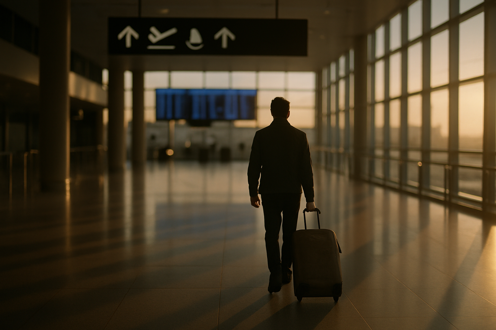

# [법안 산책] 미국 이민 벌금 최종규칙 이야기 (feat. 하루 최대 998달러)

> 📜 **Imposition and Collection of Civil Penalties for Certain Immigration-Related Violations**
> 원안 전문: https://www.federalregister.gov/d/2026-21024

❔ 제안 → ❔ 의견수렴 → ✅ 심사·작성 → ✅ 확정 공포 → ✅ 시행

| 단계 | 상태 | 날짜·비고 |
|---|---|---|
| ① 제안 공포 | ❔ 미확인 | 초안 혈통 미확인 |
| ② 의견수렴 | ❔ 미확인 | — |
| ③ 확정안 심사·작성 | ✅ 완료 |  |
| ④ 확정(Final Rule) 공포 | ✅ 완료 | 2026-10-14 |
| ⑤ 시행 | ✅ 완료 | 2026-10-14 시행 |

---

1. 미국에는 법원이나 이민 당국에서 '미국을 떠나라'는 최종 명령을 받고도 실제로는 떠나지 않은 사람이 아주 많고, 이민 단속 기관인 ICE가 구금하지 않은 채 관리하는 명단에만 약 150만 명이 올라 있음.

2. 2024 회계연도에 나온 퇴거명령(removal order, 미국을 떠나야 한다고 법적으로 확정한 명령) 가운데 실제로 집행된 것은 약 10%뿐이었음.

3. 그래서 나온 생각이, 사람을 일일이 붙잡아 내보내는 대신 매일 쌓이는 벌금으로 압박해서 스스로 떠나게 만들자는 것임.

4. 이번 규칙은 트럼프 대통령의 행정명령 E.O. 14159(이민법 전면 집행과 벌금 징수 지시)·E.O. 14165(국경 확보), 그리고 '자진출국 아니면 제재'의 양자택일을 내건 Proclamation 10935(Project Homecoming)를 이행하기 위한 것임.

5. 2025년 6월부터 잠정규칙(IFR, 의견수렴을 다 마치기 전에 일단 먼저 시행하는 임시 규칙)이 먼저 돌았고, 15개월간 벌금이 대량으로 발행되면서 자진출국이 이어졌음.

6. 2026년 10월 14일, 국토안보부(DHS)가 이 잠정규칙을 거의 그대로 확정한 최종규칙(Final Rule)을 공포했고, 공포와 동시에 효력이 시작됐음.

7. 새로 시작되는 제도가 아니라, 이미 돌아가던 제도에 도장을 찍은 것임.

8. 벌금 대상은 기업이 아니라 외국인 개인이고, 세 부류임.

9. 첫째, 최종 퇴거명령을 받고도 고의로 떠나지 않는 사람 — 고의 불이행 하루당 최대 998달러씩 벌금이 쌓일 수 있음.

10. 둘째, 자진출국(voluntary departure, 정해진 기한 안에 스스로 미국을 떠나기로 약속하는 것) 기한을 어긴 사람 — 1,992달러에서 9,970달러 사이, 보통은 3,000달러임.

11. 셋째, 불법으로 입국하다 붙잡힌 사람 — 건당 100~500달러임.

12. 예전에는 벌금을 매기려면 미리 통지하고 30일을 기다리고 대면 인터뷰도 하고, BIA(이민항소위원회, 이민 사건 결정에 불복할 때 가던 별도 항소 기구)에 항소하는 긴 절차가 필요했음.

13. 이제는 DHS 이민관이 서면 결정 한 장으로 바로 벌금을 매김.

14. 억울하면 영업일로 보름 안에 DHS 내부에 서면으로 항소해야 하고, 그 결정에 관여하지 않은 상급 감독관이 서류만 보고 원점에서 재검토해 45일 안에 최종 결정함.

15. BIA로 가는 길은 막혔고, 국토안보부 장관의 재량 재검토만 가능할 뿐 감독관 결정이 사실상 끝임.

16. 최종규칙에서 잠정규칙과 달라진 것은 하나 — 본인 통제를 벗어난 우편 배달 지연이 증빙되고 ICE가 이를 인정하면, 기한을 넘긴 항소도 받아줄 수 있게 됐음.

17. 참고로 CBP Home이라는 앱으로 자진출국을 마치면 출국 불이행 벌금의 대부분을 면제해 주기 때문에, 이 벌금은 돈을 걷는 것보다 '나가게 만드는' 수단에 가까움.

18. 벌금 압박과 CBP Home 앱의 벌금 면제 유인이 결합해 자진출국이 급증하고 있고, 규칙 본문상 상당수가 본인 부담(at the alien's own expense) 송환임 → 출국 항공권·송환 운송 수요가 늘어나는 쪽으로 돈이 흐름.

19. 직접 수혜는 국제선 여객 항공·송환 운송업이지만, 수혜 강도는 '약함' 수준으로 제한적임.

20. 첫 번째로 지켜볼 것은 연방지법 소송 제기와 가처분(효력정지) 여부로, 특히 BIA 심사 배제와 적법절차(정부가 불이익을 주기 전에 공정한 절차를 거쳐야 한다는 헌법 원칙) 쟁점을 2026년 4분기에 살펴볼 만함.

21. 두 번째는 DHS 통계국(OHSS)이 분기별로 내는 벌금 발행·자진출국 건수 업데이트로, 주당 2,800건 추세가 유지되는지를 2027년 1월 전후의 다음 발표에서 확인할 수 있음.

22. 세 번째는 CBP Home 벌금 면제 정책의 유지·변경 공지인데, 면제가 줄면 실제 징수액이 급증하는 구조라 DHS 보도자료를 상시로 봐야 함.

23. 네 번째는 미등록 노동에 의존해 온 산업의 인력난 지표(구인·임금)와 업계 단체의 대응 성명으로, 파종기와 건설 성수기가 겹치는 2027년 상반기가 확인 시점임.

**한 줄 코멘트**: 돈을 걷는 수단이라기보다 나가게 만드는 수단에 가까운 제도라, 진짜 볼 것은 징수액이 아니라 적법절차 소송의 향방과 미등록 노동에 기대온 산업의 인력난임.

---

**영향 산업 한눈에**

| 산업 | 방향 |
|---|---|
| 국제선 여객 항공·송환 운송업 | 🟢 수혜 |

---

**용어**
- **퇴거명령 (removal order)**: 미국 정부가 '당신은 미국을 떠나야 한다'고 법적으로 확정한 명령. 이 명령이 최종 확정됐는데도 남아 있으면 이번 규칙의 벌금 대상이 된다.
- **잠정규칙 (IFR)**: 의견수렴을 다 마치기 전에 '일단 먼저 시행'하는 임시 규칙. 이번 최종규칙은 2025년 6월부터 돌던 잠정규칙을 거의 그대로 확정한 것이다.
- **BIA (이민항소위원회)**: 이민 사건의 결정에 불복할 때 가던 별도의 항소 기구. 이번 규칙은 벌금 사건에서 이 기구로 가는 길을 막고, DHS 내부 심사로 끝내도록 했다.

---

### ⚠️ 이 글은 투자 권유 목적이 아니며, 투자에 대한 책임은 본인에게 있습니다.

_이 글은 AI의 도움을 받아 작성한 글이며, 대표 이미지는 AI가 생성한 이미지입니다._
