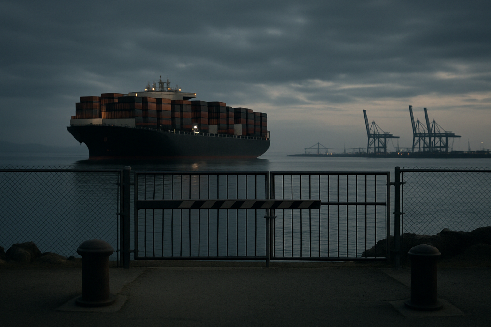

# [법안 산책] 미국이 러시아 우라늄을 끊기로 한 이야기 (feat. 2028년이라는 시한)

> 📜 **Prohibiting Russian Uranium Imports Act (H.R.1042 → Public Law 118-62)**
> 원안 전문: https://www.congress.gov/bill/118th-congress/house-bill/1042

✅ 발의 → ✅ 하원 통과 → ✅ 제정(서명) → 🔵 **시행 중 (웨이버 병행)** → ⬜ 웨이버 종료·전면 금지

| 단계 | 상태 | 날짜·비고 |
|---|---|---|
| ① 발의 (H.R.1042) | ✅ 완료 | 2023 (118대 의회) |
| ② 하원 통과 | ✅ 완료 | 2023-12 |
| ③ 제정 (대통령 서명) | ✅ 완료 | 2024-05-13 |
| ④ 시행 (수입 금지 개시) | 🔵 **지금 여기** | 2024-08-11부터 · DOE 웨이버 병행 |
| ⑤ 웨이버 종료 (전면 금지) | ⬜ 아직 | 2028-01-01 |

---

1. 2024년 5월, 미국이 러시아산 농축우라늄(LEU)의 수입을 법으로 금지함. 이름도 직설적임. '러시아 우라늄 수입 금지법'.

2. 배경 설명이 필요함. 원전 연료는 캐낸 우라늄을 그대로 쓰는 게 아니라, 타는 성분(U-235)의 비율을 인위적으로 높인 '농축 우라늄'을 씀. 이 농축이라는 공정이 전 세계 원자력의 병목임.

3. 세계 농축 시장은 4개 회사가 95% 이상을 차지함. 러시아 로사톰(세계 1위), 영국·네덜란드 정부계 유렌코, 중국 CNEIC, 프랑스 오라노. 넷 다 외국 정부가 소유하거나 지배하는 회사임.

4. 미국은 세계에서 원전을 가장 많이 돌리는 나라인데, 정작 미국 기업이 가진 상업 농축 공장은 0개임. 미국 땅 안의 유일한 상업 농축 공장(뉴멕시코)도 주인은 유럽 정부들이 소유한 유렌코임.

5. 여기엔 역사가 있음. 냉전이 끝나고 미국은 러시아와 '메가톤을 메가와트로'라는 거래를 함. 해체한 소련 핵탄두에서 나온 우라늄을 사다가 원전 연료로 쓴 것임. 1993년부터 20년간 이어졌고, 한때 미국 전기의 10%가 옛 소련 탄두에서 나왔다는 계산이 있을 정도였음.

6. 탄두에서 나온 우라늄이 워낙 싸게 들어오니 미국의 자체 농축 산업은 말라죽었음. 자국 기술로 돌아가던 마지막 공장이 2013년에 문을 닫음.

7. 2022년 우크라이나 전쟁이 터지자 이 구조가 문제가 됨. 러시아 제재를 아무리 쌓아도, 원전 연료 대금은 꼬박꼬박 러시아 국영기업으로 들어가고 있었기 때문임.

8. 그래서 나온 답이 이 법임. 2023년 12월 하원 통과, 2024년 5월 13일 제정, 그리고 8월 11일부터 러시아산 LEU의 미국 반입이 금지됨.

9. 그런데 조문을 보면 금지 옆에 안전판이 하나 붙어 있음. 웨이버(면제)임. 대체 공급원이 없어 미국 원전이나 원자력 기업의 운영이 곤란해지거나 국익에 부합하면, 에너지부(DOE)가 수입을 예외적으로 허가할 수 있게 해놨음.

10. 왜 안전판이 필요했나. 당장 칼같이 끊으면 러시아보다 미국 원전이 먼저 다치기 때문임. 미국의 러시아 연료 의존이 그만큼 깊었음.

11. 다만 안전판에는 시한이 박혀 있음. 웨이버로 들여올 수 있는 건 2028년 1월 1일 이전 수입분까지임. 즉 이 법의 진짜 메시지는 '지금 당장 끊어라'가 아니라 '2028년까지 러시아 없이 사는 법을 배워라'임.

12. 채찍만 있는 것도 아님. 백악관은 2023년 10월 농축 증설 자금 22억 달러와 장기 수입금지를 한 묶음으로 발표했고, 법 제정 뒤 에너지부는 그 해 안에 합계 34억 달러 재원의 농축 신설 계약 3종의 사업자 선정을 마침. 금지가 수요를 만들고, 정부 돈이 공장을 짓는 구조임.

13. 러시아도 가만있지 않았음. 2024년 11월 포고령으로 자국 농축회사의 대미 수출 일반허가를 철회함. 이제 선적 한 건마다 러시아 당국의 개별 허가가 필요함. 작년 10월에는 이 체제를 2027년 말까지 연장함. 미국의 '수입 금지+웨이버'를 '수출 금지+개별허가'로 거울처럼 받아친 것임.

14. 그래서 지금은 양쪽 다 밸브를 완전히 잠그지는 않고 손잡이만 쥐고 있는 모양새임. 물건은 지금도 오감 — 미국은 웨이버를 내주고, 러시아는 선적 허가를 내주면서.

15. 이 법의 한복판에 있는 회사가 센트러스 에너지임. 러시아산 LEU를 수입해 미국 전력사에 재판매하는 게 주업인데, 2027년까지 고객에게 보낼 물량의 절반 이상이 러시아 계약분임. 회사는 지금까지 웨이버 2건을 받아냈고(이미 계약된 미국 고객분, 해외 재수출분), 2026~27년 신규 판매분에 대한 세 번째 웨이버는 올해 2월 연차보고서 시점까지 심사 중이었음.

16. 동시에 이 회사는 미국에 남은 유일한 자국 기술 농축 회사라서, 에너지부 증설 자금의 1순위이기도 함(올해 1월 9억 달러 과업 선정, 확정계약 협상 중). 금지로 흔들리는 몸과 금지 덕에 크는 몸이 한 회사 안에 같이 있는 셈임.

17. 한국과도 접점이 생기고 있음. 한수원과 포스코인터내셔널이 센트러스의 오하이오 농축 공장 증설에 참여하는 협약을 맺었다는 소식이 전해짐(2025년 8월, 보도·블로그 기준). 미국의 '러시아 끊기'가 한국 기업의 투자 기회로 번지는 경로임.

18. 지켜볼 것 하나. 세 번째 웨이버의 승인 여부 — 러시아산을 다루는 회사들의 2026~27년 장사가 여기 걸려 있음.

19. 둘. 2028년 1월 1일 — 웨이버가 끝나는 날. 그 전에 미국 안의 새 농축 공장들(오하이오·테네시 등에서 추진 중)이 제때 올라오는지가 관건임.

20. 셋. 러시아 쪽 밸브 — 2027년 말까지 연장된 개별허가 체제에서 허가가 계속 나오는지임. 멈추는 순간, 금지법보다 러시아의 손이 먼저 시장을 흔들게 됨.

**한 줄 코멘트**: 이 법은 수입 금지법이라기보다 '2028년까지 갈아타라'는 시간표임. 겨눈 것은 러시아지만, 돈이 흘러가는 곳은 미국과 동맹국의 새 농축 공장임.

---

**영향 산업 한눈에**

| 산업 | 방향 |
|---|---|
| 우라늄 농축 (미국 내 신설·증설) | 🟢 수혜 |
| 서방 우라늄 채굴·변환 | 🟢 수혜 |
| 원전 플랜트 건설·기자재 (농축설비 EPC) | 🟢 수혜 |
| 미국 원전 전력사 (유틸리티) | 🔴 부담 |
| 러시아 국영 원자력 (로사톰 계열) | 🔴 부담 |

---

**용어**
- **LEU(저농축우라늄)**: 타는 성분(U-235)을 5% 미만으로 높인 원전 연료용 우라늄입니다. 지금 돌아가는 상업 원전 대부분이 이걸 씁니다.
- **농축**: 천연 우라늄 속 U-235의 비율(0.7%)을 원심분리기로 끌어올리는 공정입니다. 같은 기계를 더 돌리면 무기급까지 갈 수 있어서, 아무 나라나 못 하게 국제적으로 엄격히 관리됩니다.
- **웨이버(waiver)**: 법으로 금지해 놓고, 심사를 거쳐 예외적으로 허용해 주는 면제 허가입니다. 이 법에서는 에너지부(DOE)가 심사하며, 2028년부터는 이 예외도 사라집니다.

---

### ⚠️ 이 글은 투자 권유 목적이 아니며, 투자에 대한 책임은 본인에게 있습니다.

_이 글은 AI의 도움을 받아 작성한 글이며, 대표 이미지는 AI가 생성한 이미지입니다._
