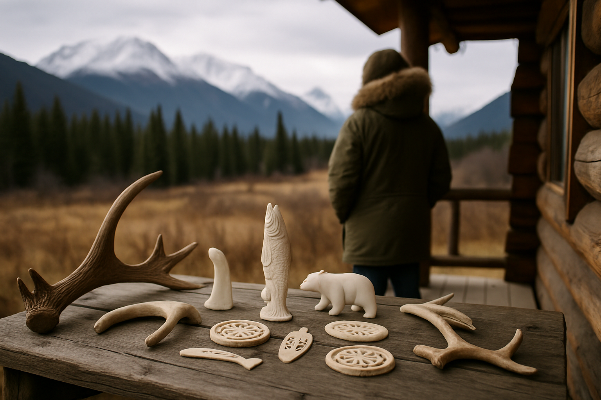

# [행정 규제] 알래스카 국립공원 사냥 규칙 이야기 (feat. 곰 미끼 사냥)

> 📜 **Alaska; Wildlife, Harvest, and Access**
> 원안 전문: https://www.federalregister.gov/d/2026-21299

❔ 제안 → ❔ 의견수렴 → ✅ 심사·작성 → ✅ 확정 공포 → 🔵 **시행 대기**

| 단계 | 상태 | 날짜·비고 |
|---|---|---|
| ① 제안 공포 | ❔ 미확인 | 초안 혈통 미확인 |
| ② 의견수렴 | ❔ 미확인 | — |
| ③ 확정안 심사·작성 | ✅ 완료 |  |
| ④ 확정(Final Rule) 공포 | ✅ 완료 | 2026-10-19 |
| ⑤ 시행 | 🔵 **지금 여기** | 2026-11-18 예정 |

---

1. 알래스카는 미국에서 가장 큰 주이고, 땅의 상당 부분이 국립공원 같은 연방 보호지역임. 1980년에 만들어진 알래스카 국익토지보전법(ANILCA)이라는 법이 이 땅들의 규칙을 정했음.

2. 이 법은 주정부와 연방정부의 권한이 공존하는 알래스카 고유의 관리 체계를 세웠고, 자연을 지키면서도 그 땅에서 사냥과 낚시로 먹고살아 온 지역 주민(특히 원주민)의 생활 방식을 함께 보장함.

3. 알래스카 국립공원 체계 안에는 ANILCA로 설립·확장된 국립보호구(국립공원과 비슷하게 보호되지만 사냥이 허용되는 구역) 10곳이 있고, 사냥은 주로 이 보호구에서 허용됨.

4. 1981년에 만들어진 시행규정이 30년 넘게 이 틀을 지켜왔음.

5. 그런데 2015년과 2017년에 연방 공원청이 금지 확대, 폐쇄 기준 재량화, 공고·청문 축소, 허가제 신설 등으로 이 틀에서 이탈했음.

6. 알래스카 원주민 단체들(알래스카원주민연맹 결의 14-42, Tanana Chiefs Conference)이 강하게 반대했음.

7. 2020년 규칙이 곰 미끼 사냥 금지 등을 일부 철회했지만, 2024년 규칙이 다시 금지했음.

8. 2026년 10월 19일, 미국 내무부가 행정명령 14153이 지시한 대로 2024년 개정을 철회하고 2020년 규정을 복원하면서 2015·2017년 변경까지 포괄적으로 옛 틀로 되돌리는 확정 규칙(Final Rule, 의견수렴을 끝내고 최종 확정해 공포한 규정)을 공포했음. 2026년 3월 제안규칙 공고 후 의견수렴을 거쳐 확정된 것임.

9. 바뀌는 내용 첫째, 곰 미끼 사냥(먹이를 한 곳에 놓아 곰을 유인한 뒤 잡는 사냥 방식)을 모든 이용자에게 주법대로 다시 허용함. 알래스카 주법에서는 1982년부터 허용돼 온 방식임.

10. 둘째, 뿔이나 뼈 같은 동물 부위를 수공예품 재료로 주울 때 받아야 했던 2017년 의무 허가제를 없앰. 줍는 것 자체는 원래부터 합법이었고, 허가라는 절차만 사라지는 것임.

11. 셋째, 매 사냥(훈련시킨 매 같은 맹금류로 하는 전통 사냥)에 쓸 새끼 맹금류 생포를 금지했던 2017년 조항을 삭제하고, 주정부와 연방 어류·야생동물국의 기존 허가 체계에 맡김.

12. 넷째, 주 규제와 겹치는 트래핑(덫사냥) 정의를 예전 것으로 되돌리고, 불필요해진 모피동물(furbearer) 정의를 삭제함.

13. 다섯째, 공원 구역을 폐쇄할 때의 절차도 복원됨. 긴급 폐쇄는 최대 30일까지만 가능하고 연장할 수 없으며, 임시 폐쇄에도 기간 상한이 다시 생기고 역시 연장이 안 됨.

14. 사냥·낚시에 영향을 주는 폐쇄는 시행 전에 그 지역에서 공청회를 열어야 함.

15. 폐쇄 소식은 신문, 지역 라디오, 우체국 게시판, 지도 비치 중 골라서 하는 게 아니라 전부 해야 함. 조문의 'or'를 'and'로 바꿔 이를 못 박았음.

16. 돈의 흐름을 보면, 알래스카 원주민 수공예·전통교역은 뿔·뼈 채집 때 받아야 했던 의무 허가가 없어져 → 물물교환·관습 교역용 수공예 생산의 행정 부담이 사라짐.

17. 지역 신문·라디오 방송(지역 언론)은 폐쇄·제한 때 신문 게재와 라디오 방송이 '선택'에서 '의무'로 바뀌어 → 미국 국립공원청(NPS)이 내는 공고·광고비가 지역 언론 수입으로 흘러감. 다만 공고 건수에 달린 수입이라 규모는 중간 수준임.

18. 야생동물 관찰 생태관광(곰 관찰 투어 등)은 '자연 상태의 곰'이라는 상품 전제가 약해질 수 있음. 다만 미끼 사냥 수확이 연 10마리 이하로 추정되어 실질 타격은 제한적이라는 단서가 붙음.

19. 환경보전 비영리·보전 기반 사업은 금지 유지를 지지해 온 보전 진영의 이해가 규칙에서 명시적으로 기각되어, 캠페인·소송 대응 비용을 떠안게 됨.

20. 원주민 등 농촌 주민의 생계형 수확(돈벌이가 아니라 먹고살기 위해 하는 사냥·낚시·채집) 우선권과 알래스카 주정부의 관리 권한은 그대로임.

21. 시행일은 2026년 11월 18일이고, 일괄 발효라 단계 적용은 없음.

22. 지켜볼 것은 2026년 11월 18일 전후부터 2027년 1분기까지, 규칙 발효 확인과 환경단체의 소송 제기 여부(연방지법 제소·가처분 신청)임.

23. 2027년 2분기 봄 곰 사냥 시즌에는 알래스카 주정부의 베이트 스테이션(곰 미끼를 놓아두는 지정 장소) 등록·사냥 허가 통계와 가이드업계(Safari Club, Alaska Outdoor Council)의 반응 발표를 지켜볼 만함. 체감 영향이 시작되는 시점도 이때임.

**한 줄 코멘트**: 30년 넘게 쓰던 옛 틀로 되돌아가는 확정 규칙이라 2026년 11월 18일 발효는 사실상 정해진 수순이고, 남은 변수는 환경단체 소송뿐임.

---

**영향 산업 한눈에**

| 산업 | 방향 |
|---|---|
| 알래스카 원주민 수공예·전통교역 | 🟢 수혜 |
| 지역 신문·라디오 방송(지역 언론) | 🟢 수혜 |
| 야생동물 관찰 생태관광(곰 관찰 투어 등) | 🔴 부담 |
| 환경보전 비영리·보전 기반 사업 | 🔴 부담 |

---

**용어**
- **확정 규칙 (Final Rule)**: 미국 정부 기관이 의견수렴을 끝내고 최종 확정해 공포한 규정. 법원이 막지 않는 한 정해진 날짜에 그대로 시행된다.
- **국립보호구 (National Preserve)**: 국립공원과 비슷하게 보호되지만 사냥이 허용되는 구역. 알래스카에는 1980년 ANILCA 법으로 설립·확장된 국립보호구가 10곳 있고, 이번 규칙의 수렵 관련 내용도 주로 이 구역에 적용된다.
- **곰 미끼 사냥 (bear baiting)**: 먹이를 한 곳에 놓아 곰을 유인한 뒤 잡는 사냥 방식. 알래스카 주법에서는 1982년부터 허용돼 온 방식이다.

---

### ⚠️ 이 글은 투자 권유 목적이 아니며, 투자에 대한 책임은 본인에게 있습니다.

_이 글은 AI의 도움을 받아 작성한 글이며, 대표 이미지는 AI가 생성한 이미지입니다._
