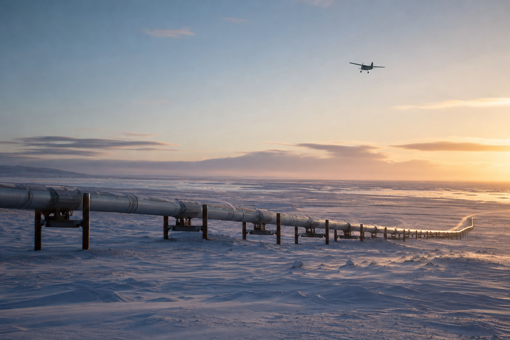

# [행정 규제] 북극곰과 석유회사 이야기 (feat. 보퍼트해 5년 면책 통로)

> 📜 **Marine Mammals; Incidental Take of Polar Bears and Pacific Walruses in the Beaufort Sea and North Slope of Alaska**
> 원안 전문: https://www.federalregister.gov/d/2026-21371

❔ 제안 → ❔ 의견수렴 → ✅ 심사·작성 → ✅ 확정 공포 → ✅ 시행

| 단계 | 상태 | 날짜·비고 |
|---|---|---|
| ① 제안 공포 | ❔ 미확인 | 초안 혈통 미확인 |
| ② 의견수렴 | ❔ 미확인 | — |
| ③ 확정안 심사·작성 | ✅ 완료 |  |
| ④ 확정(Final Rule) 공포 | ✅ 완료 | 2026-10-19 |
| ⑤ 시행 | ✅ 완료 | 2026-10-19 시행 |

---

1. 알래스카 북쪽 끝에는 '노스슬로프'라는 넓은 평원이 있고, 석유 회사들이 여기서 기름을 뽑아 송유관으로 남쪽까지 보냄. 그 앞바다가 보퍼트해인데, 여기에는 북극곰과 태평양바다코끼리가 살고 있음.

2. 미국은 1972년에 해양포유류보호법(MMPA, 고래·물개·북극곰 같은 바다 포유류를 잡는 것은 물론 놀라게 하거나 괴롭히는 것까지 원칙적으로 금지하는 법)을 만들었음.

3. 문제는 석유 회사가 일부러 동물을 해치지 않아도, 비행기 소음이나 공사 진동만으로 동물이 놀랄 수 있다는 점임.

4. 그 한 번 한 번이 전부 법 위반이 되면 사업 자체가 불가능해지니, 법은 조건을 지키면 소수의 우발적 포획(incidental take, 일하다가 의도치 않게 동물을 놀라게 하거나 다치게 하는 것)을 미리 승인해 주는 예외 통로를 열어 뒀음.

5. 보퍼트해 석유 업계는 1993년부터 이 승인을 5년 단위로 계속 갱신받아 왔고, 직전 승인은 2026년 8월 5일에 만료된 상태였음.

6. 2026년 10월 19일, 미국 내무부 산하 어류·야생동물국(FWS)이 그 공백을 메우는 새 승인 규칙을 확정했고, 공포일부터 바로 시행됐음.

7. 이번 규칙은 ITR(우발적 포획을 봐주겠다는 5년 단위의 큰 틀 규정)로, 유효기간은 2026년 10월 19일부터 2031년 10월 19일까지임.

8. 업계 단체인 알래스카석유가스협회(AOGA)가 ConocoPhillips, ExxonMobil, Hilcorp 같은 회원사들을 대신해 신청했음.

9. 적용 지역은 포인트 배로에서 캐나다 국경까지의 보퍼트해와 노스슬로프 연안이고, 북극국립야생보호구역(ANWR)은 빠짐.

10. 주의할 점은 이 규칙이 석유 시추 자체를 허가해 주는 것은 아니라는 것임. 각 회사는 실제 활동 시작 90일 전까지 LOA(큰 틀 안에서 회사 하나하나가 활동별로 받아야 하는 개별 승인서)를 서면으로 신청해야 함.

11. LOA에는 완화 조치(동물 피해를 줄이기 위해 승인에 붙는 조건)가 따라붙음.

12. 비행기는 비상시가 아니면 고도 457m(1,500피트) 아래로 내려가거나, 얼음·육지 위에서 관찰된 북극곰·바다코끼리의 805m(0.5마일) 안쪽으로 접근할 수 없음.

13. 배는 바다코끼리 무리를 갈라놓으면 안 되고, 물속 12마리 이상 바다코끼리 무리나 얼음 위 북극곰 주변에서는 속도를 줄이고 805m 거리를 지켜야 함.

14. 겨울 공사 전에는 매년 11월~1월에 활동 반경 1.6km 안의 굴 서식지를 AIR 측량(비행기에 적외선 카메라를 달아 눈 속에서 새끼를 키우는 어미 북극곰 굴의 온기를 찾아내는 조사)으로 확인해야 함.

15. 원주민 마을이나 생계 수렵(알래스카 원주민이 먹고살기 위해 전통적으로 해 온 사냥) 단체의 우려가 초기 협의로 풀리지 않으면, 회사는 협력계획(POC)을 만들어 LOA 신청서와 함께 내야 함.

16. FWS는 이런 조치를 전제로 하면 동물 피해가 소수에 그치고, 종 전체와 원주민 생계 사냥에 미치는 영향도 미미하다고 판정했음.

17. 여기서부터는 돈의 흐름임. 참고로 석유·가스에서 '상류(E&P)'는 기름을 찾아 뽑아내는 탐사·시추·생산 단계와 그 사업을 하는 회사를 가리키는 말임.

18. 면책 통로가 복원되면서 석유·가스 상류(알래스카 노스슬로프 E&P — ConocoPhillips, Hilcorp, ExxonMobil, Santos, Repsol 등)는 탐사·시추·생산이 법 위반 리스크 때문에 멈출 걱정이 사라짐.

19. 매년 겨울 AIR 굴 측량, 훈련된 관찰 인력, 현장별 모니터링 계획이 승인 조건으로 의무화됐음 → 석유 회사가 내는 준수 비용이 환경 모니터링·항공 측량 서비스(환경 컨설팅, 적외선 항공 측량, 야생동물 관찰 인력) 업계에는 5년치 반복 매출이 됨.

20. 바지선·예인선 운항과 실리프트(대형 설비 모듈을 배로 실어 나르는 여름철 해상 수송) 같은 운송 활동도 승인 대상에 명시돼, 생산이 이어지는 만큼 파이프라인·해상 물류(Alyeska 송유관, 바지·예인선 운항)의 물동량과 해상 운송 작업이 5년간 뒷받침됨.

21. 반대로 석유·가스 상류(노스슬로프 운영사) — 준수비용 측면에서는 굴 측량, 관찰 인력, 805m 회피, 각종 계획서 작성 비용을 운영사가 부담함. 다만 제3차 AIR 측량 요구가 최종안에서 삭제되는 등 업계 의견이 대부분 수용돼, 부담은 직전 승인 때 수준에 그침.

22. 면책을 받을 수 있는 회사가 AOGA 회원사와 8 Star Alaska 및 그 계열·계약자로 한정돼, 비(非)AOGA 신규 진입 석유기업이 보퍼트해에 들어가려면 별도의 규제 절차를 밟아야 함.

23. 지켜볼 것 하나는 환경단체(예: Center for Biological Diversity)가 규칙 무효 소송을 낼지 여부로, 구간은 공포 후 60~180일에 해당하는 2026년 12월~2027년 4월임. 소송이 붙으면 모델이 계산한 포획 추정치를 둘러싼 논란이 쟁점이 될 수 있음.

24. 매년 11월~1월의 AIR 굴 측량 실시와 결과 보고, 그리고 2030년 하반기의 차기 5년 갱신 신청(현행 승인은 2031년 10월 19일 만료, AOGA는 통상 만료 1년 전에 신청해 왔음)도 지켜볼 지점임.

**한 줄 코멘트**: 동물 보호 규칙의 모양을 하고 있지만, 내용을 들여다보면 노스슬로프 석유 생산이 5년간 법적 공백 없이 굴러가게 하는 안전판을 복원한 이야기임. 남은 변수는 환경단체 소송 여부와 매년 겨울 굴 측량 이행임.

---

**영향 산업 한눈에**

| 산업 | 방향 |
|---|---|
| 석유·가스 상류(알래스카 노스슬로프 E&P — ConocoPhillips, Hilcorp, ExxonMobi | 🟢 수혜 |
| 환경 모니터링·항공 측량 서비스(환경 컨설팅, 적외선 항공 측량, 야생동물 관찰 인력) | 🟢 수혜 |
| 파이프라인·해상 물류(Alyeska 송유관, 바지·예인선 운항) | 🟢 수혜 |
| 석유·가스 상류(노스슬로프 운영사) — 준수비용 측면 | 🔴 부담 |
| 비(非)AOGA 신규 진입 석유기업 | 🔴 부담 |

---

**용어**
- **우발적 포획(incidental take)**: 동물을 일부러 잡는 게 아니라, 일하다가 의도치 않게 놀라게 하거나 다치게 하는 것. 미국 법에서는 이것도 '포획'으로 쳐서 승인 없이는 한 건도 불법이다.
- **ITR과 LOA**: ITR은 '이 지역에서 이런 조건이면 우발적 포획을 봐주겠다'는 5년짜리 큰 틀의 규정이다. LOA는 그 틀 안에서 회사 하나하나가 활동별로 받아야 하는 개별 승인서다.
- **AIR 측량**: 비행기에 적외선 카메라를 달고 눈 덮인 땅을 훑어, 눈 속에서 새끼를 키우는 어미 북극곰 굴의 온기를 찾아내는 조사 방법이다. 공사 장비가 굴을 깔아뭉개는 사고를 막기 위한 것이다.

---

### ⚠️ 이 글은 투자 권유 목적이 아니며, 투자에 대한 책임은 본인에게 있습니다.

_이 글은 AI의 도움을 받아 작성한 글이며, 대표 이미지는 AI가 생성한 이미지입니다._
