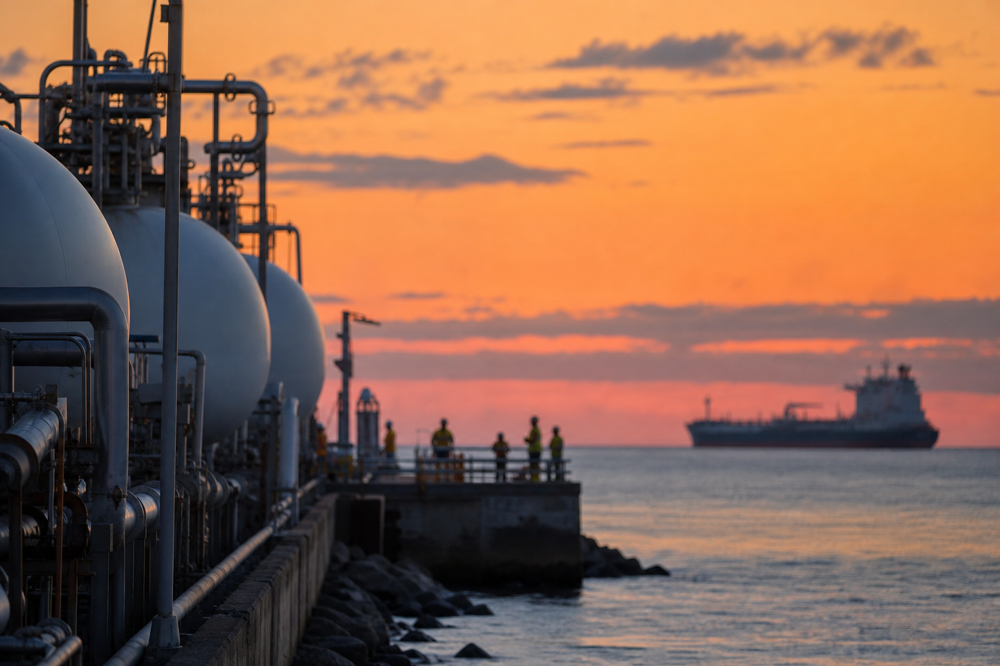

# [행정 규제] 미국 LNG 터미널 공사 허가 이야기 (feat. FERC 블랭킷 승인)

> 📜 **Authorizations for Certain Activities at Liquefied Natural Gas Plants**
> 원안 전문: https://www.federalregister.gov/d/2026-21443

✅ 제안 → 🔵 **의견수렴** → ⬜ 심사·작성 → ⬜ 확정 공포 → ⬜ 시행

| 단계 | 상태 | 날짜·비고 |
|---|---|---|
| ① 제안 공포 | ✅ 완료 | 2026-10-20 |
| ② 의견수렴 | 🔵 **지금 여기** | ~2026-12-21 마감 |
| ③ 확정안 심사·작성 | ⬜ 아직 |  |
| ④ 확정(Final Rule) 공포 | ⬜ 아직 |  |
| ⑤ 시행 | ⬜ 아직 |  |

---

1. LNG(액화천연가스)는 천연가스를 액체 형태로 만든 것으로, 미국은 이것을 전용 수출 터미널에서 배에 실어 해외로 내보냄.

2. 이런 LNG 터미널을 지어도 되는지, 고쳐도 되는지 허가해 주는 기관이 FERC(연방에너지규제위원회)임.

3. 지금까지는 잘 돌아가고 있는 터미널에서 낡은 장비 하나를 새것으로 바꾸는 일조차 FERC에 서류를 내고 개별 허가를 받아야 하는 경우가 많았음.

4. 가스를 나르는 파이프라인 쪽에는 1982년부터 자잘한 공사를 미리 묶어서 허가해 주는 편한 제도가 있었지만, LNG 플랜트는 복잡하고 위험한 설비라는 이유로 그 제도에서 두 번 빠졌음.

5. 그 사이 미국은 2023년 세계 최대 LNG 수출국이 됐고, FERC에는 2006년 이후 100건 넘는 심사 경험이 쌓였음.

6. 그래서 FERC가 2026-10-20에 'LNG 플랜트에도 같은 편의를 주자'는 규칙안을 공포했고, 지금은 2026-12-21 마감으로 의견을 받는 단계임.

7. 뼈대는 블랭킷(포괄) 승인, 즉 공사 하나하나 허가받는 대신 '이 범위 안의 공사는 해도 좋다'고 미리 통째로 내주는 허가임.

8. 구조는 2단계인데, 승인된 용량을 늘리지 않고 기존 부지 범위(footprint, 설비가 이미 허가받아 차지하고 있는 땅의 범위)와 설계 한계 안에 있는 장비 교체·개조는 자동승인됨.

9. 그보다 큰 변경은 사전통지(공사 전에 미리 알리고 정해진 기간을 기다리는 절차)를 거치는데, 부지 안의 큰 변경은 60일, 부지 밖에 새 액화트레인·LNG 탱크·선박 접안시설을 짓는 것은 90일을 기다림.

10. 그 기간에 이의가 제기되어 철회되거나 기각되지 않으면 그 사업만 예전 방식인 건별 심사로 돌아가고, 이의가 없으면 기간이 끝난 뒤 공사를 진행할 수 있음.

11. 파이프라인 제도와 달리 공사비 상한은 두지 않아, 돈이 많이 드는 공사라도 범위 요건만 맞으면 블랭킷 대상임.

12. 수출입 터미널(천연가스법 섹션 3이 적용되는 쪽)만이 아니라 미국 안에서 쓰는 LNG 저장·피크셰이빙(가스 수요가 몰리는 때를 대비해 평소에 LNG를 저장해 뒀다 꺼내 쓰는 방식) 설비(같은 법 섹션 7이 적용되는 쪽)에도 같은 제도를 적용하자는 제안임.

13. 확정되면 가동 중 터미널의 장비 교체·효율 개선·병목 해소 공사를 건별 허가 없이 자동승인 또는 60일·90일 대기만으로 할 수 있게 됨 → 인허가 비용과 지연이 줄고 용량 증대가 빨라짐.

14. 현재 가동 중인 미국 대형 LNG 수출터미널은 7곳, 건설 중은 8곳으로, 수혜 쪽은 미국 LNG 수출터미널 운영업 (Cheniere, Woodside 등)임.

15. EPC는 설계(Engineering)·조달(Procurement)·시공(Construction)을 한 회사가 통째로 맡는 방식, 또는 그런 플랜트 건설업체를 가리키는 말임. 노후 설비 교체, 누출·화재가스 감지 업그레이드, 오염제어·배출모니터링 장치 설치 같은 공사가 허가 대기 없이 바로 집행 가능해짐 → LNG 플랜트 기자재·안전계측·배출제어 장비 및 EPC 업계의 장비와 시공 발주가 앞당겨짐.

16. 주간(州間) LNG 저장·피크셰이빙 가스 저장업도 일상적 개보수의 인허가 부담이 줄어드는 쪽임.

17. 반면 개보수 건마다 생기던 건별 인허가 자문·환경검토 일감이 구조적으로 줄어, 에너지 인허가·규제대응 법률 및 환경영향평가 대행 서비스업은 부담 쪽임. 다만 사전통지와 이의제기 대응이라는 새 일감이 일부를 메워 타격은 약한 편임.

18. 단서도 있는데, 아직 '제안' 단계이고 최종 확정 뒤에도 주정부·환경단체의 소송으로 시행이 늦어질 수 있음.

19. 지켜볼 것은 먼저 2026-12-21 의견 마감까지 주 법무장관·환경단체의 반대 강도, 그리고 업계가 공사비 상한을 두지 않는 방침 유지와 변경 보고(Change Reporting) 제도 유지를 추가로 요구하는지임.

20. 다음은 FERC 최종규칙 공포인데, 자동승인 범위에 용량을 늘리는 우프레이트(설비를 새로 짓지 않고 기존 설비의 처리 능력을 끌어올려 생산 용량 자체를 늘리는 작업)가 포함되는지, 사전통지 기간과 섹션 7 적용 조건이 어떻게 확정되는지를 봐야 함.

21. 이 최종규칙 공포 여부를 확인해 볼 시간대는 2027년 상반기~중반임.

22. 최종규칙 공포 후 60일 이내에 주정부·환경단체가 재심 청구(rehearing, 확정된 결정을 다시 심사해 달라는 요구)나 항소법원 제소를 하는지가 시행을 늦출 수 있는 최대 변수임.

23. 최종규칙 시행 후 첫 2개 분기에는 Cheniere 등 LNG 운영사의 실적발표·보도자료에서 블랭킷 승인을 활용한 디보틀넥(공장에서 생산 속도를 가로막는 병목 구간을 고쳐서, 큰 증설 없이 생산량을 늘리는 작업)·우프레이트 계획이 언급되는지 확인할 만함.

24. 첫 영향이 나타나는지 확인해 볼 시점은 2027년 4분기임.

**한 줄 코멘트**: 새 터미널을 짓는 것보다 눈에 덜 띄지만 기존 설비에서 더 뽑아내는 길을 넓혀 주는 규칙안이라, 확정 내용과 소송 변수를 같이 지켜볼 만함.

---

**영향 산업 한눈에**

| 산업 | 방향 |
|---|---|
| 미국 LNG 수출터미널 운영업 (Cheniere, Woodside 등) | 🟢 수혜 |
| LNG 플랜트 기자재·안전계측·배출제어 장비 및 EPC 업계 | 🟢 수혜 |
| 주간(州間) LNG 저장·피크셰이빙 가스 저장업 | 🟢 수혜 |
| 에너지 인허가·규제대응 법률 및 환경영향평가 대행 서비스업 | 🔴 부담 |

---

**용어**
- **FERC(연방에너지규제위원회)**: 미국에서 전력망·가스 파이프라인·LNG 터미널 같은 에너지 설비의 건설과 운영을 허가하는 연방 기관입니다. 이번 규칙안을 만든 주체입니다.
- **블랭킷(포괄) 승인**: 공사 하나하나 허가받는 대신, '이 범위 안의 공사는 해도 좋다'고 미리 통째로 내주는 허가입니다. 담요(blanket)처럼 넓게 덮는다는 뜻에서 온 말입니다.
- **사전통지(prior notice)**: 공사를 시작하기 전에 '이런 공사를 하겠다'고 미리 알리고 정해진 기간(여기서는 60일 또는 90일)을 기다리는 절차입니다. 그동안 반대가 없으면 그냥 진행할 수 있습니다.

---

### ⚠️ 이 글은 투자 권유 목적이 아니며, 투자에 대한 책임은 본인에게 있습니다.

_이 글은 AI의 도움을 받아 작성한 글이며, 대표 이미지는 AI가 생성한 이미지입니다._
