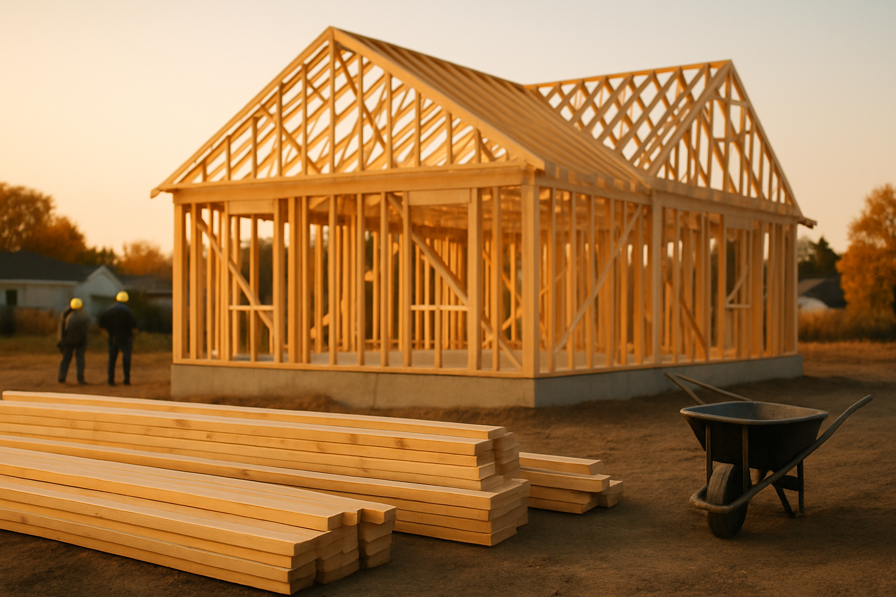

# [미국 지표] 주택착공건수 발표 — 10/20(화) 한국시간 밤 9:30

> 10/20(화) 한국시간 밤 9:30 (서머타임 해제 시 10:30) · 미국 센서스국·주택도시개발부 · 월간 · _이 코너는 예상치를 싣지 않습니다_

---

오늘 밤에는 미국의 주택착공 지표가 나옵니다. 센서스국과 주택도시개발부가 매달 발표하는 건데요, 한 달 동안 미국에서 '첫 삽을 뜬' 새 주택이 몇 채인지를 세어 연간 속도로 환산한 숫자입니다. 이게 왜 중요하냐면, 주택은 금리에 가장 민감한 실물 경기이기 때문인데요. 대출(모기지) 금리가 오르내리는 효과가 제일 먼저 찍히는 곳이고, 집 한 채를 짓기 시작하면 건자재·가전·가구 수요로 번지는 파급도 큽니다. 그래서 이 숫자가 계속 줄면 '높은 금리가 실물 경기를 조이고 있다'는 신호로, 반대로 살아나면 '금리 부담 속에서도 집을 사려는 실수요가 버티고 있다'는 신호로 읽힙니다.

먼저 최근 흐름부터 보겠습니다. 올해 주택착공은 꽤 울퉁불퉁했는데요. 3월 152만 2천 호(연율 환산)였던 착공이 5월 118만 2천 호까지 미끄러졌다가, 6월 143만 9천 호로 크게 되살아났습니다. 그런데 7월 130만 9천 호, 8월 127만 5천 호로 다시 두 달 연속 줄었습니다. 한 번 반등했다가 다시 내리막, 이 패턴이 반복되는 모양새입니다.

**주택착공 (연율 환산, 천 호)**

| 2026-03 | 2026-04 | 2026-05 | 2026-06 | 2026-07 | 2026-08 |
|---|---|---|---|---|---|
| 1,522 | 1,414 | 1,182 | 1,439 | 1,309 | **1,275** |

이번 발표의 관전 포인트는 하나입니다. 6월 반등 뒤 두 달 연속 이어진 감소가 석 달째로 길어지는지, 아니면 여기서 끊기는지인데요. 숫자가 더 줄면 '금리 부담이 집 짓는 경기를 본격적으로 조이고 있다'는 쪽에 힘이 실리고, 반대로 내리막이 멈추면 6월처럼 일시적인 출렁임이었다는 해석이 가능해집니다. 다만 이 지표는 날씨 영향 등으로 원래 월별 출렁임이 심한 편이라, 한 달 숫자 하나에 너무 큰 의미를 두기는 어렵다는 점은 염두에 두셔야 합니다.

📈 착공이 살아나면 — 금리 부담 속에서도 실수요가 버틴다는 뜻이라 건설주·건자재·가전에 순풍이고, 경기가 큰 충격 없이 식는다는 '연착륙' 논거가 강해집니다. 게다가 주택 공급이 늘면 1~2년 뒤 집세(물가지표인 CPI의 주거비 항목)를 눌러주기 때문에, 물가에는 장기적으로 우호적입니다. 📉 반대로 착공이 계속 줄면 — 고금리, 그러니까 연준(미국 중앙은행)이 돈값을 높게 유지하는 긴축이 실물을 조이고 있다는 가장 선명한 증거가 됩니다. 당장은 건설·건자재 업종부터 아픈데, 몇 분기 뒤에는 지어둔 집이 모자라 집값과 집세를 다시 밀어 올리는 역설이 생길 수 있다는 점도 함께 보셔야 합니다.

같이 보면 좋은 것도 짚어두겠습니다. 첫째, 전체 숫자보다 단독주택 착공인데요, 아파트 쪽은 변동이 큰 편이라 단독주택 착공이 실수요 추세를 더 잘 보여줍니다. 둘째, 같이 발표되는 건축 허가입니다. 허가는 착공보다 한 발 앞선 선행 지표라서, 착공이 줄어도 허가가 버티면 그림이 달라집니다. 읽는 요령은 간단합니다 — 이 지표는 한 달 숫자 자체보다 '몇 달째 어느 방향으로 가고 있나'를 보는 것이 핵심입니다.

---

_이 글은 AI의 도움을 받아 작성한 글이며, 대표 이미지는 AI가 생성한 이미지입니다._
