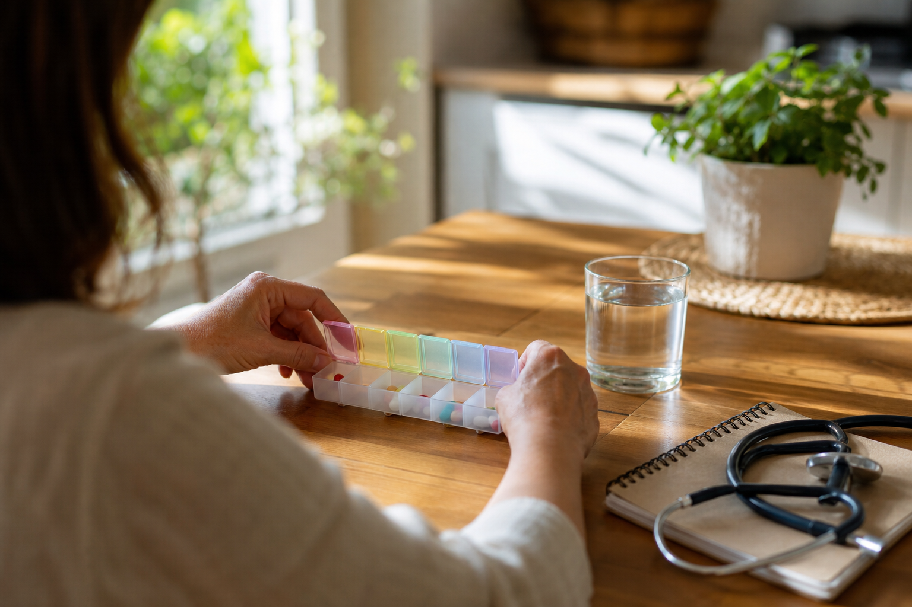

# [행정명령] 미국 여성건강 행정명령 이야기 (feat. NIH 여성건강국, 돈줄은 의회)

> 📜 **Advancing Women's Health To Improve Outcomes in All Phases of Life**
> 원안 전문: https://www.federalregister.gov/d/2026-21666

✅ 서명 → ✅ 발효

| 단계 | 상태 | 날짜·비고 |
|---|---|---|
| ① 서명·공포 | ✅ 완료 | 서명 2026-10-19 · 관보 2026-10-22 |
| ② 발효 | ✅ 완료 | 서명 즉시 발효 (전문에 별도 발효일 없음) |

---

1. 미국 대통령에게는 행정명령(의회 통과 없이 연방정부 조직에 직접 내리는 지시)이라는 도구가 있음.

2. 서명하는 순간 바로 효력이 생기지만, 돈이 필요한 일은 의회가 예산을 줘야 실행됨.

3. 생의학이 상당히 발전했는데도, 심혈관질환·암·자궁내막증·불임·폐경처럼 여성에게 불균형적으로 또는 여성에게만 영향을 미치는 질환들은 다른 질환만큼의 연구·임상 관심을 받지 못했다는 문제의식이 이번 명령의 배경임.

4. 전임 행정부도 2024년에 비슷한 행정명령(14120호)을 냈는데, 이번 명령은 그것을 폐지하고 자기 식의 새 체계로 갈아끼우는 것임.

5. 2026년 10월 19일 대통령이 여성 건강 연구를 연방정부의 공식 우선순위로 올리는 행정명령에 서명했고, 서명 즉시 발효됐음. 관보 공고일은 2026년 10월 22일임.

6. 핵심 지시는 두 가지 조직을 만드는 것임.

7. 보건복지부 장관은 서명 후 90일 안에(2027년 1월 17일경까지) NIH(국립보건원, 미국 보건복지부 산하의 의학 연구 기관) 안에 여성건강국이라는 전담 조직을 설치해야 함.

8. 여성건강국은 연구가 부족했던 여성질환 연구를 조정하고, 진단에 걸리는 시간을 줄이는 기술과 개인맞춤의학을 밀어주고, 임상시험에 여성 참여를 늘리는 일을 맡음.

9. 또 하나는 보건복지부 장관과 백악관 비서실장이 공동 의장을 맡는 백악관 여성건강 태스크포스(여러 부처에서 사람을 모아 흩어진 일을 한곳에서 조율하는 임시 조직)의 신설임.

10. 태스크포스에는 FDA·CDC·CMS 등 여러 부처가 참여해, 예방·치료 중심으로 연구 보조금(정부가 연구기관에 주는, 갚을 필요가 없는 지원금)을 우선 배정하고 연구 결과가 진료 현장에 빨리 쓰이도록 하며 민간 투자를 끌어들이는 역할을 함.

11. 보조금은 영유아기부터 폐경·노년기까지 전 생애주기에 걸친 예방·치료·장기 건강 연구에 우선 배정됨.

12. 임상시험에 여성과 소녀의 참여를 늘리고, 성별에 따른 건강 차이를 더 잘 파악하는 데이터 수집 방법을 지원하라고도 명시됐음.

13. NIH 돈을 받아 연구하는 기관들은 '성별을 생물학적 변수로 반영하라'는 기존 정책을 지킬 책임이 더 무거워짐.

14. 단, 이 명령은 예산의 가용성을 조건으로 이행된다고 적혀 있어, 의회가 세출(의회가 '이 일에 이만큼 돈을 써도 된다'고 법으로 정해 주는 것)을 주지 않으면 집행 규모는 제한됨.

15. 돈의 흐름을 보면, 여성질환 신약·치료법 개발 가속이 연방정부의 공식 목표가 되면서 제약·바이오(여성질환 신약 개발)에는 NIH 연구비와 임상 수요가 이쪽으로 이동하는 순풍이 됨.

16. 단, 실제 자금 규모는 의회 예산에 달려 있어 즉시 매출로 이어지는 것은 아님.

17. 신설 여성건강국의 임무에 '진단까지 시간 단축'과 '개인맞춤의학 접근성 개선'이 직접 적혀 있어, 진단·정밀의료(개인맞춤의학) 기기·서비스에 대한 연방 연구·조달 수요가 생길 수 있음.

18. 제약회사 대신 신약 임상시험을 설계하고 진행해 주는 전문 회사인 임상시험 수탁기관(CRO)도 여성 대상 임상시험을 설계·수행하는 일감이 늘어날 수 있는 수혜 분야임.

19. 예방·치료·장기 건강 중심으로 보조금을 우선 배정한다고 명시돼, 대학·의학연구기관(NIH 보조금 수혜)의 여성건강 분야 보조금 수주 기회가 커짐.

20. 의료서비스(1차·전문·행동건강 통합 진료, 여성 전문 클리닉)는 여성 중심 통합 진료 모델에 대한 교육·연구 지원과 파일럿 프로그램 가능성이 언급된 수준이라, 효과는 점진적이고 강도도 약한 편임.

21. 반대로 대학·학술연구기관(기존 NIH 과제 수행 기관)은 연구설계·보고 부담이 추가되고, 여성건강 분야로 우선순위가 쏠리면 다른 분야 과제의 몫이 상대적으로 줄 수 있음. 다만 이쪽 부담의 강도는 약한 편임.

22. 지켜볼 것 하나는 NIH 여성건강국 설치 공고임. 시한은 2027년 1월 17일까지이고, 어느 연구소 소속인지와 조직 규모·배정 예산이 얼마인지가 포인트임.

23. 2026년 4분기부터 2027년 1분기 사이에는 백악관 여성건강 태스크포스의 첫 회의·공청회 개최와 부처 간 파일럿 프로그램 발표가 나오는지 지켜볼 대목임.

24. 신규 보조금 공고와 세출 반영은 2027년 상반기 세출 심의 시즌에 확인할 수 있고, 실질 영향 관찰의 기준 분기는 2027년 3분기임.

**한 줄 코멘트**: 행정명령이 방향은 정했지만 돈줄은 의회가 쥐고 있음. 진짜 신호는 2027년 상반기 세출 심의 시즌에 보조금 공고와 세출 반영이 나오는지임.

---

**영향 산업 한눈에**

| 산업 | 방향 |
|---|---|
| 제약·바이오(여성질환 신약 개발) | 🟢 수혜 |
| 진단·정밀의료(개인맞춤의학) 기기·서비스 | 🟢 수혜 |
| 임상시험 수탁기관(CRO) | 🟢 수혜 |
| 대학·의학연구기관(NIH 보조금 수혜) | 🟢 수혜 |
| 의료서비스(1차·전문·행동건강 통합 진료, 여성 전문 클리닉) | 🟢 수혜 |
| 대학·학술연구기관(기존 NIH 과제 수행 기관) | 🔴 부담 |

---

**용어**
- **행정명령**: 미국 대통령이 의회 통과 없이 연방정부 조직에 직접 내리는 지시. 서명 즉시 효력이 생기지만, 돈이 필요한 일은 의회가 예산을 줘야 실행된다.
- **NIH(국립보건원)**: 미국 보건복지부 산하의 의학 연구 기관. 연구기관에 보조금을 주어 의학 연구를 지원하며, 이번 명령으로 그 안에 여성건강국이 새로 설치된다.
- **세출(예산 배정)**: 의회가 '이 일에 이만큼 돈을 써도 된다'고 법으로 정해 주는 것. 미국에서는 대통령이 명령을 내려도 세출이 없으면 돈을 쓸 수 없다.

---

### ⚠️ 이 글은 투자 권유 목적이 아니며, 투자에 대한 책임은 본인에게 있습니다.

_이 글은 AI의 도움을 받아 작성한 글이며, 대표 이미지는 AI가 생성한 이미지입니다._
