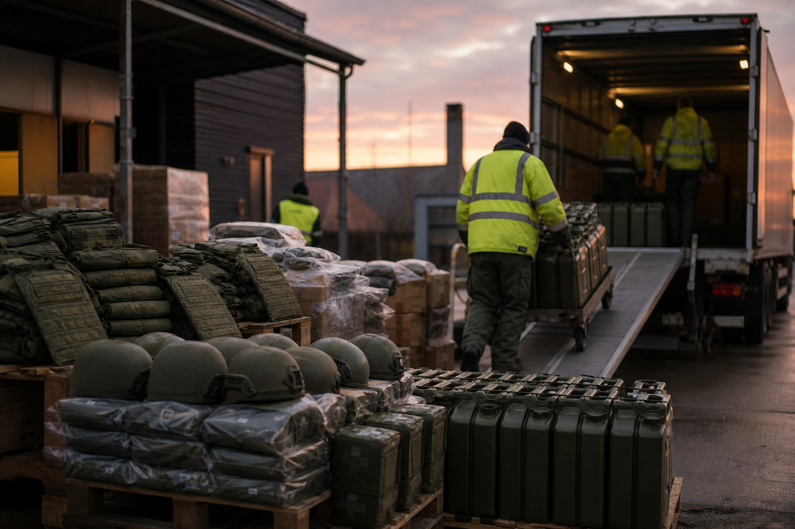

# [행정 규제] EU가 우크라이나군 지원 통장 한도를 늘린 이야기 (feat. 유럽평화기금, 방탄복·구급키트·연료)

> 📜 **Council Decision (CFSP) 2026/2365 of 26 October 2026 amending Decision (CFSP) 2022/339 on an assistance measure under the European Peace Facility to support the Ukrainian Armed Forces**
> 원안 전문: https://eur-lex.europa.eu/legal-content/EN/TXT/?uri=CELEX:32026D2365

✅ 채택 → ❔ 적용

| 단계 | 상태 | 날짜·비고 |
|---|---|---|
| ① 채택·공포 | ✅ 완료 | 2026-10-26 |
| ② 발효·적용 | ❔ 미확인 | 적용일 미확인 |

---

1. 2022년 2월, 러시아가 우크라이나를 침공하면서 전쟁이 시작됐음.

2. EU는 이보다 앞선 2021년에 유럽평화기금(EPF, 회원국들이 돈을 각출해 모아두고 다른 나라 군대의 군사·방위 역량 강화를 지원하는 데 쓰는 공동 기금)을 만들어 뒀음.

3. 침공 직후인 2022년 2월, EU는 이 기금으로 우크라이나군에 방탄복·구급키트·연료 같은 비살상 장비(사람을 해치는 용도로 설계되지 않은 군용 물자)의 비용을 대주는 지원조치(Decision 2022/339)를 만들었음.

4. 전쟁이 길어지면서 돈이 계속 더 필요해졌고 → 2023년에 한 번 증액한 데 이어 이번에 또 한 번 금액을 늘리게 됐음.

5. 2026년 10월 26일, EU 이사회가 이 지원조치의 재정참조액(이 지원에 쓰기로 정해 둔 돈의 상한선)을 늘리는 결정을 채택했고, 채택한 그날 바로 발효됐음.

6. 원래 상한선이 3억 8천만 유로였는데, 여기에 372,115,534.32유로를 더해 총 752,115,534.32유로가 됐음.

7. 늘어난 돈의 용도는 정해져 있는데, 개인보호장비·구급키트·연료처럼 살상력을 발휘하도록 설계되지 않은 장비와 물자를 우크라이나군에 제공하는 비용을 대는 것임.

8. 특이한 점은 소급 적용(규칙이 만들어진 날보다 앞선 과거 지출부터 효력을 인정해 주는 것)임.

9. 증액분은 2023년 6월 1일 이후 쓴 돈부터 인정되고, 유지·보수 비용은 2022년 10월 17일부터, 개장(refit, 이미 있는 장비를 고치거나 개조해 다시 쓸 수 있게 만드는 작업) 비용은 2023년 2월 2일부터 인정됨.

10. 즉 회원국들이 그동안 먼저 지출한 돈을 이 기금에서 돌려받는 구조에 가까움.

11. 기금 관리자는 결정 채택 즉시 회원국들에게 752,115,534.32유로 한도까지 분담금 소집(약속한 돈을 내 달라고 공식 요청하는 절차)을 할 수 있음.

12. 다만 실제로 돈이 나가는 것은 기금위원회(Facility Committee)가 승인한 예산 한도 안에서만 가능하고, 지원이 언제 끝날지는 이사회가 나중에 따로 정함.

13. 집행할 때는 EU의 무기수출 통제 원칙 등 기존 규칙을 지켜야 함.

14. 돈의 흐름을 보면, 회원국이 우크라이나에 보내는 물자의 구매 대금을 기금이 되갚아 주는 구조임.

15. 개인보호장비(방탄복·헬멧 등) 제조업은 증액분의 용도에 첫 번째 예시로 직접 거명됐고, 되갚아 주는 구조라서 해당 제조사의 수주로 바로 이어짐.

16. 의료기기·구급의료소모품 제조업도 구급키트가 지원 대상 품목으로 명시됐는데, 품목별 배분 금액이 본문에 없어 보호장비·연료와 예산을 나눠 갖는 만큼 수혜 강도는 중간 수준임.

17. 정유·군용 연료 공급업은 우크라이나군의 연료 조달 대금이 이 기금에서 상환되므로 유럽 연료 공급업체의 매출 요인이 됨.

18. 군용 장비 정비·수리(MRO) 서비스업도 유지·보수와 개장(refit) 지출이 기금에서 인정되는 비용으로 따로 규정돼 지급 대상에 들어가는데, 배분 금액이 본문에 없어 수혜 강도는 약한 편임.

19. 비용을 지는 쪽은 민간 산업이 아니라 EU 회원국 정부 재정(공공부문)이고, 본문상 민간 산업에 직접 비용을 지우는 조항은 없음.

20. 지켜볼 것 하나, 기금 관리자가 실제로 회원국들에게 분담금 납부를 요청하는지임(2026년 4분기, 채택 직후부터 가능).

21. 지켜볼 것 둘, 기금위원회의 예산 승인 내역임(2026년 4분기~2027년 1분기) — 실제로 쓸 수 있는 돈의 한도가 여기서 확정됨.

22. 추가 증액 결정이나 지원 종료일을 정하는 후속 이사회 결정이 나오는지, 그리고 유럽 보호장비·의료소모품·연료 공급사들의 우크라이나향 수주·납품 공시를 2027년 1분기 실적 발표 시즌에 확인해 볼 수 있음.

**한 줄 코멘트**: 통장 한도를 늘리는 결정이지만, 상당 부분은 이미 쓴 돈을 돌려주는 정산에 가까움. 새 수주가 얼마나 붙을지는 기금위원회의 예산 승인부터 확인할 일임.

---

**영향 산업 한눈에**

| 산업 | 방향 |
|---|---|
| 개인보호장비(방탄복·헬멧 등) 제조업 | 🟢 수혜 |
| 의료기기·구급의료소모품 제조업 | 🟢 수혜 |
| 정유·군용 연료 공급업 | 🟢 수혜 |
| 군용 장비 정비·수리(MRO) 서비스업 | 🟢 수혜 |
| EU 회원국 정부 재정(공공부문) | 🔴 부담 |

---

**용어**
- **유럽평화기금(EPF)**: EU 회원국들이 돈을 모아 두었다가, 다른 나라 군대의 군사·방위 역량 강화를 지원하는 데 쓰는 기금입니다. 회원국들이 각출한 분담금으로 채워지는 공동 주머니라고 보면 됩니다.
- **재정참조액**: 이 지원조치에 쓰기로 정해 둔 돈의 상한선입니다. 통장에 '여기까지만 채워 쓰겠다'고 그어 둔 금액이라고 보면 됩니다.
- **소급 적용**: 규칙이 만들어진 날보다 앞선 과거 시점부터 효력을 인정해 주는 것입니다. 이 결정에서는 과거에 이미 쓴 지원 비용도 기금에서 돌려받을 수 있게 했습니다.

---

### ⚠️ 이 글은 투자 권유 목적이 아니며, 투자에 대한 책임은 본인에게 있습니다.

_이 글은 AI의 도움을 받아 작성한 글이며, 대표 이미지는 AI가 생성한 이미지입니다._
