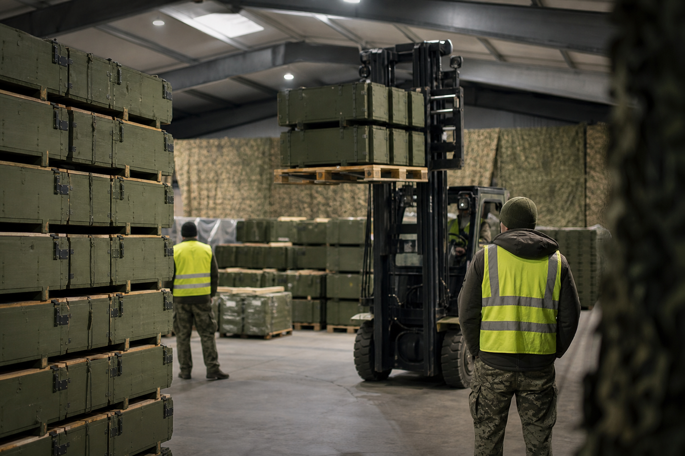

# [행정 규제] EU 우크라이나 무기값 상환 한도 증액 이야기 (feat. 유럽평화기금 21.79억 유로)

> 📜 **Council Decision (CFSP) 2026/2366 of 26 October 2026 amending Decision (CFSP) 2022/338 on an assistance measure under the European Peace Facility for the supply to the Ukrainian Armed Forces of military equipment, and platforms, designed to deliver lethal force**
> 원안 전문: https://eur-lex.europa.eu/legal-content/EN/TXT/?uri=CELEX:32026D2366

✅ 채택 → ❔ 적용

| 단계 | 상태 | 날짜·비고 |
|---|---|---|
| ① 채택·공포 | ✅ 완료 | 2026-10-26 |
| ② 발효·적용 | ❔ 미확인 | 적용일 미확인 |

---

1. 2022년 2월 러시아가 우크라이나를 전면 침공하자, EU는 같은 달 회원국의 무기 공여 비용을 되돌려 주는 지원 조치를 만들었음.

2. 그 돈주머니가 유럽평화기금(EPF, EU 회원국들이 돈을 모아 만든 공동 군사지원 기금)임.

3. 회원국이 자기 창고에 있던 무기를 우크라이나군에 건네면 → 나중에 EPF가 그 값을 되돌려 주는 방식임.

4. 전쟁이 길어지자 2024년에는 우크라이나 지원에만 쓰는 전용 주머니인 우크라이나 지원기금(UAF, 50억 유로)이 EPF 안에 따로 만들어졌음.

5. EU는 제재로 유럽 안에 묶어 둔 러시아 자산을 굴리는 과정에서 보관 기관에 생긴 특별 이익(동결자산 초과수익)을 거둬 우크라이나 지원 재원으로 돌리는 장치도 2024년에 마련해 두었음.

6. 2026년 10월 26일, EU가 이 지원 조치의 재정 기준액(이 조치에 쓸 수 있는 돈의 총 한도)을 올리는 결정을 채택했고, 채택 당일 바로 발효했음.

7. 이번에 늘어난 금액은 21.79억 유로이고, 이 돈은 우크라이나 지원기금(UAF)에서 나옴.

8. 이로써 조치 전체의 총 한도는 80억 유로를 넘는 수준이 됐음.

9. 지원 조치가 유지되는 기간도 채택일로부터 82개월로 연장됐음.

10. 쓰임새는 회원국이 우크라이나군에 공여한 살상용 군사장비와 플랫폼(무기를 실어 운용하는 몸체, 탑재체)의 비용 상환임.

11. 상환 대상이 되는 지출은 2022년 1월 1일부터 2024년 11월 15일 사이에 발생한 것으로, 앞으로 새 무기를 사는 돈이 아니라 이미 건넨 무기 값을 소급해서 갚아 주는 성격이 강함.

12. 지대지·포병 탄약과 미사일은 기존 재고를 내주거나 기존 주문 순서를 바꿔 공여한 몫도 별도로 상환해 줌.

13. 장비를 고치는 비용(유지·수리)은 2022년 10월 17일부터, 성능을 개선해 다시 쓸 수 있게 만드는 비용(개수, refit)은 2023년 2월 2일부터 적격 비용으로 인정됨.

14. 동결된 러시아 자산에서 나온 수익이 EPF에 들어오면 이 지원 조치에 계속 배분할 수 있다는 창구도 이번에 새로 열어 두었음.

15. 초과 수익을 거둬 가는 환수 장치 자체는 이번 결정보다 앞서 만들어진 선행 체계(이미 깔려 있던 기존 환수 장치)이고, 이 선행 체계의 초과 순이익 환수율은 99.7%임.

16. 돈의 흐름을 보면, 무기를 내준 회원국이 돈을 돌려받으면 → 빈 창고를 다시 채우려고 새 발주를 내는 구조임.

17. 특히 지대지·포병 탄약과 미사일의 재고 공여분 상환 재원이 확충돼 → 유럽 방위산업(탄약·미사일 제조)의 수주로 이어지는 구조임.

18. 공여 장비의 정비·개수 서비스를 수행하는 군수 정비·수리·개수(MRO) 업체도 EPF 상환 재원의 수혜를 받음.

19. 다만 상환이 집행된 뒤 기업 매출로 잡히기까지는 1~2분기가 걸림.

20. 반대로 중앙예탁결제·금융 인프라(CSD) 쪽을 보면, 동결자산 초과수익을 보유한 중앙예탁결제기관(주식·채권 같은 금융자산을 대신 보관하고 거래를 정산해 주는 기관)은 이익 환수가 지속되는 쪽임. 다만 환수 의무 자체는 선행 결정이 부과한 것이라, 이 결정이 더하는 부담은 제한적임.

21. 이제부터는 지켜볼 대목임. 먼저 EPF 예산을 승인하는 운영위원회(Facility Committee)가 2026년 4분기~2027년 1분기에 수정·연례 예산을 승인하면, 기준액 안에서 실제 지출 한도가 확정됨.

22. 동결자산 초과수익의 EPF 할당 비율은 매년 재검토되는데, 차기 재검토는 2027년 상반기임.

23. 회원국의 상환 집행과 유럽 방위산업(탄약·미사일 제조) 업체의 재고 보충 수주 공시가 2026년 4분기부터 2027년 분기 실적·수주 발표에 나오는지도 지켜볼 대목임.

**한 줄 코멘트**: 새 돈을 푸는 결정이라기보다, 이미 건넨 무기 값을 갚아 줄 한도를 올려 준 결정임. 환급받은 나라들의 창고 보충 발주가 실제 수주 공시로 이어지는지가 다음 확인 지점임.

---

**영향 산업 한눈에**

| 산업 | 방향 |
|---|---|
| 유럽 방위산업(탄약·미사일 제조) | 🟢 수혜 |
| 군수 정비·수리·개수(MRO) | 🟢 수혜 |
| 중앙예탁결제·금융 인프라(CSD) | 🔴 부담 |

---

**용어**
- **유럽평화기금(EPF)**: EU 회원국들이 돈을 모아 만든 공동 군사지원 기금. 회원국이 다른 나라에 무기를 주면 그 비용을 이 기금에서 되돌려 준다.
- **우크라이나 지원기금(UAF)**: EPF 안에 2024년 새로 만든, 우크라이나 지원에만 쓰는 전용 주머니. 이번 증액분 21.79억 유로가 여기서 나온다.
- **동결자산 초과수익**: 제재로 묶인 러시아 자산을 굴리는 과정에서 보관 기관에 생긴 특별 이익. EU는 이 이익의 대부분을 거둬 우크라이나 지원 재원으로 쓴다.

---

### ⚠️ 이 글은 투자 권유 목적이 아니며, 투자에 대한 책임은 본인에게 있습니다.

_이 글은 AI의 도움을 받아 작성한 글이며, 대표 이미지는 AI가 생성한 이미지입니다._
