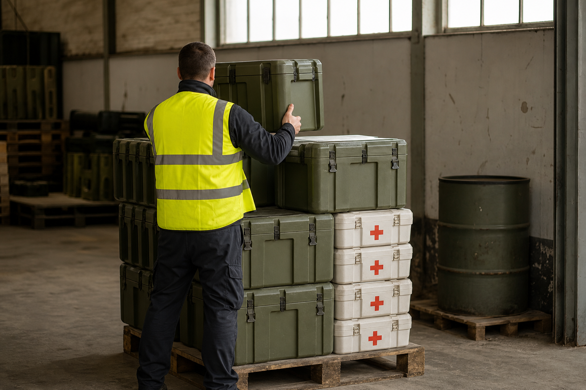

# [행정 규제] EU가 우크라이나군 물자 외상값을 갚는 이야기 (feat. 유럽평화기금 증액)

> 📜 **Council Decision (CFSP) 2026/2367 of 26 October 2026 amending Decision (CFSP) 2022/339 on an assistance measure under the European Peace Facility to support the Ukrainian Armed Forces**
> 원안 전문: https://eur-lex.europa.eu/legal-content/EN/TXT/?uri=CELEX:32026D2367

✅ 채택 → ❔ 적용

| 단계 | 상태 | 날짜·비고 |
|---|---|---|
| ① 채택·공포 | ✅ 완료 | 2026-10-26 |
| ② 발효·적용 | ❔ 미확인 | 적용일 미확인 |

---

1. 2022년 2월, 러시아가 우크라이나를 침공하면서 전쟁이 시작됐음.

2. EU는 회원국들이 분담금을 모아 꾸리는 공동 기금인 유럽평화기금(EPF, EU 본예산과는 별도로 운영되는 기금)으로 우크라이나를 지원해 왔음.

3. 그중 이번 결정이 다루는 지원수단은 총이나 포탄 같은 무기가 아니라, 방탄조끼·구급키트·연료처럼 사람을 지키고 군대를 움직이는 데 필요한 비살상 물자(살상용으로 만들지 않은 군수 물자)만 담당함.

4. 전쟁이 길어지면서 돈이 계속 더 필요해졌고 → EU는 2024년에 우크라이나 지원 전용 칸인 우크라이나지원기금(UAF)을 유럽평화기금 안에 새로 만들어 한도를 크게 늘렸음.

5. 같은 해, 동결된 러시아 자산을 보관하는 중앙예탁결제기관(CSD, 주식·채권을 금고처럼 맡아 보관하고 거래가 이뤄지면 주인을 바꿔 기록해 주는 금융기관)이 동결 상태에서 얻은 초과 순이익의 99.7%를 납부하게 됐음. 그 돈이 유럽평화기금으로 들어가도록 하는 장치도 만들어 뒀음.

6. 2026년 10월 26일, EU 이사회가 이 지원수단에 돈을 한 번 더 채워 넣는 결정을 채택했고, 채택한 날 바로 효력이 생겼음.

7. 이번에 우크라이나지원기금에서 추가로 들어가는 돈은 약 사억 이천만 유로임.

8. 같은 날 채택된 다른 결정의 증액분과 합치면, 이 지원수단이 쓸 수 있는 돈의 기준액은 총 약 십일억 칠천만 유로가 됨.

9. 이 돈의 쓰임새는 개인보호장비·구급키트·연료 같은 비살상 물자를 우크라이나군에 제공한 비용과, 예전에 접수된 상환(먼저 돈을 쓴 쪽에게 나중에 그 비용을 갚아 주는 것) 요청을 갚는 것으로 정해져 있음.

10. 갚아 줄 수 있는 지출은 2022년 1월 1일부터 2024년 11월 15일 사이에 생긴 것으로 한정됨.

11. 유지·보수와 개수(refit, 장비를 고쳐 다시 쓸 수 있게 만드는 것) 지출도 적격 비용에 들어가고, 이쪽의 적격 개시일은 2022년 10월 17일임.

12. 지원수단의 운영 기간은 처음 만들어진 2022년 원결정의 채택일로부터 82개월로 늘어났음.

13. 쉽게 말해 새 물건을 사는 돈이라기보다, 이미 납품된 물건의 외상값을 확실히 갚아 주는 돈에 가까움.

14. 돈의 흐름을 보면, 증액분이 개인보호장비·구급키트 조달 비용의 상환 재원으로 결정 본문에 명시되어 있어, 해당 물자를 공급한 개인보호장비·의료구급용품 제조업의 매출이 EU 공동재원으로 확정·보전됨.

15. 정유·연료 공급업도 결정 본문이 연료를 지원 대상 물자로 직접 열거하고 있어, 우크라이나군에 연료를 공급한 유럽 업체들이 같은 상환 재원의 직접 수혜자가 됨.

16. 군수 정비·수리(MRO) 서비스업은 장비 정비·개수 용역을 수행한 업체가 이 재원에서 비용을 상환받을 수 있음.

17. 부담 쪽을 보면, 이 돈은 회원국 분담금과 동결자산 수익에서 나오므로 민간 기업에 새 비용이나 규제를 지우는 조항은 없음.

18. 기권(표결에서 찬성도 반대도 하지 않는 것)을 공식 선언한 회원국은 이 비용을 나눠 내지 않음.

19. 동결 러시아 자산에서 생긴 수익이 유럽평화기금으로 들어오면, 이 지원수단이 그 돈을 받는 통로로 계속 열려 있음.

20. 지켜볼 것은 먼저 Facility Committee(기금 운영위원회)의 본 지원수단 관련 수정·연간 예산 승인과 상환 공고로, 2026년 4분기~2027년 1분기에 납품 업체들에게 실제로 돈이 언제 나가는지가 정해짐.

21. 동결 러시아 자산 수익의 유럽평화기금 배분 비율은 매년 재검토되고, 차기 재검토는 2027년 상반기임.

22. 개인보호장비·연료 납품 기업들의 미수금 회수와 매출 인식 공시가 2026년 4분기~2027년 2분기 실적 발표에서 확인되는지도 지켜볼 대목임.

**한 줄 코멘트**: 신규 수요를 만드는 결정이라기보다 이미 납품한 업체들의 미수금 회수가 확실해지는 결정이라, 실적 공시에서 상환이 실제로 확인되는지가 관전 포인트임.

---

**영향 산업 한눈에**

| 산업 | 방향 |
|---|---|
| 개인보호장비·의료구급용품 제조업 | 🟢 수혜 |
| 정유·연료 공급업 | 🟢 수혜 |
| 군수 정비·수리(MRO) 서비스업 | 🟢 수혜 |
| 해당 없음(비용 부담 주체는 EU 회원국 정부 — 민간 산업의 직접 비용 부담 조항은 본문에 없음) | 🔴 부담 |

---

**용어**
- **유럽평화기금(EPF)**: EU 회원국들이 분담금을 모아 꾸리는 공동 기금으로, EU 본예산과는 별도로 운영됩니다. 이번 결정의 지원수단은 이 기금(그중 우크라이나 전용 칸인 UAF)에서 돈을 받습니다.
- **우크라이나지원기금(UAF)**: 유럽평화기금 안에 2024년 새로 만든 우크라이나 전용 칸입니다. 우크라이나 지원에만 쓰도록 돈을 따로 떼어 둔 것입니다.
- **상환(reimbursement)**: 먼저 돈을 쓴 쪽에게 나중에 그 비용을 갚아 주는 것입니다. 이번 결정의 돈은 대부분 이미 납품·지출된 비용의 외상값을 갚는 용도입니다.

---

### ⚠️ 이 글은 투자 권유 목적이 아니며, 투자에 대한 책임은 본인에게 있습니다.

_이 글은 AI의 도움을 받아 작성한 글이며, 대표 이미지는 AI가 생성한 이미지입니다._
