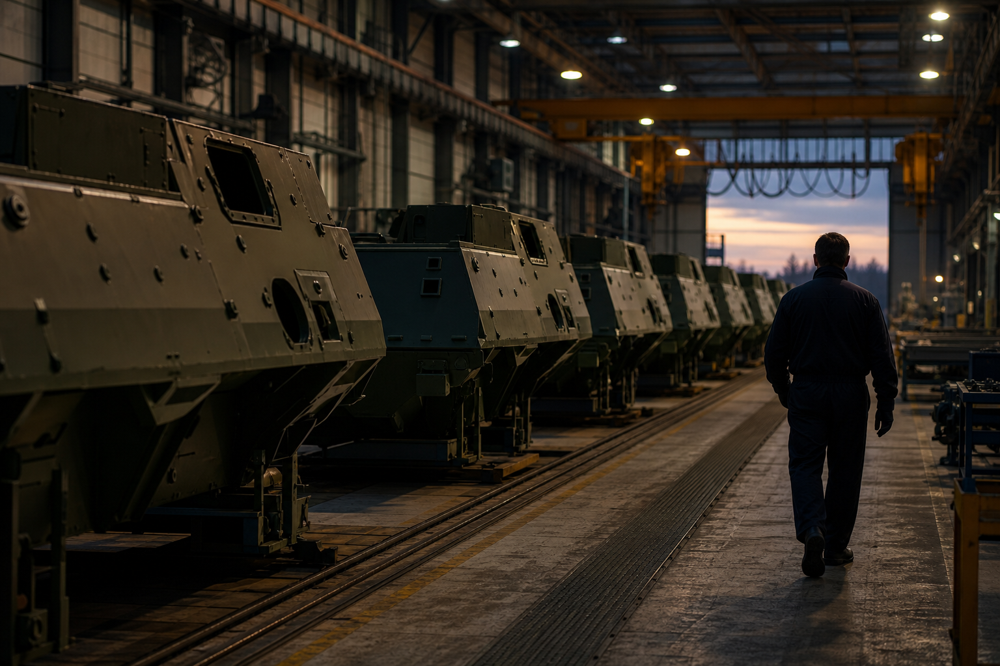

# [행정 규제] EU의 우크라이나군 무기 지원 예산 증액 이야기 (feat. 유럽평화기금 4억 유로)

> 📜 **Council Decision (CFSP) 2026/2368 of 26 October 2026 amending Decision (CFSP) 2022/2245 on an assistance measure under the European Peace Facility to support the Ukrainian Armed Forces trained by the European Union Military Assistance Mission in support of Ukraine with military equipment, and platforms, designed to deliver lethal force**
> 원안 전문: https://eur-lex.europa.eu/legal-content/EN/TXT/?uri=CELEX:32026D2368

✅ 채택 → ❔ 적용

| 단계 | 상태 | 날짜·비고 |
|---|---|---|
| ① 채택·공포 | ✅ 완료 | 2026-10-26 |
| ② 발효·적용 | ❔ 미확인 | 적용일 미확인 |

---

1. 1. 러시아의 군사 침략에 맞서 우크라이나의 영토 보전과 주권을 지키고 민간인을 보호하기 위해, EU 이사회는 2022년 11월 14일 우크라이나군 지원조치를 채택했음.

2. 2. EU는 EUMAM Ukraine(2022년에 만든 EU의 우크라이나 군사지원 임무로, 우크라이나 군인들을 훈련시킴)을 통해 훈련을 맡는데, 그 훈련에 쓸 무기와 장비를 대주는 것이 이 지원조치임. 돈은 유럽평화기금(EPF, EU 회원국들의 분담금으로 조달되는 EU 공동기금)에서 나옴.

3. 3. 2026년 6월 18일 유럽이사회는 우크라이나에 대한 확고한 지지를 재확인했음. 이번 결정은 그 연장선에서 지원조치에 돈을 더 붓고 기간을 늘리는 개정임.

4. 4. 2026년 10월 26일 EU 이사회가 이 개정을 담은 이사회 결정(EU 회원국 정부 대표들이 모인 '이사회'가 내리는 법적 결정)을 채택했고, 채택 즉시 발효했음.

5. 5. 핵심은 예산 증액으로, 재정 참조액(이 사업에 쓰기로 정해 둔 예산 한도)이 기존 2억 유로에서 2억 유로 늘어 총 4억 유로가 됐음. 지원조치 기간도 원결정 채택 시점부터 80개월(약 2029년 중반까지)로 연장됐음.

6. 6. 운영관리자는 회원국들에게 최대 4억 유로까지 분담금 소집(공동 기금의 관리자가 회원국들에게 약속한 돈을 내 달라고 공식 요청하는 것)을 할 수 있음. 다만 그 돈은 Facility Committee(EPF 운영위원회 — EPF 지출을 승인하는 위원회로, 이름이 비슷하지만 유럽연합 집행위원회와는 다른 기구)가 승인한 한도 안에서만 쓸 수 있음.

7. 7. 훈련이 완전히 끝나거나 EUMAM 임무가 종료되면, 지원된 탄약·군사장비·플랫폼(전차나 장갑차처럼 무기를 운반·발사하는 '몸체')의 관리권은 우크라이나로 넘어감. 꼭 끝까지 기다릴 필요는 없고, 각 훈련 과정에서 한 번 쓴 장비는 우크라이나의 필요에 따라 바로 넘길 수 있음.

8. 8. 돈의 흐름을 보면, EPF는 회원국이 내준 장비값을 보전해 주는 구조 → 그 장비를 만들어 납품하는 방산업체가 최종 수혜자임. 훈련용 군사장비·플랫폼을 사는 돈이 커지면서 유럽 방위산업(무기체계·치명적 플랫폼 제조)에 수혜가 되지만, 어느 회사가 얼마를 받을지는 아직 정해지지 않았음.

9. 9. 지원 품목에는 탄약이 명시돼 있고, 탄약은 훈련에서 쓰고 나면 우크라이나로 넘기는 소모품이라 계속 다시 사야 함. 다만 4억 유로 중 탄약 몫이 얼마인지는 본문에 없어서, 탄약 제조업의 수혜 강도는 약하게 봐야 함.

10. 10. 앞으로의 재원은 EU 차기 예산주기에서 EPF 전체 한도를 정하는 이사회 결정에 달려 있어, 추가 증액은 아직 확정이 아님. 그 논의는 2027년 중 EU 차기 예산주기 일정에서 이뤄지는데, 이것이 이 지원조치의 재원이 다시 검토되는 조건임.

11. 11. 지켜볼 것은 Facility Committee가 이 지원조치의 예산을 얼마나 승인하는지(2026년 4분기~2027년 1분기)와, 발효 직후인 2026년 11월부터 나올 수 있는 운영관리자의 회원국 분담금 소집 공고·규모(최대 4억 유로)임. 2027년 상반기부터는 유럽 방산업체들의 EPF·EUMAM 관련 수주·납품 공시와 회원국들의 장비 제공 발표도 분기별로 지켜볼 만함.

**한 줄 코멘트**: 전쟁이 길어지면서 EU의 지원도 단발성에서 수년짜리 장기 체제로 바뀌고 있다는 신호로 읽을 수 있음. 업체별 배분은 아직 미정이라, 실제 돈의 흐름은 앞으로 나올 수주·납품 공시에서 확인해 볼 필요가 있음.

---

**영향 산업 한눈에**

| 산업 | 방향 |
|---|---|
| 유럽 방위산업(무기체계·치명적 플랫폼 제조) | 🟢 수혜 |
| 탄약 제조업 | 🟢 수혜 |

---

**용어**
- **유럽평화기금(EPF)**: EU 회원국들의 분담금으로 조달되는 EU 공동기금. 우크라이나군 지원조치처럼 군사 지원이 필요할 때 이 기금에서 재원을 댄다.
- **EUMAM Ukraine**: EU가 2022년에 만든 우크라이나 군사지원 임무. 우크라이나 군인들을 훈련시키는 일을 한다.
- **Facility Committee(EPF 운영위원회)**: 유럽평화기금의 지출을 승인하는 위원회. 이 지원조치의 돈도 이 위원회가 승인한 예산 한도 안에서만 쓸 수 있다. 이름이 비슷하지만 유럽연합 집행위원회(European Commission)와는 다른 기구다.

---

### ⚠️ 이 글은 투자 권유 목적이 아니며, 투자에 대한 책임은 본인에게 있습니다.

_이 글은 AI의 도움을 받아 작성한 글이며, 대표 이미지는 AI가 생성한 이미지입니다._
