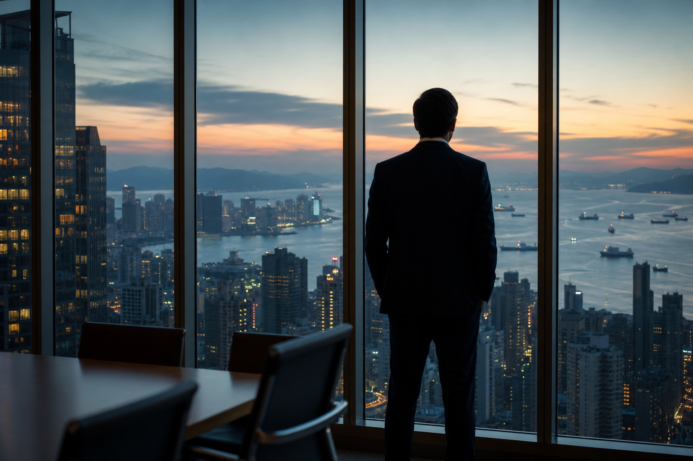

# [행정 규제] 미국 대외투자 심사 이야기 (feat. 초지능 투자 전면 금지)

> 📜 **Outbound Investment Security Program Regulations**
> 원안 전문: https://www.federalregister.gov/d/2026-21786

✅ 제안 → 🔵 **의견수렴** → ⬜ 심사·작성 → ⬜ 확정 공포 → ⬜ 시행

| 단계 | 상태 | 날짜·비고 |
|---|---|---|
| ① 제안 공포 | ✅ 완료 | 2026-10-26 |
| ② 의견수렴 | 🔵 **지금 여기** | ~2026-12-07 마감 |
| ③ 확정안 심사·작성 | ⬜ 아직 |  |
| ④ 확정(Final Rule) 공포 | ⬜ 아직 |  |
| ⑤ 시행 | ⬜ 아직 |  |

---

1. 미국에는 자국 돈이 외국 기업에 투자될 때 정부가 들여다보고 금지하거나 신고받는 대외투자 심사(아웃바운드 스크리닝)라는 제도가 있음.

2. 취지는 미국인의 투자금이 우려국(미국이 안보에 위험하다고 법으로 지정한 나라)의 첨단 무기나 감시 기술을 키우는 밑천이 되지 않게 하자는 것임.

3. 시작은 2023년 8월 9일 행정명령 14105로, 이 명령이 중국(홍콩·마카오 포함)을 우려국으로 지정하고 3개 기술 분야의 대외투자 통제를 지시했음.

4. 재무부는 2024년 11월 15일 Part 850 규정을 공포했고, 2025년 1월 2일부터 이 프로그램(OISP)을 실제로 돌려 왔음.

5. 21개월 동안 약 100건의 신고가 접수됐고 FAQ(자주 묻는 질문과 답)도 50건 넘게 나왔음.

6. 2025년 12월 18일에는 의회가 FY26 국방수권법(NDAA)의 일부로 COINS 법을 제정해 이 프로그램을 법률로 명문화하면서, 대상 국가·기술을 넓히고 비구속 피드백 절차·공개 데이터베이스 같은 새 장치도 도입하도록 했음.

7. 이번에 재무부가 2026년 10월 26일 공포한 것은 그 법을 실행하기 위한 세부 규정 초안(신설 Part 851)이고, 의견 제출 마감은 2026년 12월 7일임.

8. 뼈대는 두 갈래로, 신고 대상 기술에 투자하면 재무부에 신고해야 하고 금지 기술에 투자하면 투자 자체가 불법임.

9. 우려국이 중국 1개국에서 쿠바·이란·북한·러시아·베네수엘라를 더한 6개국으로 늘어남.

10. 대상 기술도 기존 반도체·AI·양자 3개에 고성능컴퓨팅(HPC)·슈퍼컴퓨팅과 극초음속 시스템이 추가돼 5개가 됐음.

11. 여기에 법에는 없던 바이오테크놀로지가 재무부 장관 재량으로 금지 기술에 추가됐는데, 우려국의 바이오 섹터가 그 나라들의 군사·정보·감시·사이버 역량을 가능하게 한다고 판단했기 때문임.

12. 초지능(SI) 시스템(사람의 지적 능력을 넘어서는 수준을 목표로 하는 AI)은 우려국의 역량이 빠르게 발전하고 있다는 판단 → 신고만 하면 되던 투자가 전면 금지로 격상됐음.

13. 규제에 걸리는 거래는 지분 인수, 지분 성격이 붙은 대출, 합작투자, 전환사채 전환(주식으로 바꿀 권리를 행사해 실제 주식을 취득하는 것), 우려국 안의 자산 취득, 펀드 LP 출자(펀드에 돈만 대고 운용에는 간섭하지 않는 투자) 등 사실상 돈을 대는 행위 대부분임.

14. 반대로 인수주선(기업이 발행한 주식·채권을 받아 투자자에게 파는 서비스), 은행 대출, 결제 처리, 프라임브로커리지(큰손 투자자에게 대출·거래·결제를 묶어 주는 종합 서비스), 글로벌 커스터디(해외 자산을 대신 보관·관리하는 서비스)는 명시적으로 빠졌음.

15. 소액(de minimis) 거래도 면제되는데, 그 기준 금액은 재무부 장관이 나중에 정함.

16. '몰랐다'는 변명이 통하지 않을 수 있는데, 거래 시점에 합리적이고 성실한 조사를 하지 않았다면 재무부가 '알았어야 했다'고 간주할 수 있음.

17. 과거로 거슬러 적용하지는 않고, 최종 규칙이 발효되기 전의 행위에는 기존 Part 850 규정이 그대로 적용됨.

18. 부담은 미국 벤처캐피털·사모펀드·자산운용·투자은행(대중화권 첨단기술 투자)에 집중되는데, 대상국·기술이 넓어진 데다 초지능 시스템과 양자는 전면 금지라 딜 포기, 실사 비용, 펀드 구조 재편 부담이 커짐.

19. 중국 등 우려국 반도체·AI·양자·HPC·극초음속 기업은 미국 자본과 그에 따라오는 네트워크·경영 노하우 유입이 끊기고, 금지 기술 분야 기업은 미국인 투자 자체가 불법이 됨.

20. 우려국 바이오테크놀로지 기업(및 이들에 투자하던 미국 바이오 전문 펀드)은 기존 Part 850에 없던 신규 차단 영역이라 직접 타격인데, 장관 재량 조치인 만큼 의견수렴 과정에서 범위가 조정될 여지는 지켜봐야 함.

21. 미국 대형은행(인수주선·대출·결제·프라임브로커리지·수탁)은 해당 서비스가 적용 제외라 규제 비용 없이 기존 사업을 유지하는데, 남이 막힐 때 나는 안 막힌다는 상대적 수혜라 강도는 약한 편임.

22. 1차 관전 포인트는 2026년 12월 7일 의견 제출 마감까지 업계가 초지능 전면금지·바이오 섹터 포함·소액 기준에 대해 얼마나 강하게 반발하는지임.

23. 다음은 최종 규칙에서 초지능 전면금지와 바이오 섹터 포함이 유지되는지, 소액 기준 금액과 발효일이 어떻게 확정되는지인데, 공포 시점은 2027년 상반기임. 다만 이 시점은 추정임.

24. 최종 규칙이 발효되면 비구속 피드백 절차, 공개 covered foreign person(규제 대상 외국인) 데이터베이스, FAQ·가이던스 발표, 재무부의 집행 사례, 그리고 미국 쪽 펀드 결성·철수 발표를 지켜보면 됨.

**한 줄 코멘트**: 법률 근거가 이미 확정된 만큼, 최종 규칙에서는 '시행 여부'가 아니라 '범위'가 쟁점이 될 가능성이 높음. 미국 돈이 나가는 문을 지키는 제도가 법률로 뿌리를 내려가는 중임.

---

**영향 산업 한눈에**

| 산업 | 방향 |
|---|---|
| 미국 대형은행(인수주선·대출·결제·프라임브로커리지·수탁) | 🟢 수혜 |
| 미국 벤처캐피털·사모펀드·자산운용·투자은행(대중화권 첨단기술 투자) | 🔴 부담 |
| 중국 등 우려국 반도체·AI·양자·HPC·극초음속 기업 | 🔴 부담 |
| 우려국 바이오테크놀로지 기업(및 이들에 투자하던 미국 바이오 전문 펀드) | 🔴 부담 |

---

**용어**
- **우려국 (country of concern)**: 미국이 '이 나라 첨단기술에 우리 돈이 흘러가면 안보에 위험하다'고 법으로 지정한 나라. 이번 초안에서는 중국(홍콩·마카오 포함)·쿠바·이란·북한·러시아·베네수엘라 6개국임.
- **초지능(SI) 시스템**: 사람의 지적 능력을 넘어서는 수준을 목표로 하는 AI 시스템. 이번 초안에서 우려국의 이 분야 개발에 대한 미국인 투자는 전면 금지됐음.
- **인수주선 (underwriting)**: 기업이 주식·채권을 발행해 자금을 모을 때 증권사·은행이 그 증권을 받아 투자자에게 파는 일을 맡아 주는 서비스. 그 과정에서 지분을 취득하더라도 이번 규제에서는 명시적으로 제외됨.

---

### ⚠️ 이 글은 투자 권유 목적이 아니며, 투자에 대한 책임은 본인에게 있습니다.

_이 글은 AI의 도움을 받아 작성한 글이며, 대표 이미지는 AI가 생성한 이미지입니다._
