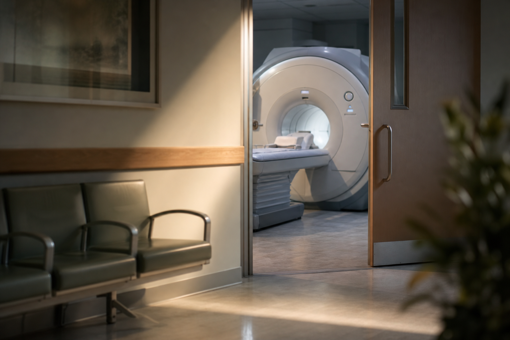

# [행정 규제] 아바나 증후군 보상 규칙 이야기 (feat. 법무부, 비과세 일시금)

> 📜 **Implementation of HAVANA Act of 2021**
> 원안 전문: https://www.federalregister.gov/d/2026-21923

❔ 제안 → ❔ 의견수렴 → ✅ 심사·작성 → ✅ 확정 공포 → 🔵 **시행 대기**

| 단계 | 상태 | 날짜·비고 |
|---|---|---|
| ① 제안 공포 | ❔ 미확인 | 초안 혈통 미확인 |
| ② 의견수렴 | ❔ 미확인 | — |
| ③ 확정안 심사·작성 | ✅ 완료 |  |
| ④ 확정(Final Rule) 공포 | ✅ 완료 | 2026-10-27 |
| ⑤ 시행 | 🔵 **지금 여기** | 2026-11-27 예정 |

---

1. 1. 2016년 쿠바의 수도 아바나에서 일하던 미국 국무부 직원들이 심한 두통과 청력 손실 같은 원인을 알 수 없는 증상을 호소하기 시작했음. 이 수수께끼 같은 병에 '아바나 증후군'이라는 별명이 붙었고, 정부 문서에서는 이상건강사건(AHI)이라고 부름.

2. 2. 2019년 세출법(의회가 '이 목적에 이만큼 쓰라'고 배정해 주는 예산 법)으로 국무부 직원에 대한 보상이 먼저 시작됐고, 2021년 HAVANA 법이 만들어지면서 모든 연방 기관이 자기 직원과 부양가족의 '자격 있는 뇌손상'을 보상할 권한을 받았음. 법은 큰 틀만 정했고, 실제로 누가 얼마를 어떻게 받는지는 기관마다 세부 규칙을 만들어야 함.

3. 3. 국무부가 먼저 규칙을 만들었고, 이번에 법무부(FBI 를 포함하는 부처)가 자기 직원용 규칙을 2026년 10월 27일에 최종 확정했음. 이번 규칙은 2024년에 잠정최종규칙(일단 시행하면서 동시에 국민 의견을 받는 규칙)으로 나왔다가, 의견이 없어 거의 그대로 확정된 것임.

4. 4. 시행일은 2026년 11월 27일임. 보상 대상은 법무부(FBI 포함)의 현직·전직 직원과 그 부양가족으로 한정되고, 민간 기업이나 다른 기관 사람은 해당되지 않음.

5. 5. 아무 뇌손상이나 되는 건 아니고, 영상검사(MRI 같은 사진 검사)로 확인되는 급성 손상이거나 12개월 이상 치료가 필요했던 외상성 뇌손상·지속 증상이어야 함. 신청 서류의 일부는 보드 인증 의사(전문 분야의 시험과 수련을 통과해 공식 자격을 인정받은 의사)가 직접 작성해야 함.

6. 6. 보상금은 딱 한 번 주는 비과세 일시금(세금을 떼지 않고 한 번에 목돈으로 주는 돈)이고, 연방 고위직 급여표의 Executive Schedule Level III(세 번째로 높은 등급) 연봉이 상한임. 기본(Base)은 그 연봉의 75%, 중증(Base+)이면 100%를 받음.

7. 7. 소급 적용 기준일도 종전 2016년 1월 1일에서 2001년 9월 11일 이후로 확대됐는데, 2025년 12월 18일 의회가 법을 개정한 결과임.

8. 8. 다만 의회가 이 목적으로 배정한 세출(appropriation) 예산이 있어야만 돈이 나가고, 신청한 순서대로(선착순) 지급됨. 거부되면 통지 후 60일 안에 이의를 제기할 수 있지만, 지급 금액에 관한 결정에는 불복할 수 없음.

9. 9. 돈의 흐름을 보면, 신청 서류 일부를 보드 인증 의사가 의무적으로 작성해야 하고 '12개월 이상 적극적 치료' 요건이 장기 진료를 전제로 함 → 의료 서비스(신경과·재활의학 전문의 진료)에 전문의 진단 수요가 생김. 뇌손상을 인정받으려면 영상검사에서 확인되는 소견이 핵심 증거임 → 신청자 1명당 의료 영상진단(MRI 등 뇌 영상검사) 수요가 따라옴.

10. 10. 다만 대상자가 법무부 직원·가족이라는 소수 집단이라, 산업 전체에 주는 영향은 미미함. 연간 총 재정 영향도 $100M 미만임.

11. 11. 지켜볼 것 하나는 FY2027 세출법에서 HAVANA Act 지급용 예산이 배정되는지임. 지급은 세출 예산에 전적으로 달려 있고, 세출 협상 시기는 2026년 12월에서 2027년 1월임.

12. 12. 또 하나는 DOJ·FBI 의 지급 승인 건수·규모 공개 또는 의회 보고임. 2027년 상반기에 실제 수혜 규모를 가늠할 수 있는 첫 지표가 됨.

**한 줄 코멘트**: 법무부 직원과 그 부양가족만을 위한 소규모 복지성 규칙이라 시장에 투자 포인트가 거의 없는 사안임. 신경과 진료·뇌 영상검사에 아주 작은 플러스가 있는 정도임.

---

**영향 산업 한눈에**

| 산업 | 방향 |
|---|---|
| 의료 서비스(신경과·재활의학 전문의 진료) | 🟢 수혜 |
| 의료 영상진단(MRI 등 뇌 영상검사) | 🟢 수혜 |

---

**용어**
- **아바나 증후군(이상건강사건)**: 2016년 쿠바 아바나의 미국 국무부 직원들이 처음 보고한 원인불명의 증상 묶음으로, 두통·청력손실 등이 나타납니다. 정부 문서에서는 '이상건강사건(AHI)'이라고 부릅니다.
- **Executive Schedule Level III**: 미국 연방 정부 최고위직들의 급여를 정해 둔 표에서 세 번째로 높은 등급의 연봉입니다. 이 규칙에서는 보상금이 넘을 수 없는 상한선 역할을 합니다.
- **세출(appropriation)**: 의회가 '이 목적에 이만큼 쓰라'고 법으로 배정해 주는 예산입니다. 이 예산이 없으면 보상 자격이 있어도 돈이 나가지 않습니다.

---

### ⚠️ 이 글은 투자 권유 목적이 아니며, 투자에 대한 책임은 본인에게 있습니다.

_이 글은 AI의 도움을 받아 작성한 글이며, 대표 이미지는 AI가 생성한 이미지입니다._
