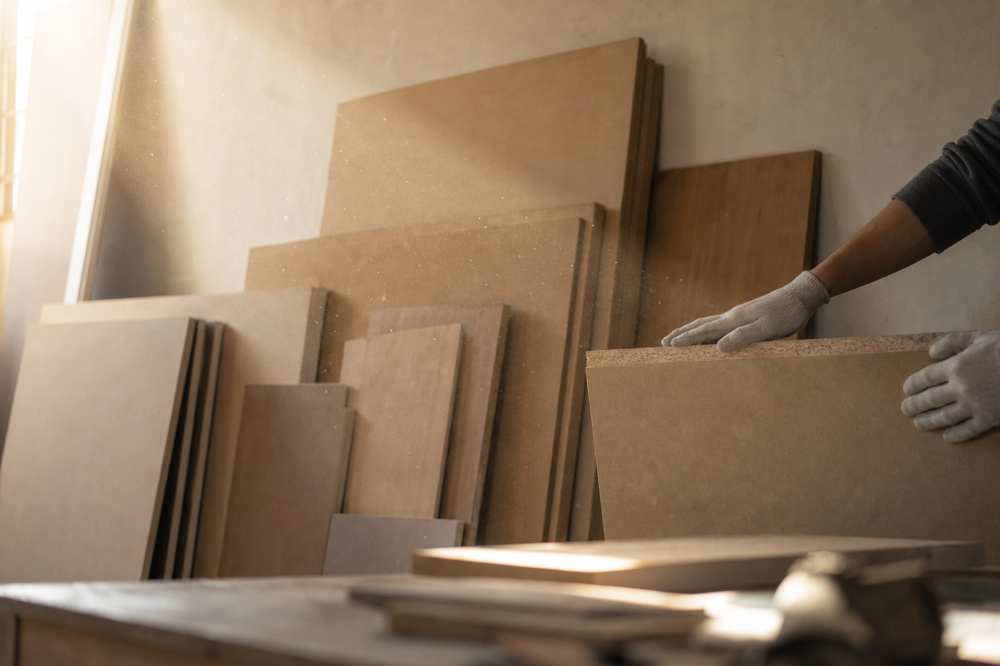

# [행정 규제] 미국 합판 포름알데히드 규제 이야기 (feat. 측정 표준 최신판 교체)

> 📜 **Voluntary Consensus Standards Update; Formaldehyde Emission Standards for Composite Wood Products**
> 원안 전문: https://www.federalregister.gov/d/2026-21963

❔ 제안 → ❔ 의견수렴 → ✅ 심사·작성 → ✅ 확정 공포 → 🔵 **시행 대기**

| 단계 | 상태 | 날짜·비고 |
|---|---|---|
| ① 제안 공포 | ❔ 미확인 | 초안 혈통 미확인 |
| ② 의견수렴 | ❔ 미확인 | — |
| ③ 확정안 심사·작성 | ✅ 완료 |  |
| ④ 확정(Final Rule) 공포 | ✅ 완료 | 2026-10-28 |
| ⑤ 시행 | 🔵 **지금 여기** | 2026-11-27 예정 |

---

1. 나무 가구나 합판에서 나는 톡 쏘는 냄새의 주범 중 하나가 포름알데히드(합판 접착제에 들어 있는 화학물질로, 많이 들이마시면 건강에 해로움)임.

2. 합판이나 섬유판 같은 복합목재(나무 조각이나 섬유를 접착제로 눌러 붙여 만든 판재)를 만들 때 쓰는 접착제에 들어 있는데, 완성된 제품에서도 조금씩 공기 중으로 새어 나옴.

3. 미국은 2010년에 복합목재 포름알데히드 표준법을 만들었고, 환경보호청(EPA)이 2016년 최종규칙으로 배출기준·시험·라벨링·제3자 인증까지 갖춘 지금의 제도를 수립했음.

4. 활엽수 합판, 중밀도 섬유판(MDF), 파티클보드 같은 복합목재 제품이 미국에서 팔리려면 포름알데히드 배출 기준을 지키고 제3자 인증기관(TPC, 제조사도 정부도 아닌 독립 기관으로 제품이 기준을 지키는지 시험하고 확인해 주는 곳)의 인증을 받아야 함.

5. 그런데 기준치 이상인지 재는 방법은 규정에 일일이 쓰는 대신 참조 인용(IBR, 외부 표준 문서를 가리켜 "이 표준을 따르라"고 하는 방식)으로 자발적 합의표준(ISO·ASTM 같은 민간 전문기관들이 업계와 합의해 만든 공식 측정 기준)을 빌려 씀.

6. 문제는 이 표준들이 몇 년마다 개정판이 나온다는 것이어서, 규제가 옛날 판을 계속 가리키고 있으면 현장과 어긋남 → 정부가 주기적으로 규정을 손봐 줘야 함.

7. EPA가 2026년 10월 28일, 이 규제가 인용하는 ANSI·ASTM·ISO·NIST 표준 6종을 각 표준기관이 낸 최신판으로 갱신하는 최종규칙을 공포했음.

8. 새로 추가된 것도 있는데, ISO 12460-2라는 품질관리 시험법을 쓰면 레이저 흡수 분광(레이저를 쏘아 공기 속 화학물질의 농도를 재는 방법) 같은 더 다양한 분석 방법을 선택할 수 있음.

9. 다만 이건 의무가 아니라 선택사항임.

10. 반대로 국제 표준과 내용이 똑같은 영국 표준(BS EN ISO 12460-3)은 두 개 있으면 헷갈린다는 이유로 허용 목록에서 삭제됐음.

11. EPA는 신판과 구판이 기술적으로 동일해 합격·불합격 판정이 달라질 일이 없다고 밝혔고, 그래서 적응 기간(전환기간)도 따로 주지 않음.

12. 시행일은 공포 30일 뒤인 2026년 11월 27일임.

13. 3개월마다 하는 정기 시험도 기존 방식 그대로여서, 대형 챔버 시험(ASTM E1333)이 기본이고 같은 결과가 나온다는 걸 입증(등가성 입증)하면 소형 챔버 시험(ASTM D6007)도 쓸 수 있음.

14. 행정부 분류상 이번 조치는 규제를 더하는 게 아니라 부담을 덜어 주는 탈규제 조치(낡거나 중복된 부분을 걷어내 기업 부담을 줄이는 방향의 조치)임. 의견수렴에서 들어온 관련 의견도 전부 찬성이었음.

15. 돈의 흐름을 보면, 복합목재(활엽수 합판·MDF·파티클보드) 제조·수입업은 갱신된 최신판 표준을 지켜야 하는 직접 규제 대상이지만, EPA가 신판과 구판이 동일해 추가 비용이 없다고 명시해 실질적인 부담 증가는 사실상 없음.

16. 가구·조립주택·RV 등 복합목재 사용 완제품 제조업도 표준 갱신의 준수 의무가 공급망을 따라 미치지만, 역시 신·구판이 동일해 비용 변화는 없음.

17. 시험·인증 서비스(제3자 인증기관 TPC·시험소)는 인증·분기시험 체계가 그대로 유지돼 최신판 대응과 등가성 입증 수요가 계속 발생하는데, 새 수입이 생긴다기보다 기존 수입원이 유지되는 쪽에 가까움.

18. 분석·계측 장비(레이저 흡수 분광 등)는 제조사나 시험소가 새 시험법을 채택하면 장비 수요가 소폭 생길 수 있지만, 선택사항이라 강제 수요는 아님.

19. 지켜볼 것은 2026년 11월 27일 발효 때 개정된 40 CFR Part 770(신판 표준 적용, ISO 12460-2 추가, 영국 표준 삭제)이 예정대로 적용되는지임.

20. EPA가 예고한 '중대한 변경'(등가성을 다시 입증해야 하는 경우)의 추가 예시가 2027년 중 나오는지도 시험소의 운영 부담과 관련해 지켜볼 부분이고, ISO·ASTM이 다음 개정판을 내면 EPA가 후속 인용 갱신에 착수하는지도 같은 맥락임.

**한 줄 코멘트**: 규제 내용은 그대로 두고 측정 설명서만 최신판으로 바꾸는 정기 정비임. EPA 스스로 추가 비용이 없다고 못 박은 만큼, 어느 업종에도 주가를 움직일 재료는 아님.

---

**영향 산업 한눈에**

| 산업 | 방향 |
|---|---|
| 시험·인증 서비스(제3자 인증기관 TPC·시험소) | 🟢 수혜 |
| 분석·계측 장비(레이저 흡수 분광 등) | 🟢 수혜 |
| 복합목재(활엽수 합판·MDF·파티클보드) 제조·수입업 | 🔴 부담 |
| 가구·조립주택·RV 등 복합목재 사용 완제품 제조업 | 🔴 부담 |

---

**용어**
- **포름알데히드**: 합판·섬유판을 만들 때 쓰는 접착제에 들어 있는 화학물질. 완성된 제품에서 공기 중으로 조금씩 새어 나오는데, 많이 들이마시면 건강에 해로워 각국이 배출량을 규제한다.
- **참조 인용(IBR)**: 법 조문에 측정 방법을 일일이 쓰는 대신 "ASTM 몇 번 표준을 따르라"고 외부 표준 문서를 가리키는 방식. 그래서 표준의 개정판이 나오면 법이 가리키는 판도 갱신해 줘야 한다.
- **자발적 합의표준**: 정부가 아니라 ISO·ASTM 같은 민간 전문기관들이 업계와 합의해 만든 공식 측정·품질 기준. 정부 규제가 이를 빌려 쓰는 경우가 많다.

---

### ⚠️ 이 글은 투자 권유 목적이 아니며, 투자에 대한 책임은 본인에게 있습니다.

_이 글은 AI의 도움을 받아 작성한 글이며, 대표 이미지는 AI가 생성한 이미지입니다._
