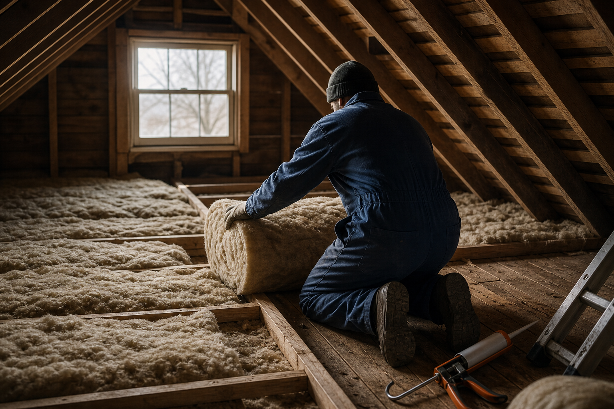

# [행정 규제] 미국 복지 블록그랜트 규정 대청소 이야기 (feat. 단열공사 물꼬 15%에서 최대 25%)

> 📜 **Reducing Bureaucracy and Burden for Block Grants**
> 원안 전문: https://www.federalregister.gov/d/2026-22123

✅ 제안 → 🔵 **의견수렴** → ⬜ 심사·작성 → ⬜ 확정 공포 → ⬜ 시행

| 단계 | 상태 | 날짜·비고 |
|---|---|---|
| ① 제안 공포 | ✅ 완료 | 2026-10-29 |
| ② 의견수렴 | 🔵 **지금 여기** | ~2026-11-30 마감 |
| ③ 확정안 심사·작성 | ⬜ 아직 |  |
| ④ 확정(Final Rule) 공포 | ⬜ 아직 |  |
| ⑤ 시행 | ⬜ 아직 |  |

---

1. 미국 연방정부는 복지 예산의 일부를 블록그랜트(포괄보조금 — 연방이 '이 분야에 쓰라'고 큰 묶음으로 주면, 세부 용도는 주 정부가 알아서 정하는 보조금) 방식으로 주 정부에 내려보냄.

2. 미국 보건복지부(HHS)는 LIHEAP(저소득층 에너지 지원 프로그램 — 겨울 난방비·여름 냉방비를 못 내는 가정의 요금을 보조하거나, 집의 에너지 효율을 높이는 공사에 쓰임), SSBG(사회서비스 블록그랜트 — 아동 보호, 노인 돌봄 같은 복지 서비스에 쓰라고 주는 묶음 보조금) 같은 복지 블록그랜트 여러 개를 관리하고 있음.

3. 이 보조금들의 공통 운영 규정(45 CFR Part 96)은 1982-07-06에 만들어졌는데, 수십 년이 지나면서 이미 지나간 연도를 기준으로 쓴 문구나 법에 이미 있는 내용을 또 적어 둔 중복 조항이 많이 남았음.

4. 규정이 낡으면 보조금을 받는 주 정부 공무원들이 지금 지켜야 할 의무가 뭔지 헷갈리고, 서류 작업만 늘어남.

5. 현재 미국 행정부는 규제 감축을 국정 우선순위로 밀고 있고, 이번 안도 새 규제를 만드는 게 아니라 있던 규제를 덜어내는 방향임.

6. 2026-10-29, 보건복지부가 이 규정에서 낡고 중복된 조항을 들어내겠다는 입법예고(NPRM — 규칙을 바꾸기 전에 초안을 공개하고 국민 의견을 받는 절차로, 의견을 반영한 최종규칙이 나와야 효력이 생김)를 공포했음.

7. 이 규정은 지역사회서비스(CSBG), 사회서비스(SSBG), 저소득층 에너지지원(LIHEAP) 등 7개 블록그랜트의 신청·지급·회계·감사 절차를 한꺼번에 다룸.

8. 삭제 대상은 이미 지나간 회계연도(1982·1986·2001년)에 묶인 구식 문구, 법률에 똑같이 적혀 있어 중복인 조항, 규정보다는 실무 지침에 어울리는 세부 절차임.

9. 문서는 법률과 중복되는 조항을 지워도 법 조문이 그대로 직접 집행되기 때문에 실체적 의무는 하나도 없어지지 않는다고 밝힘.

10. 알맹이가 되는 변화는 두 가지임.

11. 첫째, SSBG에서 '위탁가정의 단기 숙식은 사회서비스로 인정하지 않는다'는 추가 제한을 없애는 것임.

12. 이 제한이 사라지면 → SSBG 보조금을 아동 임시 긴급쉼터의 숙식 비용까지 쓸 수 있게 됨.

13. 다만 문서 스스로 '주 정부의 지출 방식이 반드시 바뀌는 것은 아니다'라고 밝힌 만큼, 가능 범위가 넓어지는 것이지 돈이 자동으로 늘어나는 건 아님.

14. 둘째, LIHEAP에서 웨더라이제이션(저소득 가정의 집에 단열재를 넣거나 창문·난방기를 고쳐 에너지가 덜 새게 만드는 공사) 지출 비율을 올려 달라는 면제(waiver — 정해진 한도나 규칙의 예외를 신청해 허락받는 제도) 신청의 복잡한 절차 요건을 없애는 것임.

15. 웨더라이제이션 지출의 기본 한도는 LIHEAP 기금의 15%인데, 면제가 승인되면 최대 25%까지 올릴 수 있음.

16. 절차 틀이 없어져도 면제 승인에 관한 법정 기준은 법에 그대로 남아 있어서, 장관이 신청을 내용 그대로 따져볼 재량을 되찾고 수급기관의 행정 부담이 줄어듦.

17. 이 밖에 폐지된 법에 근거한 감사 조항과 29개 서비스 통일 정의(Appendix A)를 삭제하고, 정신보건·약물남용(SAMHSA) 블록그랜트의 '배정액을 2년 안에 집행해야 한다'는 법정 시한을 규정에 새로 반영함.

18. 돈의 흐름을 보면, 면제 신청의 절차적 장벽이 사라져 주·부족 정부가 단열·주택수리 공사 지출을 늘리기 쉬워지고, 그 돈의 최종 도착지가 주택 단열·에너지 효율 개선 시공업(웨더라이제이션·HVAC·주택수리)임.

19. 다만 면제를 실제로 신청·승인받는 주가 얼마나 되느냐에 달린 조건부 수혜임.

20. 아동보호·긴급쉼터 등 사회복지 서비스업도 보조금 사용 가능 범위가 넓어지는 약한 수혜를 받을 수 있음.

21. 반대로 LIHEAP은 전체 금액이 고정된 프로그램이어서, 단열 공사 몫이 커지는 주가 늘면 → 그만큼 에너지요금 직접지원(체납·요금 보조로 유틸리티가 받던 돈) 몫이 줄어드는 제로섬 재배분이 생김.

22. 전력·가스 소매(유틸리티)에는 면제 신청이 실제로 늘어야 성립하는 약한 악재이고, 신청·보고·면제 서류 작업을 대행하던 보조금 행정·준법(그랜트 컴플라이언스) 컨설팅업의 수요도 한계적으로 줄어듦.

23. 지켜볼 것은 2026-11-30 마감인 서면 의견수렴에서 온라인 의견 접수 창구인 도켓(규제안마다 하나씩 열리는 의견 접수 사건 번호) ACF-2026-0628에 주 정부·복지단체·부족이 낸 반대 의견의 강도임.

24. 이후에는 최종규칙(Final Rule) 공포 여부와 핵심 두 조항(§96.71 숙식 제한 삭제, §96.83 면제 절차 삭제)이 원안대로 유지되는지, 그리고 2027-2028 난방시즌 배분 발표 시점(2027년 4분기)에 확인되는 주·부족의 면제 신청·승인 건수 추이를 지켜보면 됨.

**한 줄 코멘트**: 새 돈이 생기는 안이 아니라, 고정된 LIHEAP 예산 안에서 단열·주택수리 쪽으로 물꼬가 넓어질 수 있는 조용한 재배분 신호임. 아직 입법예고 단계라, 2026-11-30 의견수렴과 최종규칙 공포까지 확인해야 함.

---

**영향 산업 한눈에**

| 산업 | 방향 |
|---|---|
| 주택 단열·에너지 효율 개선 시공업(웨더라이제이션·HVAC·주택수리) | 🟢 수혜 |
| 아동보호·긴급쉼터 등 사회복지 서비스업 | 🟢 수혜 |
| 전력·가스 소매(유틸리티) | 🔴 부담 |
| 보조금 행정·준법(그랜트 컴플라이언스) 컨설팅업 | 🔴 부담 |

---

**용어**
- **블록그랜트(포괄보조금)**: 연방정부가 주 정부에 '이 분야에 쓰라'고 큰 묶음으로 주는 보조금. 세부 용도는 주가 알아서 정하는 대신, 큰 틀의 규칙을 지켜야 한다.
- **입법예고(NPRM)**: 정부가 규칙을 바꾸기 전에 '이렇게 바꾸려 한다'고 초안을 공개하고 국민 의견을 받는 절차. 아직 확정이 아니며, 의견을 반영해 최종규칙이 나와야 효력이 생긴다.
- **웨더라이제이션**: 저소득 가정의 집에 단열재를 넣거나 창문·난방기를 고쳐 에너지가 덜 새게 만드는 공사. 난방비를 매달 보조하는 대신, 집 자체를 고쳐 근본적으로 줄이는 방식이다.

---

### ⚠️ 이 글은 투자 권유 목적이 아니며, 투자에 대한 책임은 본인에게 있습니다.

_이 글은 AI의 도움을 받아 작성한 글이며, 대표 이미지는 AI가 생성한 이미지입니다._
