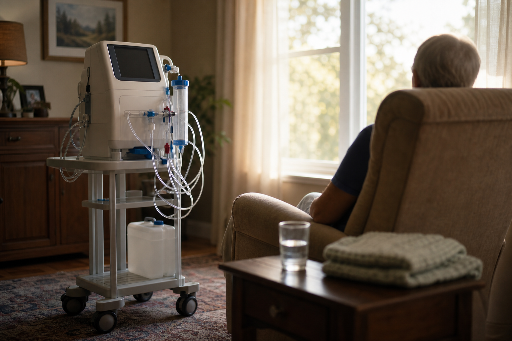

# [행정 규제] 미국 투석 수가 이야기 (feat. 인산염 결합제 번들 편입)

> 📜 **Medicare Program; CY 2027 Changes to the End-Stage Renal Disease (ESRD) Prospective Payment System, Acute Kidney Injury (AKI) Dialysis Payment, and ESRD Quality Incentive Program**
> 원안 전문: https://www.federalregister.gov/d/2026-22194

❔ 제안 → ❔ 의견수렴 → ✅ 심사·작성 → ✅ 확정 공포 → 🔵 **시행 대기**

| 단계 | 상태 | 날짜·비고 |
|---|---|---|
| ① 제안 공포 | ❔ 미확인 | 초안 혈통 미확인 |
| ② 의견수렴 | ❔ 미확인 | — |
| ③ 확정안 심사·작성 | ✅ 완료 |  |
| ④ 확정(Final Rule) 공포 | ✅ 완료 | 2026-10-30 |
| ⑤ 시행 | 🔵 **지금 여기** | 2027-01-01 예정 |

---

1. 미국에는 메디케어라는 나라가 운영하는 건강보험이 있음.

2. 주로 65세 이상 노인이 대상이지만, 신장(콩팥)이 완전히 망가진 말기신부전 환자는 나이와 상관없이 가입됨.

3. 콩팥이 멈추면 피 속의 노폐물을 기계로 걸러내야 하는데, 이것이 투석임.

4. 투석은 보통 일주일에 여러 번, 평생 받아야 해서 돈이 많이 드는 치료임.

5. 그래서 미국 정부기관 CMS(메디케어·메디케이드 서비스센터)가 투석 1회에 얼마를 지급할지 수가(건강보험이 병원에 치료 1회당 지급하는 공식 가격)를 매년 새로 정함.

6. 이 수가는 투석 자체뿐 아니라 관련 약값까지 하나로 묶어 정액으로 주는 번들(묶음 지급) 방식이라, 시설이 비싼 약을 쓰면 그만큼 자기 이익이 줄어드는 구조임.

7. 투석시설 입장에서는 이 가격표가 곧 매출이라, 매년 나오는 이 규칙이 투석 회사와 신장 관련 제약사의 실적을 좌우함.

8. 2026년 10월 30일 CMS가 2027년치 확정 규칙(Final Rule)을 공포했고, 시행은 2027년 1월 1일부터임.

9. 투석 1회 기본수가는 $281.71에서 $297.52로 오름.

10. 인상분에는 물가 반영 1.9%(약 $170M)와, 인산염 결합제(투석 환자의 혈액에 쌓이는 인 수치를 낮추는 먹는 약) 값을 $12.85로 기본수가에 새로 집어넣은 몫이 들어 있음.

11. 그동안 인산염 결합제에는 TDAPA(신약을 번들 밖에서 따로 돈을 얹어 주는 한시적 추가 지급)가 있었는데, 이 기간이 2026년 말로 끝나면서 약값이 기본수가 속으로 흡수됨.

12. 약값을 따로 받던 길이 끊기고 받는 돈이 $12.85로 정해지니 시설은 싼 제품을 고르게 되고 → 인산염 결합제 제약(경구 phosphate binder 제조사)의 고가 브랜드 결합제는 가격과 수요 모두 압박받음.

13. DefenCath·Vafseo 두 신약은 분기마다 금액을 다시 정하는 후속 가산으로 계속 지급됨.

14. 재택·자가투석 훈련 가산은 $95.60에서 $138.00로 오르고, 투석 시작 후 첫 120일 안에도 훈련비가 나오게 됐음.

15. 훈련 가산이 오르고 첫 120일 안에도 훈련비가 나오게 돼 → 환자를 재택투석으로 돌릴 유인이 커지고, 가정용 투석기기·재택투석 훈련 서비스 수요에 우호적임.

16. 저물량 가산(LVPA)은 연 8,000회 이하 치료 시설까지 대상이 넓어지고 물량에 따른 6단계 티어로 바뀜.

17. 다만 이 개편은 예산중립(제도를 바꿔도 전체 지급 총액은 그대로 두는 제로섬 설계)이라, 새 돈이 아니라 대형 시설 몫이 소규모·저물량 투석시설(지역 소형 투석 운영)로 옮겨가는 구조임.

18. 반대로 비용이 유난히 많이 든 환자에게 따로 주던 아웃라이어 지급은 손실 문턱(FDL)이 $14.80에서 $90.60로, 계산 기준 금액(MAP)이 $23.68에서 $41.83로 올라 → 문턱을 넘어 추가 지급을 받기가 훨씬 어려워졌음.

19. 급성신손상(AKI) 환자의 투석에도 말기신부전과 똑같은 $297.52가 지급됨.

20. 품질 평가(QIP) 쪽에서는 자료를 제때 제출만 하면 되던 고칼슘혈증 보고지표가 실제 치료 성과가 점수에 반영되는 고인산혈증 임상지표로 교체되고, 혈류감염(NHSN BSI) 임상지표도 갱신됨 — 2029 성과연도부터 바뀜.

21. 환자 쪽 돈의 흐름도 있는데, 수가가 2.7% 오르면 환자 본인부담금도 약 $50M 늘어나 → 이 본인부담을 대신 내주는 보충형 민간 건강보험(메디갭 등 본인부담 보장 보험)의 보험금 지출이 그만큼 증가함.

22. 지켜볼 일정으로는 2027년 1분기 이후 분기마다 공표되는 DefenCath·Vafseo 후속 가산 금액이 있음.

23. 2027년 4~5월에 나오는 대형 투석 체인(DaVita·Fresenius Medical Care 등)의 2027년 1분기 실적에서 수가 인상과 아웃라이어 축소의 순효과를 확인할 수 있음.

24. 2027년 상반기 실적 발표에서는 인산염 결합제·Vafseo 제조사(Akebia 등)의 번들 편입 영향 가이던스와 약가 추이를 지켜볼 것임.

**한 줄 코멘트**: 물가 반영 몫으로 전체 지급은 늘지만, 저물량 가산처럼 정해진 돈의 자리만 옮기는 제로섬 조정도 섞여 있는 개편임. 돈이 떠나는 자리와 도착하는 자리를 같이 봐야 함.

---

**영향 산업 한눈에**

| 산업 | 방향 |
|---|---|
| 가정용 투석기기·재택투석 훈련 서비스 | 🟢 수혜 |
| 소규모·저물량 투석시설(지역 소형 투석 운영) | 🟢 수혜 |
| 인산염 결합제 제약(경구 phosphate binder 제조사) | 🔴 부담 |
| 보충형 민간 건강보험(메디갭 등 본인부담 보장 보험) | 🔴 부담 |

---

**용어**
- **수가**: 건강보험이 병원에 치료 1회당 지급하는 공식 가격입니다. 병원이 환자에게 부르는 값이 아니라, 보험이 정해 둔 값입니다.
- **번들(묶음 지급)**: 치료비와 관련 약값을 하나로 묶어 정액으로 주는 방식입니다. 뷔페처럼 한 값에 다 포함이라, 시설이 비싼 약을 쓰면 그만큼 자기 이익이 줄어듭니다.
- **TDAPA**: 새로 나온 약을 번들 밖에서 따로 돈을 얹어 주는 한시적 추가 지급입니다. 신약이 자리 잡을 시간을 주는 장치로, 기간이 끝나면 약은 번들 속으로 들어갑니다.

---

### ⚠️ 이 글은 투자 권유 목적이 아니며, 투자에 대한 책임은 본인에게 있습니다.

_이 글은 AI의 도움을 받아 작성한 글이며, 대표 이미지는 AI가 생성한 이미지입니다._
