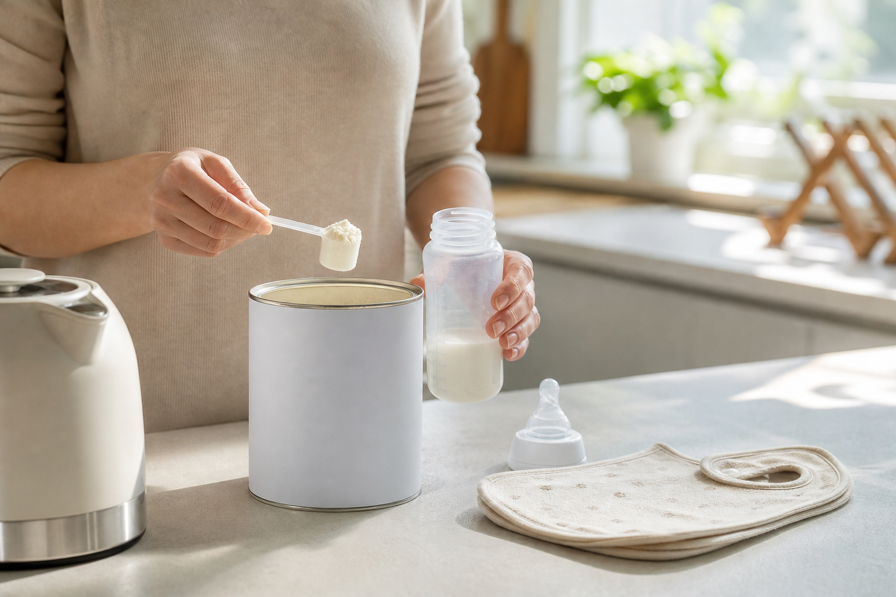

# [행정 규제] 40년 만에 바뀌는 미국 분유 영양기준 이야기 (feat. 비타민D, 요오드, 베타카로틴)

> 📜 **Infant Formula Nutrient Requirements**
> 원안 전문: https://www.federalregister.gov/d/2026-22273

✅ 제안 → 🔵 **의견수렴** → ⬜ 심사·작성 → ⬜ 확정 공포 → ⬜ 시행

| 단계 | 상태 | 날짜·비고 |
|---|---|---|
| ① 제안 공포 | ✅ 완료 | 2026-11-02 |
| ② 의견수렴 | 🔵 **지금 여기** | ~2027-03-02 마감 |
| ③ 확정안 심사·작성 | ⬜ 아직 |  |
| ④ 확정(Final Rule) 공포 | ⬜ 아직 |  |
| ⑤ 시행 | ⬜ 아직 |  |

---

1. 조제분유(모유 대신, 또는 모유와 함께 아기에게 먹이는 가루·액상 우유)는 어린 아기 영양의 큰 부분을 책임지는 식품이라, 미국은 분유에 꼭 들어가야 하는 영양소의 양을 법으로 정해 두고 있음.

2. 계기는 1979년 염화물이 빠진 분유로 영아 약 150명이 병에 걸린 사건이었고 → 이듬해 1980년 '영아용 조제분유법'이 만들어졌음.

3. FDA(미국 식품의약국)는 1985년에 영양소 기준표를 규칙으로 확정했는데, 그 뒤로 큰 손질이 거의 없었음.

4. 1998년에 마지막 종합 점검이 있었지만 기준 개정으로 이어지지 않았고, 2015년 셀레늄 추가가 유일한 변경이었음.

5. 2022년에 '4년마다 영양소 기준표를 다시 살펴보라'는 법(FDORA)이 생겼고, 2025년 정부가 분유 개선 프로젝트 'Operation Stork Speed'를 시작하면서 이번 규칙안이 나왔음.

6. 2026년 11월 2일, FDA가 규칙안(Proposed Rule, 정부 기관이 '이렇게 바꾸겠다'고 미리 내놓는 초안으로, 의견수렴을 거쳐 최종규칙으로 확정돼야 법적 효력이 생김)을 공포했는데, 약 40년 만의 본격적인 기준 손질인 셈임.

7. 30개 필수 영양소 중 8개를 먼저 심사해 요오드·비타민A·비타민D·망간 4개는 기준을 바꾸고, 염화물·셀레늄·칼륨·나트륨 4개는 지금 기준이 적절하다고 보고 그대로 둠.

8. 요오드는 최소량을 5에서 15µg/100kcal(분유 열량 100킬로칼로리당 들어 있는 영양소의 마이크로그램 양)로 3배 올리고, 최대량은 75에서 50µg/100kcal로 내림.

9. 비타민D는 최소량을 40에서 80IU/100kcal(IU는 비타민의 효과를 기준으로 양을 세는 옛 단위)로 2배로 올리고, 최대량도 100에서 120IU/100kcal로 올림.

10. 망간은 최소량을 5에서 1µg/100kcal로 내리는 대신, 지금까지 없던 최대량 50µg/100kcal를 새로 만듦.

11. 비타민A는 최소·최대를 모두 내리고, 기준을 채우는 수단에서 베타카로틴(몸속에서 비타민A로 바뀌어야 하는 '재료' 상태)을 빼고 프리폼드 비타민A(몸이 바로 쓸 수 있는 완성형 비타민A)만 인정함.

12. 라벨의 비타민A·D 표시 단위도 IU에서 µg 계열로 바뀌어서 → 시중 모든 제품의 포장을 다시 찍어야 함.

13. 비용을 사실상 전부 떠안는 쪽은 영아용 조제분유 제조업으로, 전 제품의 재배합(성분 배합을 새 기준에 맞게 다시 짜는 것)·재라벨링(포장의 표시를 다시 찍는 것)·시판 전 통지 제출 비용을 직접 부담함.

14. 그 규모는 연환산 $8.4M~$31.7M, 주 추정 $17.6M인데, 7% 할인율(미래의 돈을 지금 가치로 환산할 때 깎는 비율) 기준으로 10년치 비용을 매년 같은 금액으로 고르게 편 값임.

15. 비용 집행은 최종규칙 공포 후 준수기한 전에 집중될 전망임.

16. 베타카로틴(카로티노이드) 원료업도 영향을 받는데, 베타카로틴이 비타민A 기준 충족 수단에서 배제되면서 분유용 베타카로틴의 '영양기준 충족 용도' 수요가 사라짐.

17. 반대로 비타민D 최소량이 2배, 요오드 최소량이 3배로 오르면 모든 분유가 해당 영양소를 더 넣어야 해서 → 비타민·미네랄 영양강화제(프리믹스) 제조업의 원료 수요가 구조적으로 늘어남. 다만 수요 증가가 실제로 시작되는 시점은 최종규칙 확정 이후임.

18. 라벨 인쇄·포장재업은 제조사가 쓰는 재라벨링 비용이 곧 수입이 되지만, 일회성 성격이 강하고 효과 강도는 약한 편임.

19. 편익의 핵심은 비타민D 결핍으로 인한 후기 저칼슘혈증 치료비 회피로, 연환산 $18.8M~$171.7M, 주 추정 $80.9M(7% 할인율)의 의료비 절감이 건강보험·의료비 지불자(민간보험·메디케이드) 측에 귀속됨. 이쪽도 효과 강도는 약한 편으로 평가됨.

20. 아직 확정이 아니라 제안 단계로, 2027년 3월 2일까지 누구나 의견을 낼 수 있음.

21. 다음으로 지켜볼 것은 잔여 22개 영양소에 대한 후속 규칙안이 나오는지로, 통합 최종규칙 일정을 미리 알려주는 선행지표라 2027년 중 분기별로 관보를 보면 됨.

22. 통합 최종규칙 공포와 준수기한 확정은 2028년 이후 관보에서 정해지고, 재배합·재라벨 비용이 실제로 집행되는 시점도 여기서 정해짐. 최종규칙 공포 후 첫 실적 시즌에는 분유 제조사 실적발표에서 재배합·재라벨 관련 비용 가이던스(회사가 미리 제시하는 비용 안내) 언급이 나오는지 볼 것임.

**한 줄 코멘트**: 40년 묵은 눈금을 다시 긋는 일이지만, 확정은 빨라야 2028년 이후라 돈이 움직이는 것도 그 뒤임. 당장의 첫 관전 포인트는 2027년 3월 2일 의견수렴 마감임.

---

**영향 산업 한눈에**

| 산업 | 방향 |
|---|---|
| 영아용 조제분유 제조업 | 🔴 부담 |
| 베타카로틴(카로티노이드) 원료업 | 🔴 부담 |
| 비타민·미네랄 영양강화제(프리믹스) 제조업 | 🟢 수혜 |
| 라벨 인쇄·포장재업 | 🟢 수혜 |
| 건강보험·의료비 지불자(민간보험·메디케이드) | 🟢 수혜 |

---

**용어**
- **규칙안(Proposed Rule)**: 정부 기관이 '이렇게 바꾸겠다'고 미리 내놓는 초안입니다. 일정 기간 국민 의견을 받은 뒤 최종규칙으로 확정해야 비로소 법적 효력이 생깁니다.
- **µg/100kcal**: 분유 열량 100킬로칼로리당 들어 있는 영양소의 양(마이크로그램)입니다. 아기마다 먹는 양이 달라도 공평하게 재기 위해 열량 기준으로 셉니다.
- **재배합·재라벨링**: 재배합은 제품 성분 배합을 새 기준에 맞게 다시 짜는 것, 재라벨링은 포장의 표시를 다시 찍는 것입니다. 이번 규칙의 제조사 비용 대부분이 이 둘에서 나옵니다.

---

### ⚠️ 이 글은 투자 권유 목적이 아니며, 투자에 대한 책임은 본인에게 있습니다.

_이 글은 AI의 도움을 받아 작성한 글이며, 대표 이미지는 AI가 생성한 이미지입니다._
