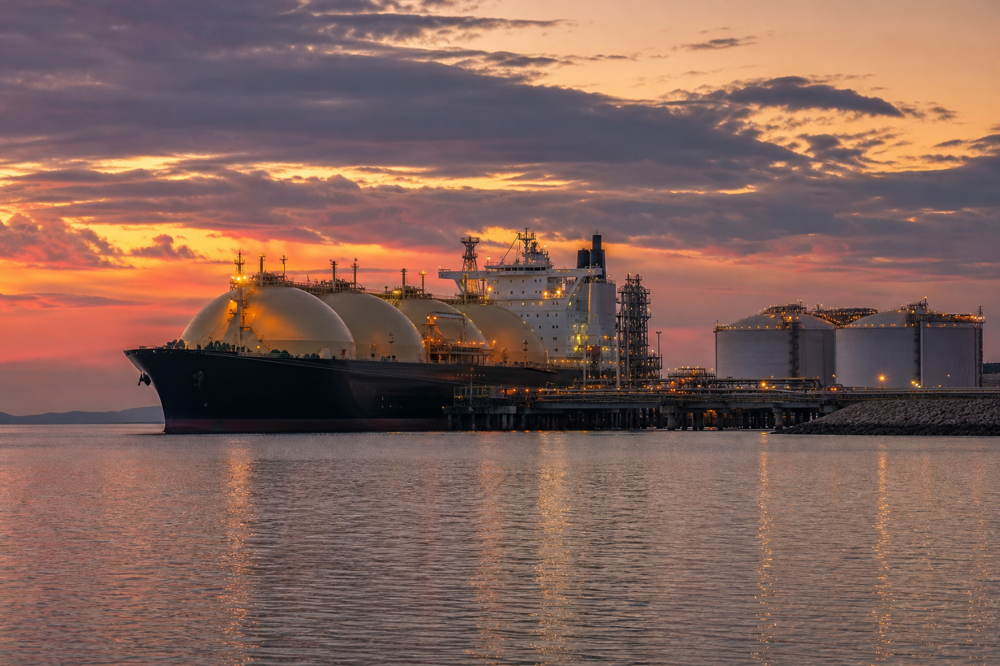

# [행정 규제] 미국 LNG 안전규정 현대화 이야기 (feat. 20년 묵은 교과서 교체)

> 📜 **Pipeline Safety: Amendments to Liquefied Natural Gas Facilities**
> 원안 전문: https://www.federalregister.gov/d/2026-22396

✅ 제안 → 🔵 **의견수렴** → ⬜ 심사·작성 → ⬜ 확정 공포 → ⬜ 시행

| 단계 | 상태 | 날짜·비고 |
|---|---|---|
| ① 제안 공포 | ✅ 완료 | 2026-11-03 |
| ② 의견수렴 | 🔵 **지금 여기** | ~2027-01-04 마감 |
| ③ 확정안 심사·작성 | ⬜ 아직 |  |
| ④ 확정(Final Rule) 공포 | ⬜ 아직 |  |
| ⑤ 시행 | ⬜ 아직 |  |

---

1. LNG(액화천연가스)는 천연가스를 영하 162도 정도로 차갑게 식혀 액체로 만든 것으로, 부피가 크게 줄어 배에 실어 바다 건너로 팔 수 있음.

2. 미국은 20년 전만 해도 천연가스를 수입하던 나라였는데, 셰일가스(암석층에서 캐내는 가스)를 캐내는 기술이 발전하면서 지금은 세계에서 LNG를 가장 많이 수출하는 나라가 됐음.

3. 그런데 LNG 시설의 안전을 관리하는 미국 정부 규정은 2001년에 만들어진 업계 기준을 그대로 쓰고 있었음.

4. 그 사이 새로운 탱크 기술이 나와도 규정에 없어서 일일이 특별허가를 받아야 했음.

5. 미국 의회도 2016년과 2020년에 법을 만들어 규정을 고치라고 지시해 둔 상태였음.

6. 2026년 11월 3일, 미국 교통부 산하 파이프라인·위험물질안전청(PHMSA)이 그 숙제를 하겠다는 제안을 공포했음.

7. 아직 확정된 법이 아니라 입법예고(규칙을 확정하기 전에 미리 공개하고 국민 의견을 받는 절차) 단계라서 내용이 바뀔 수 있음.

8. 핵심은 규정의 뼈대인 업계표준 NFPA 59A(미국 방화협회가 만드는 LNG 시설 안전 기준서)를 2001년판에서 최신 2026년판으로 바꾸는 것임.

9. 이렇게 되면 멤브레인 탱크나 파이프-인-파이프 이송계통 같은 신기술을 특별허가 없이 바로 쓸 수 있음.

10. 시설을 어디에 지어도 되는지 정하는 시팅(입지 심사) 규칙도 바뀜. 일률적인 거리 기준만 따르는 대신 위험을 숫자로 계산해 안전을 입증하는 QRA(정량적 리스크 분석) 방식도 허용함 → 기존 부지 안에서 설비를 더 지을 길이 열림.

11. 지금까지 전용 규정이 없던 영구 소형 LNG 시설에는 규정집에 새 하위 규정(subpart D)을 끼워 넣는 방식으로 맞춤 규정을 새로 만듦.

12. 연방에너지규제위원회(FERC, 미국의 대형 에너지 시설을 인허가하는 연방 기관)가 관할하는 대형 시설은 위험이 큰 곳에 점검을 집중하는 리스크 기반 운영·유지관리(O&M) 프로그램을 대안으로 고를 수 있게 함.

13. 대신 사고 보고 의무는 시설을 처음 가동하는 단계까지, 그리고 LNG가 아닌 다른 유해물질까지로 넓어짐.

14. 정부는 이 개정으로 업계의 규제 준수비용이 줄어든다고 봤음. 그 절감 폭은 연간 약 9,800만 달러(할인율 3% 기준)로 계산됐음.

15. 돈의 흐름을 보면, 이번 제안에서 가장 수혜 강도가 큰 업종은 미국 LNG 수출 터미널·운영업으로 평가됐음.

16. QRA 기반 입지 심사가 허용되면 기존 부지 안에서 설비를 늘리는 증설 투자가 가능해지고, 신기술에 거치던 특별허가·면제 절차가 사라져 준수비용이 절감됨.

17. 멤브레인 탱크, 파이프-인-파이프 이송계통 같은 신형 설비를 만드는 극저온 저장탱크·LNG 플랜트 설비 제조업에는 수주 기회가 열림. 다만 시설 자체의 인허가는 종전대로 받음.

18. 소형(small-scale) LNG·오프그리드 발전 설비업은 규칙이 없어 못 하던 불확실성이 해소되고, 데이터센터 전력 공급 같은 새 용도로 소형 LNG가 퍼질 제도적 기반이 마련됨.

19. QRA 방식이나 리스크 기반 운영 프로그램을 고르는 회사를 대신해 위험 분석과 이행계획을 짜 주는 리스크 분석·안전 엔지니어링 컨설팅업에도 수요가 생기는데, 수혜 강도는 약한 편으로 평가됐음.

20. 반대로 소형 LNG 시설 운영업(기존 무규정 영역)에는 처음으로 인증·준수 의무가 생김. 다만 대형 시설 기준을 그대로 적용받는 것보다는 완화된 규정이라는 양면성이 있음.

21. LNG 시설 운영업(보고·시팅 분석 부담 측면)은 사고 보고 범위가 넓어지고 입지 심사에서 따져야 할 위험도 늘어 분석·보고 비용이 증가함. 전체적으로는 절감이 더 크다는 게 정부 입장임.

22. 의견 제출 마감은 2027년 1월 4일로, 운영사·업계단체·주정부·안전단체가 QRA 입지 조항에 어떤 찬반을 내는지가 첫 확인 포인트임.

23. 이후에는 PHMSA 법정 자문위원회(가스 파이프라인 자문위)의 공청회 일정 공고와 표결 결과가 다음 확인 대상임. 최종규칙이 공포되는지, QRA·소형 LNG·리스크 O&M 조항이 원안대로 유지되는지, 시행일이 언제로 정해지는지도 함께 봐야 함.

24. 최종규칙 공포 후에는 FERC에 들어오는 신규 LNG 터미널·기존 부지 증설 신청 건수 변화가 입지 유연화가 실제 투자로 이어지는지를 보여주는 실측이 됨. 시장에 효과가 처음 나타나는 시점으로는 2028년 1분기가 제시됐음.

**한 줄 코멘트**: 방향은 규제완화고 확정 가능성도 높게 평가되지만, 입법예고는 내용이 바뀔 수 있는 단계임. QRA 입지 조항이 의견수렴을 거쳐 원안대로 살아남는지가 핵심 관전 포인트임.

---

**영향 산업 한눈에**

| 산업 | 방향 |
|---|---|
| 미국 LNG 수출 터미널·운영업 | 🟢 수혜 |
| 극저온 저장탱크·LNG 플랜트 설비 제조업 | 🟢 수혜 |
| 소형(small-scale) LNG·오프그리드 발전 설비업 | 🟢 수혜 |
| 리스크 분석·안전 엔지니어링 컨설팅업 | 🟢 수혜 |
| 소형 LNG 시설 운영업(기존 무규정 영역) | 🔴 부담 |
| LNG 시설 운영업(보고·시팅 분석 부담 측면) | 🔴 부담 |

---

**용어**
- **NFPA 59A**: 미국 방화협회가 만드는 LNG 시설 안전 기준서. 정부 규정이 이 책을 '교과서'처럼 통째로 인용하기 때문에, 몇 년판을 쓰느냐가 곧 규제 수준을 정한다.
- **시팅(siting)과 QRA**: 시팅은 시설을 어디에 지어도 되는지 정하는 입지 심사. QRA는 사고 확률과 피해를 숫자로 계산하는 '정량적 리스크 분석'으로, 일률적 거리 기준 대신 계산으로 안전을 입증하는 방식이다.
- **입법예고 (NPRM)**: 정부가 규칙을 확정하기 전에 '이렇게 바꾸겠다'고 미리 공개하고 국민 의견을 받는 절차. 아직 확정이 아니라 내용이 바뀔 수 있다.

---

### ⚠️ 이 글은 투자 권유 목적이 아니며, 투자에 대한 책임은 본인에게 있습니다.

_이 글은 AI의 도움을 받아 작성한 글이며, 대표 이미지는 AI가 생성한 이미지입니다._
