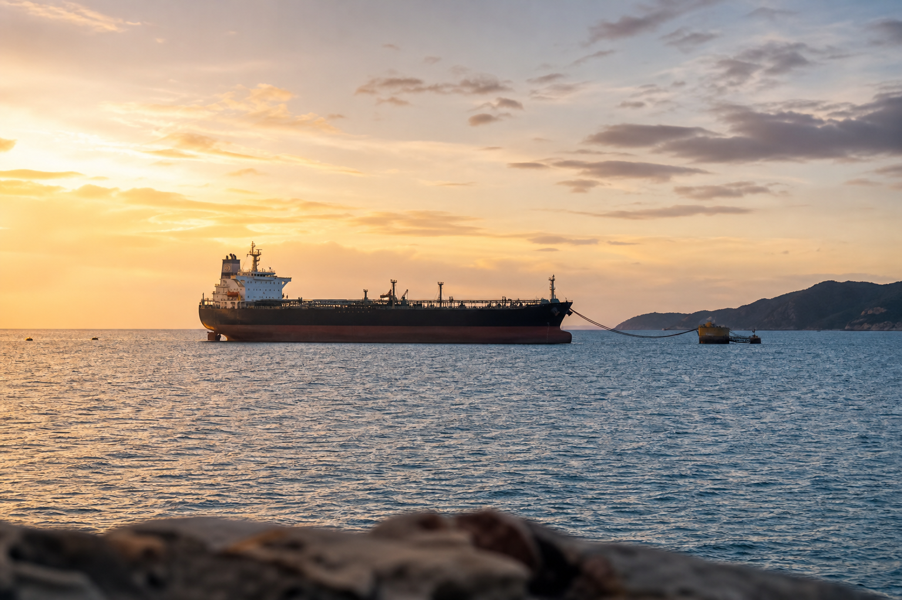

# [행정 규제] 미국 심해항 인허가 창구 일원화 이야기 (feat. MARAD, 35만 달러)

> 📜 **Deepwater Port Application Processing and Licensing**
> 원안 전문: https://www.federalregister.gov/d/2026-22617

✅ 제안 → 🔵 **의견수렴** → ⬜ 심사·작성 → ⬜ 확정 공포 → ⬜ 시행

| 단계 | 상태 | 날짜·비고 |
|---|---|---|
| ① 제안 공포 | ✅ 완료 | 2026-11-05 |
| ② 의견수렴 | 🔵 **지금 여기** | ~2027-01-04 마감 |
| ③ 확정안 심사·작성 | ⬜ 아직 |  |
| ④ 확정(Final Rule) 공포 | ⬜ 아직 |  |
| ⑤ 시행 | ⬜ 아직 |  |

---

1. 심해항(deepwater port)은 주 영해 바깥 바다에 설치돼 원유나 LNG를 해저 파이프라인으로 선박에 싣고 내리는 터미널임.

2. 큰 유조선이나 LNG선이 육지 항구까지 들어올 필요 없이, 바다 위에서 바로 화물을 옮길 수 있게 해 주는 시설임.

3. 미국은 1974년에 심해항법(DWPA)을 만들어, 이런 시설을 지으려면 정부 면허를 받도록 했음.

4. 그런데 면허 심사를 맡는 기관이 하나가 아니었음. 1997년부터 해안경비대(USCG)와 교통부 소속 해사청(MARAD, 해운·항만을 담당하는 기관)이 신청서를 같이 심사해 왔음.

5. 신청하는 회사 입장에서는 창구가 두 개라 서류도 여러 벌 내야 하고, 심사도 느려지기 쉬운 구조였음.

6. 2025년 12월에 통과된 2026 회계연도 국방수권법(NDAA, 미국 의회가 해마다 통과시키는 국방 예산·정책 법률)이 심사 관리를 MARAD 한 곳으로 모으라고 법으로 명령했음.

7. 2026년 11월 5일, 미국 교통부가 그 명령을 실제 절차로 옮기는 제안규칙(Proposed Rule, 정부가 규칙 초안을 공개하고 의견을 받는 단계)을 공포했음. 에너지 인허가를 빠르게 하겠다는 현 행정부의 정책 기조와도 맞닿아 있는 작업임.

8. 앞으로 신청서 접수, 심사 일정 관리, 환경영향평가(NEPA, 큰 시설을 짓기 전에 환경에 어떤 영향을 주는지 미리 조사하는 연방 절차)의 주관을 모두 MARAD가 맡음.

9. 다만 심해항의 설계·건조·장비·운영과 항행 안전은 지금처럼 USCG가 계속 감독함. 안전 규제는 바뀌지 않음.

10. 신청하는 회사의 부담은 여러 군데서 줄어듦.

11. 예전에는 USCG·MARAD·육군 공병대에 서로 다른 형식으로 서류를 여러 부 내야 했는데, 앞으로는 인쇄본 1부와 전자본 1부만 내면 됨.

12. 5년 이내에 수집한 기존 바다 측량·지질 조사 자료가 있으면, 새로 조사하지 않고 그대로 제출할 수 있음.

13. 심사 기간을 멈추는 방식도 달라짐. 예전에는 기관이 재량으로 기간을 연장할 수 있었는데, 앞으로는 신청인이 추가 정보 요청에 대응하면서 요청할 때만 심사 시계가 멈춤.

14. 신청 수수료는 지금과 같은 35만 달러를 유지하고, 정부가 심사에 쓴 비용을 신청인이 갚는 방식도 그대로임. 다만 중복 기관의 처리비용을 갚아야 하던 부담은 가벼워짐.

15. 규칙안 자료에는 신청인 1건당 총비용이 수수료를 포함해 $705,843, 변호사·환경엔지니어 등 전문인력 비용이 $770,952.64로 적혀 있음. MARAD는 연간 신청 건수를 약 2건으로 잡고 있음.

16. 환경심사는 'Seven County Infrastructure Coalition 대 Eagle County, Colorado' 연방대법원 판결과 그 후속 판례에 부합하게 수행함. 직접 영향 범위를 넘는 과잉 분석은 하지 않는 방식임.

17. 돈의 흐름을 보면, 인허가 창구가 MARAD 한 곳으로 모이고 심사 지연 요인이 줄어듦 → 석유·LNG 심해항(수출입 터미널) 개발·운영업의 신청 비용과 지연 리스크가 줄어듦.

18. 석유·천연가스 생산·수출업도 심해항 승인이 빨라지면 수출 경로가 넓어짐. 다만 효과는 간접적이고, 얼마나 절감되는지는 MARAD 스스로도 추정 불가라고 밝혔음.

19. 이 제안규칙에 대한 의견은 2027년 1월 4일까지 받음. 업계·환경단체 의견에서 쟁점(특히 §248.44 환경심사 방식)이 무엇인지 확인할 지점임.

20. 이후에는 서류 부담(PRA) 관련 30일 추가 공고가 2027년 1분기에 실제로 나오는지, 최종규칙(Final Rule)이 2027년 상반기에 공포되는지를 지켜보면 됨.

21. 최종규칙 시행 후 2~4분기에는 계류 중인 심해항 신청 건(LNG 수출 프로젝트 등)에 대한 MARAD의 최종 결정(Record of Decision) 발급 간격이 달라지는지 확인하면 됨.

**한 줄 코멘트**: 권한 이관 자체는 이미 법으로 확정된 사안이라 최종 확정 가능성이 높음. 안전 규제는 그대로 두고 절차만 정리하는, 관련 업계에 완만한 순풍임.

---

**영향 산업 한눈에**

| 산업 | 방향 |
|---|---|
| 석유·LNG 심해항(수출입 터미널) 개발·운영업 | 🟢 수혜 |
| 석유·천연가스 생산·수출업 | 🟢 수혜 |

---

**용어**
- **심해항(deepwater port)**: 주 영해 바깥 바다에 설치돼 원유나 LNG를 해저 파이프라인으로 선박에 싣고 내리는 터미널. 큰 유조선이나 LNG선이 육지 항구까지 들어올 필요 없이 바다 위에서 바로 화물을 옮길 수 있게 해 주는 시설.
- **MARAD(해사청)**: 미국 교통부 소속으로 해운·항만을 담당하는 기관. 이번 규칙으로 심해항 면허 심사의 총괄 창구가 된다.
- **제안규칙(Proposed Rule)**: 정부가 "이렇게 규칙을 바꾸려 하는데 어떻게 생각하세요?"라고 초안을 공개하고 의견을 받는 단계. 의견을 반영해 최종규칙이 나와야 실제로 시행된다.

---

### ⚠️ 이 글은 투자 권유 목적이 아니며, 투자에 대한 책임은 본인에게 있습니다.

_이 글은 AI의 도움을 받아 작성한 글이며, 대표 이미지는 AI가 생성한 이미지입니다._
