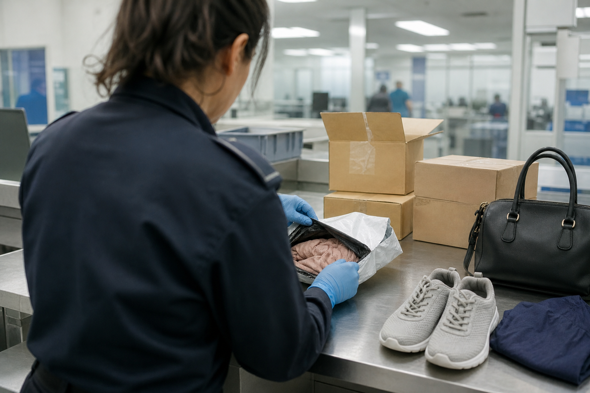

# [법안 산책] 미국 세관의 짝퉁 정보 공유 확대 이야기 (feat. H.R. 4930)

> 📜 **To expand the sharing of information with respect to suspected violations of intellectual property rights in trade.**
> 원안 전문: https://www.congress.gov/bill/119th-congress/house-bill/4930

✅ 발의 → ✅ 하원 → ✅ 상원 → 🔵 **양원 조정**

| 단계 | 상태 | 날짜·비고 |
|---|---|---|
| ① 발의 | ✅ 완료 | 2025-08-08 |
| ② 하원 통과 | ✅ 완료 | 2026-04-27 |
| ③ 상원 통과 | ✅ 완료 | 2026-11-10 |
| ④ 대통령 서명 → 법률 | 🔵 **지금 여기** |  |

---

1. 1. 요즘은 해외 직구나 온라인 쇼핑으로 물건이 국경을 쉽게 넘어오고, 그 속에 가짜 상품(짝퉁)도 섞여 들어옴.

2. 2. 미국에서 수입품을 검사하고 가짜 상품을 붙잡는 기관이 세관국경보호청(CBP)임. 우리나라 관세청과 비슷한 역할을 하는 곳임.

3. 3. 문제는 CBP가 가짜 의심 물건을 찾아도, 그 정보를 상표 주인(브랜드)에게 어디까지 알려줄 수 있는지 법에 한계가 있었다는 점임.

4. 4. 브랜드 입장에서는 누가 어떤 경로로 짝퉁을 팔았는지 알아야 소송을 하든 차단을 하든 할 수 있음. 요즘 가짜 상품은 온라인 마켓과 국제 특송 소포를 타고 들어오는 경우가 많아, 그 경로의 정보가 중요해졌음.

5. 5. 이 '정보 공유의 폭'을 넓히는 법안이 H.R. 4930(제119대 의회)임. 완전히 새 법을 만드는 게 아니라, 수입품 정보 공유를 다루는 기존 관세법 조항을 고치는 방식임.

6. 6. 이 법안은 2025-08-08에 발의돼 2026-04-27 하원, 2026-11-10 상원을 통과했고, 이제 대통령 서명 단계만 남았음. 서명까지 마치면 공법 번호(상·하원 통과와 서명을 마친 법률이 받는 일련번호)가 붙으면서 정식 법으로 확정됨.

7. 7. 바뀌는 것 첫째, 정보를 공유하는 기준이 단순한 '의심'에서 '합리적 의심'(막연한 느낌이 아니라 구체적 근거가 있는 의심)으로 명확해짐. 둘째, 브랜드에 보여줄 수 있는 물건 정보에 포장재와 컨테이너(이미지 포함)가 추가됨.

8. 8. 셋째이자 이 법안의 핵심은, 온라인 마켓플레이스·특송업체·화물 포워더(수출입 화물의 운송을 대신 짜주고 처리해 주는 중개 업체)가 만들어 세관이 갖고 있는 비공개 정보(일반에 공개되지 않은 판매자·거래 데이터)도 권리자에게 줄 수 있게 된다는 점임. 판매자나 거래에 관한 속사정 데이터가 브랜드 손에 들어갈 수 있다는 뜻임.

9. 9. 대신 비공개 정보를 넘길 때는 어떤 정보가 전달됐는지 통지해야 하고, 그 세부 절차는 재무장관이 규정으로 정함. 정보를 받을 수 있는 사람도 상표 주인만이 아니라, 세관 청장이 인정하는 '그 물건에 이해관계가 있는 당사자'까지 넓어짐.

10. 10. 돈의 흐름을 보면, 소비재·명품 등 상표권 보유 브랜드는 짝퉁을 찾아내고 소송·차단하는 힘이 세져 가짜에 뺏기던 정품 매출을 지키는 데 유리함. 정품 라이선스·공식 수입유통업도 세관 정보를 받아 위조·비정상 유통에 대응할 수 있게 되는데, 다만 효과 강도는 약한 편(weak)으로 평가됐음.

11. 11. 반대로 온라인 이커머스 플랫폼(오픈마켓)은 세관에 낸 판매자·거래 데이터가 브랜드에 공유되면 짝퉁 유통의 법적 책임 노출이 커지고, 판매자 검증·감시 같은 관리 비용도 늘어남. 특송(익스프레스)·화물 포워딩 업계도 가진 정보가 브랜드에 전달될 법적 근거가 생겨 소액 직구·소포 경로의 짝퉁 적발이 쉬워지고, 그 물량에 기대온 사업자는 물동량 감소와 정보관리 부담이 커질 수 있음.

12. 12. 이제 지켜볼 것은 대통령 서명 여부, 아마존·이베이 등 대형 플랫폼과 특송업계(FedEx·UPS 등)의 대응·입장 발표, 그리고 CBP·재무부의 비공개 정보 제공 통지 절차 시행규정 고시인데, 고시 시점과 첫 영향 시점은 아직 예상의 영역임. 지켜볼 구간은 각각 서명 후 6~12개월과 2027년 4분기임.

**한 줄 코멘트**: 짝퉁 단속은 결국 정보 싸움인데, 이번 법안은 세관 손에 있던 패를 브랜드에 건네주는 쪽임. 남은 관문은 대통령 서명과 시행규정임.

---

**영향 산업 한눈에**

| 산업 | 방향 |
|---|---|
| 소비재·명품 등 상표권 보유 브랜드 | 🟢 수혜 |
| 정품 라이선스·공식 수입유통업 | 🟢 수혜 |
| 온라인 이커머스 플랫폼(오픈마켓) | 🔴 부담 |
| 특송(익스프레스)·화물 포워딩 | 🔴 부담 |

---

**용어**
- **CBP (세관국경보호청)**: 미국 국경에서 수입품을 검사하고 가짜 상품을 붙잡는 정부 기관. 우리나라의 관세청과 비슷한 역할이다.
- **비공개 정보**: 일반에 공개되지 않은 내부 정보. 여기서는 온라인 마켓이나 운송업체가 만들어 세관에 제공했거나, 세관이 공유받거나 입수한 판매자·거래 관련 데이터를 말한다.
- **화물 포워더**: 수출입 화물의 운송을 대신 짜주고 처리해 주는 중개 업체. 국제 이사를 맡기면 배편·서류를 알아서 처리해 주는 대행사라고 보면 된다.

---

### ⚠️ 이 글은 투자 권유 목적이 아니며, 투자에 대한 책임은 본인에게 있습니다.

_이 글은 AI의 도움을 받아 작성한 글이며, 대표 이미지는 AI가 생성한 이미지입니다._
