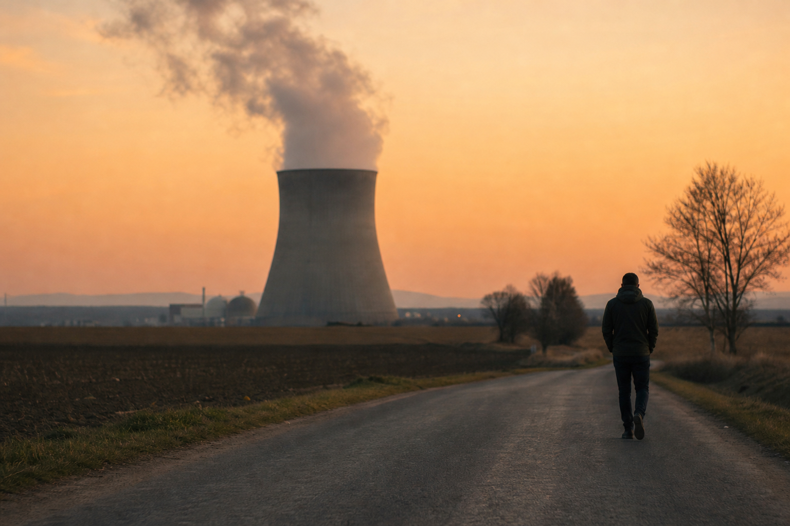

# [법안 산책] 미국 원전 인허가 이야기 (feat. 청문회 없이 나오는 허가)

> 📜 **Efficient Nuclear Licensing Hearings Act**
> 원안 전문: https://www.congress.gov/bill/119th-congress/house-bill/5549

✅ 발의 → ✅ 하원 → 🔵 **상원 심의** → ⬜ 법률

| 단계 | 상태 | 날짜·비고 |
|---|---|---|
| ① 발의 | ✅ 완료 | 2025-09-23 |
| ② 하원 통과 | ✅ 완료 | 2026-11-11 |
| ③ 상원 통과 | 🔵 **지금 여기** |  |
| ④ 대통령 서명 → 법률 | ⬜ 아직 |  |

---

1. 미국에서 원자력 발전소를 지으려면 NRC(원자력규제위원회 — 원전과 핵연료 시설의 안전을 감독하고 허가를 내주는 정부 기관)의 허가를 받아야 함.

2. 이 허가 절차의 뿌리는 1954년에 만들어진 원자력법임.

3. 지금 규칙으로는 허가를 내주기 전에 원칙적으로 청문회(결정을 내리기 전에 찬성·반대 의견을 공개적으로 듣는 절차)를 열어야 함.

4. 반대하는 사람이 아무도 없어도 이 절차를 거쳐야 함 → 허가가 나오기까지 시간이 길어짐.

5. 이걸 고치겠다고 2025년 9월 23일 공화당 Griffith 의원이 민주당 Schrier·Veasey 의원과 함께 'Efficient Nuclear Licensing Hearings Act'(H.R. 5549, 제119대 의회)를 초당파로 발의했음.

6. 2026년 11월 5일에는 공동발의자 23명이 추가되면서 전원위원회에 회부되고 보고서(Report No. 119-872) 인쇄까지 명령됐음.

7. 이 법안이 2026년 11월 11일 하원을 통과했음. 이제 상원 표결과 대통령 서명이 남아 있음.

8. 법안의 핵심은 한 줄로 요약됨. 아무도 청문회를 요청하지 않으면 청문회 없이 허가를 내주자는 것임.

9. 법안이 통과되면 순서가 뒤집힘. NRC가 '허가를 내주겠다'고 연방관보(미국 정부가 새 규칙과 공고를 싣는 공식 게시판)에 1회 공고하고 30일을 기다림.

10. 그 사이에 이해관계인(그 허가로 영향을 받을 수 있는 사람, 예컨대 인근 주민이나 단체)이 청문을 요청하면 청문을 열고, 아무도 요청하지 않으면 그대로 허가가 나감.

11. 이 방식은 건설허가·운영허가는 물론 통합허가(건설허가와 운영허가를 따로 받지 않고 한 번에 묶어서 받는 허가)와 그 수정허가에도 적용됨.

12. 이미 받은 허가의 내용을 고치는 수정허가는 더 간단함. NRC가 '중대한 위험 고려가 없다'고 판단하면 30일 공고 자체를 생략할 수 있음.

13. 청문이 열리더라도 재판처럼 증인 신문을 전부 거치는 정식 절차 대신 약식 절차(서류 중심으로 간소하게 진행하는 심리 방식)를 쓰도록 의무화함.

14. 우라늄 농축(천연 우라늄에서 연료로 쓸 수 있는 성분의 비율을 높이는 공정) 시설의 인허가도 청문 요청이 있을 때만 청문을 열도록 바꾸고, '기록상(on the record) 정식 청문' 요건은 삭제됨.

15. 이 변화는 법이 제정되는 날 NRC에 이미 접수돼 심사 중인 신청과 절차에도 곧바로 적용됨.

16. 돈의 흐름을 보면, 원자력 발전·원전 건설업에는 호재가 될 수 있음. 청문 요청이 없으면 의무 청문 없이 30일 공고만으로 허가가 나와 → 인허가 기간과 절차 비용이 줄고 신규 원전·시험시설 착공이 앞당겨짐.

17. 우라늄 농축·핵연료 가공업도 수혜 쪽임. 농축시설 인허가에서 '기록상 정식 청문' 요건이 삭제되고 청문 요청이 있을 때만 청문을 열게 돼 → 농축시설의 신설·증설 인허가가 빨라짐.

18. 반대로 원자력 인허가 소송·청문 대리 법률서비스는 부담 쪽임. 의무 청문이 사라지고 열리는 청문도 전부 약식 절차로 바뀌어 → 정식 청문의 대리·증거조사에서 나오던 법률 자문 수요가 줄어듦.

19. 다만 법률서비스 쪽 영향 강도는 약한 편으로 평가됐음.

20. 지켜볼 것은 우선 상원 환경·공공사업위원회 상정과 표결임. 아직 법이 아니라 법안이라는 점이 조건임.

21. 대통령이 서명하는 날(제정일)부터 계류 중인 NRC 신청에 즉시 적용되니, 제정 시점 자체가 중요함.

22. 제정되면 수개월 내에 NRC가 청문 절차 규정(10 CFR Part 2)을 고치는 고시와 계류 안건 처리 방침을 내놓는지도 지켜볼 대목임.

23. 시장에 영향이 처음 나타난다고 보는 시점은 따로 있음. 2027년 4분기임.

**한 줄 코멘트**: 허가 절차의 기본값이 '청문회'에서 '30일 공고'로 바뀌는 법안임. 다음 관문인 상원 표결을 지켜볼 일임.

---

**영향 산업 한눈에**

| 산업 | 방향 |
|---|---|
| 원자력 발전·원전 건설업 | 🟢 수혜 |
| 우라늄 농축·핵연료 가공업 | 🟢 수혜 |
| 원자력 인허가 소송·청문 대리 법률서비스 | 🔴 부담 |

---

**용어**
- **NRC (원자력규제위원회)**: 미국에서 원전과 핵연료 시설의 안전을 감독하고 허가를 내주는 정부 기관. 원전을 짓거나 돌리려면 반드시 이곳의 허가가 필요하다.
- **이해관계인**: 그 결정으로 이해관계가 영향을 받을 수 있는 사람. 원전 허가라면 시설 인근 주민이나 관련 단체처럼, 허가의 결과가 자신에게 미치는 사람을 말한다. 이 법안에서는 이들이 요청할 때만 청문회가 열린다.
- **약식 절차 (informal)**: 재판처럼 증인 신문과 반대신문을 전부 거치는 정식 절차 대신, 서류 중심으로 간소하게 진행하는 심리 방식. 시간과 비용이 훨씬 적게 든다.

---

### ⚠️ 이 글은 투자 권유 목적이 아니며, 투자에 대한 책임은 본인에게 있습니다.

_이 글은 AI의 도움을 받아 작성한 글이며, 대표 이미지는 AI가 생성한 이미지입니다._
